# Golden counterfactual attack scenarios cho path prediction

Refs [#175](https://github.com/nairyuuu/ad-weighted-graph/issues/175),
[#174](https://github.com/nairyuuu/ad-weighted-graph/issues/174), disposition
[#180](https://github.com/nairyuuu/ad-weighted-graph/issues/180), accepted foundations
[#181](https://github.com/nairyuuu/ad-weighted-graph/pull/181) và
[#182](https://github.com/nairyuuu/ad-weighted-graph/pull/182).
Owner @nairyuuu; reviewer @Lolavine777. Ngày 2026-10-05. Trạng thái: chờ review.

## Contract và nghĩa của oracle

Đầu vào là canonical graph, initial attacker state, actor và các runtime facts được
khai báo. Kết quả là applicability ba trạng thái, reachable security capabilities,
causal dependencies và terminal security predicate. Không yêu cầu observed attack log.
Golden correctness là lời khẳng định trong **bounded catalog được khai cho mỗi fixture**;
không tuyên bố bao phủ toàn bộ kỹ thuật tấn công AD.

Authority: [ADR-0008](https://github.com/Lolavine777/ad-weighted-graph-neo/blob/282450279ae0afa035b9597b86b2d250f6feca69/docs/adr/ADR-0008-structural-graph-attack-semantics-layering.md),
[ADR-0009](https://github.com/Lolavine777/ad-weighted-graph-neo/blob/282450279ae0afa035b9597b86b2d250f6feca69/docs/adr/ADR-0009-direct-memberof-transitive-resolution.md),
[Graph Contract 1.3.0](../../configs/contract.yml),
[Catalog 0.3](../../configs/attack_semantics.yml), immutable `AttackState` và
public `generate_attack_paths`/semantics API. Week 3 scenario contract còn ghi catalog
0.2 và mô tả DCSync research proposal; đó là discrepancy tài liệu lịch sử, không là
authority của executable suite này. Không implement lại bridge #181/#182.

### Các lớp thông tin

| Lớp | Artifact | Ý nghĩa |
| --- | --- | --- |
| Structural fact | `graphs/*.json`, exact canonical edge ID/provenance | Quyền/quan hệ observed trong synthetic snapshot; không phải action đã xảy ra |
| Initial state | `initial_state`, `initial_actor` | Năng lực attacker có trước khi predict; chi phí giành foothold ngoài scope |
| Runtime fact/assumption | `runtime_facts`, typed origin/scope/evidence | Điều kiện network, token, policy snapshot không chứng minh |
| Predicted action | `steps[].request`, catalog `action_required` | Request chủ động; `MemberOf` là passive entitlement |
| Derived state | `expected.additions`, causal parent | Permission/capability của branch, không materialize vào canonical graph |
| Expected telemetry | Catalog `expected_telemetry` | Tín hiệu có thể xuất hiện sau action, không phải evidence success |

### Schema 1.0.0 và validator thật

[suite.json](../../tests/fixtures/attack_scenarios/suite.json) là machine-readable oracle.
[Validator và runner](../../scripts/research/attack_scenarios.py) implement schema strict,
không thêm dependency. `validate_suite` validate tất cả nested objects; canonical graph
được validate bởi Graph Contract validator qua `EngineGraph.from_canonical`.
Mỗi trường ngoài contract, unknown reference, sai kind/endpoints/edge binding, malformed
state, duplicate/contradictory fact, incompatible owner, orphan derived parent hoặc
ambiguous expected status/outcome đều bị reject. Tests cố ý phá contract và expected
để chứng minh validation/comparison hoạt động; Markdown này không thay validator.

| Object | Fields bắt buộc |
| --- | --- |
| Suite | `schema_version`, `bindings`, `graphs`, `evidence`, `scenarios` |
| Bindings | `contract_version`, `contract_digest`, `catalog_version`, `catalog_digest` |
| Graph binding | `path`, `digest`, `snapshot_id`, bijective `aliases` |
| Scenario | `scenario_id`, `version`, `description`, `graph`, `initial_actor`, `initial_state`, `authentication_context`, `target_goal`, `runtime_facts`, `steps`, `oracle_scope`, `variants`, `evidence_refs` |
| Runtime fact | `predicate`, `subject`, `target`, `value`, `origin`, `scope`, `rationale`, `evidence_ref` |
| Step | `step_id`, `request`, independent `before`, `expected`, `edge_id`, `derived_from`, `explanation`, `evidence_refs` |
| Expected transition | `status`, exact `additions`, exact `failed`, exact `unknown` |
| Variant | `variant_id`, `description`, explicit `fact_changes`, `transition_overrides`, `expected_search`; optional replacement `initial_state` |
| Search oracle | `outcome`, `required_reachable`, `forbidden`, `acceptable_paths`, `required_diagnostics` |
| Oracle scope | selected `techniques`, finite `budget`, `completeness`, `path_policy` |
| Evidence | primary `url`, exact `section`, supported `claim`, applicability `limit` |

`required_reachable` là tập existential state projections: mỗi pattern phải cùng tồn
tại trong một reachable branch; không ghép capability từ hai branch khác nhau.
`forbidden` là các atoms không được có trong bất kỳ explored state nào.
Transition additions/diagnostics dùng equality; state projections chỉ claim những
fields khai trong pattern. Không assert toàn bộ state space ngoài scope.
Empty list trong `acceptable_paths` ở outcome âm nghĩa không có terminal program;
`[[]]` ở initial success nghĩa một zero-action program. `indeterminate` phải có witness
request với exact unknown predicates; unknown không được apply thành confirmed state.
Public search API chỉ trả zero-action success khi `target_predicate` khớp đúng một
asset. Nếu initial success predicate đã true nhưng có nhiều matching assets, API
raise `ValueError`: state-only predicate không xác định asset nào đã đạt success.
Caller phải thu hẹp target trước khi gọi; `max_paths` không được che ambiguity này.

`exact_set` assert exact ordered programs chỉ trong fixture unique ở selected owner scope.
`causal_alternatives` yêu cầu search khám phá mọi minimal causal alternative, chấp nhận
additional valid passive/action orderings chứa ít nhất một alternative. Counterexample
bỏ direct route vẫn phải sinh inherited route. Oracle không inject supplied paths vào
search; replay/request-level checks và discovery được kiểm riêng.

### Pin và versioning

Graph pins dùng canonical sorted JSON SHA-256; snapshot ID synthetic là digest của
invented nodes/edges với provenance, độc lập initial state/runtime. Config pins là SHA-256
của exact bytes, có prefix `sha256:`. Graphs có `synthetic:true`, `unit` weight profile,
synthetic locator và timestamp `assumed`; không giả observed collection time.
Counterfactual chỉ tham chiếu một graph rồi khai delta `set false`, `remove` hoặc
replacement initial state; không duplicate graph cho mỗi variant.

Schema/version incompatible phải bump version và cập nhật validator/tests/docs.
Thay semantic catalog/config byte digest buộc review rationale trước khi rebind.
Behavioral oracle không được học từ engine actual; expected và giải thích được commit
cùng fixtures. Accepted SEAMLESS bindings consume exact upstream pins, không fork ratings.
Các JSON input có byte pins được khai `eol=lf` trong `.gitattributes`; Windows checkout
với `core.autocrlf=true` không được đổi byte binding. CI đã phát hiện lỗi `text=auto`
ở bridge/search plan và raw manifest; fix chỉ attributes, không sửa accepted nội dung.

### State lifetime và simplifications

Current `AttackState` chỉ additive và immutable trong một snapshot/evaluation window.
Không có clock, expiry, revocation, token renewal, TGT/service-ticket phân loại hoặc
password reset invalidation model. Caller phải rebuild state/context khi thời gian hoặc
authentication context đổi. `usable_identity(user,context)` scoped bằng exact
`RuntimeContext.authentication_context`; context của fixtures là Computer Host.
`effective_member` còn cần `membership_usable`/`security_group`, không giả snapshot là
token đang sử dụng. Không thêm ticket-expiry/renewal assumptions ngầm.

Initial `control` là trusted foothold capability; các owner legacy host actions dùng
`actor_controlled` + `authentication_accepted`, chưa bắt buộc `usable_identity`.
Scoped `scenario_winrm_admin` còn bắt buộc `actor_authenticated`.
`acquire_reset_identity` là active owner và search actor handoff bookkeeping; không có
technique ID riêng cho actor switch. Authentication tạo usable_identity của Bob;
`control` vẫn chỉ có Alice, nhưng actor-controlled được thỏa bởi usable identity đúng scope.
`scenario_winrm_admin` Catalog 0.3 **chỉ thêm `admin_control`**, không tự thêm
`remote_command_execution`; owner `open_winrm_remote_session` có effect khác.

## Coverage matrix

Mỗi positive seed kiểm một cơ chế/interaction. False/missing variants chỉ thay từng gate
quan trọng; không tạo Cartesian product để tăng test count. Toàn bộ 13 owner Catalog 0.3
được bind ở suite; tất cả 8 canonical relationship kinds được kiểm. Hai semantic triggers
`AuthenticationControl`/`DeclaredHostAdmin` là capability vocabulary, không phải edge kind.

| Scenario | Relationship | Technique/transition | Expected effect | Positive / blocked / unknown | Evidence |
| --- | --- | --- | --- | --- | --- |
| direct-admin | AdminTo | `obtain_admin_execution_on_host` | `{"admin_control":["Host"]}` | applicable, blocked, indeterminate; 5 variants | bh-admin, winrm |
| genericall-user | GenericAll | `genericall_reset_password` | `{"authentication_control":["Bob"]}` | applicable, blocked, indeterminate; 5 variants | bh-generic, ad-reset, bh-reset |
| force-reset | ForceChangePassword | `reset_target_password` | `{"authentication_control":["Bob"]}` | applicable, blocked, indeterminate; 5 variants | ad-reset, bh-reset |
| active-group | GenericAll, MemberOf, AdminTo | `genericall_add_member`, `propagate_group_entitlement`, `obtain_admin_execution_on_host` | `{"admin_control":["Host"]}` | applicable, blocked, indeterminate; 13 variants | bh-generic, token, bh-admin |
| dacl-reset | WriteDacl, GenericAll | `grant_new_object_right`, `genericall_reset_password` | `{"authentication_control":["Bob"]}` | applicable, blocked, indeterminate; 5 variants | bh-dacl, bh-generic, ad-reset |
| rdp-session | CanRDP | `open_remote_interactive_session` | `{"interactive_session":[["Alice","Host"]]}` | applicable, blocked, indeterminate; 5 variants | bh-rdp, token, mitre-rdp |
| psremote-command | CanPSRemote | `open_winrm_remote_session` | `{"remote_command_execution":[["Alice","Host"]]}` | applicable, blocked, indeterminate; 5 variants | bh-ps, winrm, mitre-remoting |
| session-material | HasSession | `recover_session_credential_material` | `{"credential_material":["Bob"]}` | applicable, blocked, indeterminate; 8 variants | bh-session, mitre-credential |
| acl-auth-host | MemberOf, WriteDacl, GenericAll, AuthenticationControl, DeclaredHostAdmin | `propagate_group_entitlement`, `grant_new_object_right`, `scenario_reset_password`, `acquire_reset_identity`, `scenario_winrm_admin` | `{"admin_control":["Host"]}` | applicable, blocked, indeterminate; 32 variants | token, bh-dacl, bh-generic, ad-reset, kerberos, winrm, mitre-remoting |
| two-routes | AdminTo, MemberOf | `obtain_admin_execution_on_host`, `propagate_group_entitlement` | `{"admin_control":["Host"]}` | applicable; 1 variants | bh-admin, token |
| membership-cycle-diamond | MemberOf, AdminTo | `propagate_group_entitlement`, `obtain_admin_execution_on_host` | `{"admin_control":["Host"]}` | applicable; 1 variants | token, bh-admin |
| no-route | không edge |  | `{"admin_control":["Host"]}` | ; 2 variants | bh-admin |
| structural-not-admin | CanRDP | `open_remote_interactive_session` | `{"admin_control":["Host"]}` | applicable; 1 variants | bh-rdp, token, mitre-rdp |
| force-auth-gap | ForceChangePassword, AuthenticationControl, AdminTo | `reset_target_password`, `acquire_reset_identity`, `obtain_admin_execution_on_host` | `{"admin_control":["Host"]}` | applicable, blocked; 1 variants | ad-reset, bh-reset, kerberos, bh-admin |
| genericall-dacl | GenericAll, WriteDacl | `genericall_grant_write_dacl`, `grant_new_object_right` | `{"permission":[["Alice","GenericAll","Bob"]]}` | applicable, blocked, indeterminate; 3 variants | bh-generic, bh-dacl |

Coverage false/missing của diamond và alternatives được kiểm qua primitive MemberOf/AdminTo
và scoped chain; diamond fixture chuyên termination/multiple inheritance, không đòi false
ở một route phải loại bỏ cả independent alternative. `no-route` kiểm exploration complete;
`initial-success` kiểm cùng graph và zero-action terminal.

## Giải thích từng scenario

Các tên Alice/Bob/Helpdesk/Operators/Admins/Host/OtherHost dưới đây là aliases synthetic,
không phải account SEAMLESS. Mỗi graph registry ánh xạ aliases sang canonical IDs invented.
Alice/Bob là User; Helpdesk/Operators/Admins là Group; Host/OtherHost là Computer.
Mọi initial capability là khai báo scenario, không suy từ label hoặc observed attack log.
Trong table, `before` là independent prerequisite state của request check; search phải tự
sinh state đó. Một probe downstream có thể được kiểm trong declared before state dù một
variant đã chặn prefix; điều đó không chứng minh downstream reachable ở variant ấy.
`before` là full probe state; chỉ subset được owner prerequisites dùng mới là bắt buộc.
Ví dụ nhánh `right-nested` của diamond chỉ cần entitlement Operators, không phụ thuộc
nhánh Helpdesk. Alternative causal paths kiểm tính độc lập đó qua search.
`evidence_ref` của assumption hỗ trợ cơ chế/gate, không chứng minh giá trị true của
runtime fact trong môi trường thật.

Runtime value missing và `null`/unknown đều giữ unknown; false là veto. Known-false snapshot
`enabled=false` không được optimistic assumption override. Duplicate runtime entries không
được resolve bằng “last wins”; constructor/validator reject contradiction.

### direct-admin

Alice có AdminTo Host; chỉ channel và authentication hợp lệ mới đạt admin_control.

**Bối cảnh.** Initial actor `Alice`; capability `{"control":["Alice"]}`. Target `Host`; success predicate `{"admin_control":["Host"]}`.

Observed structural facts trong invented snapshot: `Alice → AdminTo → Host`.

Declared assumptions: `admin_channel(Alice,Host)=true`; `authentication_accepted(Alice,Host)=true`. Snapshot các nodes `enabled=true`; các gates khác không tự được điền. Authentication context: `null`.

| Step | Actor trước | Structural evidence / derived capability | Technique ID | Required attacker state | Runtime predicates | Predicted operation | State additions | Actor sau | Evidence |
| --- | --- | --- | --- | --- | --- | --- | --- | --- | --- |
| admin | Alice | canonical `Alice → AdminTo → Host` / edge ID trong fixture | `obtain_admin_execution_on_host` | `{"control":["Alice"]}` | `admin_channel`, `authentication_accepted` | Dùng host-bound AdminTo để yêu cầu administrative execution; channel và authentication vẫn là runtime gates. | `{"admin_control":["Host"]}`; applicable | Alice | bh-admin, winrm |

**admin.** Dùng host-bound AdminTo để yêu cầu administrative execution; channel và authentication vẫn là runtime gates. Prerequisites exact của owner: `actor_controlled`, `source_authorized`, `actor_enabled`, `admin_channel`, `authentication_accepted`.

Terminal theo seed: `success`; required reachable projections `[{"control":["Alice"],"admin_control":["Host"]}]`. Forbidden states/effects `{}`. Success được đạt bằng các additions nói trên.

**Các biến thể.** Với runtime gate true, request theo declared before state applicable; false tạo blocked; remove giữ indeterminate. Cả false và missing đều cấm toàn bộ additions của request bị chặn và cấm terminal goal, theo fixture. Bảng ghi exact delta; initial variants thay capability thay vì graph.

| Variant | Delta / claim | Request diagnostic | Terminal |
| --- | --- | --- | --- |
| positive | Các gates khai báo true; expected được lập từ quyền, state và cơ chế, không từ engine output. | `{}` | success |
| admin-admin_channel-false | Chỉ đổi false ['admin_channel', 'Alice', 'Host']; graph giữ digest. | `{"admin":{"status":"blocked","additions":{},"failed":["admin_channel"],"unknown":[]}}` | no_path |
| admin-admin_channel-missing | Chỉ xóa fact ['admin_channel', 'Alice', 'Host']; graph giữ digest. | `{"admin":{"status":"indeterminate","additions":{},"failed":[],"unknown":["admin_channel"]}}` | indeterminate |
| admin-authentication_accepted-false | Chỉ đổi false ['authentication_accepted', 'Alice', 'Host']; graph giữ digest. | `{"admin":{"status":"blocked","additions":{},"failed":["authentication_accepted"],"unknown":[]}}` | no_path |
| admin-authentication_accepted-missing | Chỉ xóa fact ['authentication_accepted', 'Alice', 'Host']; graph giữ digest. | `{"admin":{"status":"indeterminate","additions":{},"failed":[],"unknown":["authentication_accepted"]}}` | indeterminate |

### genericall-user

GenericAll/User cho reset; chưa tạo usable identity.

**Bối cảnh.** Initial actor `Alice`; capability `{"control":["Alice"]}`. Target `Bob`; success predicate `{"authentication_control":["Bob"]}`.

Observed structural facts trong invented snapshot: `Alice → GenericAll → Bob`.

Declared assumptions: `password_policy_accepts(Alice,Bob)=true`; `directory_write_allowed(Alice,Bob)=true`. Snapshot các nodes `enabled=true`; các gates khác không tự được điền. Authentication context: `null`.

| Step | Actor trước | Structural evidence / derived capability | Technique ID | Required attacker state | Runtime predicates | Predicted operation | State additions | Actor sau | Evidence |
| --- | --- | --- | --- | --- | --- | --- | --- | --- | --- |
| reset | Alice | canonical `Alice → GenericAll → Bob` / edge ID trong fixture | `genericall_reset_password` | `{"control":["Alice"]}` | `password_policy_accepts`, `directory_write_allowed` | Full control trên User cho password reset; effect chỉ authentication_control, Bob chưa là controlled actor. | `{"authentication_control":["Bob"]}`; applicable | Alice | bh-generic, ad-reset, bh-reset |

**reset.** Full control trên User cho password reset; effect chỉ authentication_control, Bob chưa là controlled actor. Prerequisites exact của owner: `actor_controlled`, `source_authorized`, `actor_enabled`, `target_enabled`, `password_policy_accepts`, `directory_write_allowed`.

Terminal theo seed: `success`; required reachable projections `[{"control":["Alice"],"authentication_control":["Bob"]}]`. Forbidden states/effects `{"control":["Bob"],"usable_identity":[["Bob","Host"]]}`. Success được đạt bằng các additions nói trên.

**Các biến thể.** Với runtime gate true, request theo declared before state applicable; false tạo blocked; remove giữ indeterminate. Cả false và missing đều cấm toàn bộ additions của request bị chặn và cấm terminal goal, theo fixture. Bảng ghi exact delta; initial variants thay capability thay vì graph.

| Variant | Delta / claim | Request diagnostic | Terminal |
| --- | --- | --- | --- |
| positive | Các gates khai báo true; expected được lập từ quyền, state và cơ chế, không từ engine output. | `{}` | success |
| reset-password_policy_accepts-false | Chỉ đổi false ['password_policy_accepts', 'Alice', 'Bob']; graph giữ digest. | `{"reset":{"status":"blocked","additions":{},"failed":["password_policy_accepts"],"unknown":[]}}` | no_path |
| reset-password_policy_accepts-missing | Chỉ xóa fact ['password_policy_accepts', 'Alice', 'Bob']; graph giữ digest. | `{"reset":{"status":"indeterminate","additions":{},"failed":[],"unknown":["password_policy_accepts"]}}` | indeterminate |
| reset-directory_write_allowed-false | Chỉ đổi false ['directory_write_allowed', 'Alice', 'Bob']; graph giữ digest. | `{"reset":{"status":"blocked","additions":{},"failed":["directory_write_allowed"],"unknown":[]}}` | no_path |
| reset-directory_write_allowed-missing | Chỉ xóa fact ['directory_write_allowed', 'Alice', 'Bob']; graph giữ digest. | `{"reset":{"status":"indeterminate","additions":{},"failed":[],"unknown":["directory_write_allowed"]}}` | indeterminate |

### force-reset

ForceChangePassword reset Bob; accepted owner không cấp reset_password_control.

**Bối cảnh.** Initial actor `Alice`; capability `{"control":["Alice"]}`. Target `Bob`; success predicate `{"authentication_control":["Bob"]}`.

Observed structural facts trong invented snapshot: `Alice → ForceChangePassword → Bob`.

Declared assumptions: `password_policy_accepts(Alice,Bob)=true`; `directory_write_allowed(Alice,Bob)=true`. Snapshot các nodes `enabled=true`; các gates khác không tự được điền. Authentication context: `null`.

| Step | Actor trước | Structural evidence / derived capability | Technique ID | Required attacker state | Runtime predicates | Predicted operation | State additions | Actor sau | Evidence |
| --- | --- | --- | --- | --- | --- | --- | --- | --- | --- |
| reset | Alice | canonical `Alice → ForceChangePassword → Bob` / edge ID trong fixture | `reset_target_password` | `{"control":["Alice"]}` | `password_policy_accepts`, `directory_write_allowed` | Extended right reset không cần password cũ; model owner chỉ thêm authentication_control. | `{"authentication_control":["Bob"]}`; applicable | Alice | ad-reset, bh-reset |

**reset.** Extended right reset không cần password cũ; model owner chỉ thêm authentication_control. Prerequisites exact của owner: `actor_controlled`, `source_authorized`, `actor_enabled`, `target_enabled`, `password_policy_accepts`, `directory_write_allowed`.

Terminal theo seed: `success`; required reachable projections `[{"control":["Alice"],"authentication_control":["Bob"]}]`. Forbidden states/effects `{"control":["Bob"],"reset_password_control":["Bob"],"usable_identity":[["Bob","Host"]]}`. Success được đạt bằng các additions nói trên.

**Các biến thể.** Với runtime gate true, request theo declared before state applicable; false tạo blocked; remove giữ indeterminate. Cả false và missing đều cấm toàn bộ additions của request bị chặn và cấm terminal goal, theo fixture. Bảng ghi exact delta; initial variants thay capability thay vì graph.

| Variant | Delta / claim | Request diagnostic | Terminal |
| --- | --- | --- | --- |
| positive | Các gates khai báo true; expected được lập từ quyền, state và cơ chế, không từ engine output. | `{}` | success |
| reset-password_policy_accepts-false | Chỉ đổi false ['password_policy_accepts', 'Alice', 'Bob']; graph giữ digest. | `{"reset":{"status":"blocked","additions":{},"failed":["password_policy_accepts"],"unknown":[]}}` | no_path |
| reset-password_policy_accepts-missing | Chỉ xóa fact ['password_policy_accepts', 'Alice', 'Bob']; graph giữ digest. | `{"reset":{"status":"indeterminate","additions":{},"failed":[],"unknown":["password_policy_accepts"]}}` | indeterminate |
| reset-directory_write_allowed-false | Chỉ đổi false ['directory_write_allowed', 'Alice', 'Bob']; graph giữ digest. | `{"reset":{"status":"blocked","additions":{},"failed":["directory_write_allowed"],"unknown":[]}}` | no_path |
| reset-directory_write_allowed-missing | Chỉ xóa fact ['directory_write_allowed', 'Alice', 'Bob']; graph giữ digest. | `{"reset":{"status":"indeterminate","additions":{},"failed":[],"unknown":["directory_write_allowed"]}}` | indeterminate |

### active-group

Sửa membership Group rồi token usability mới dùng inherited AdminTo.

**Bối cảnh.** Initial actor `Alice`; capability `{"control":["Alice"]}`. Target `Host`; success predicate `{"admin_control":["Host"]}`.

Observed structural facts trong invented snapshot: `Alice → GenericAll → Admins`; `Admins → AdminTo → Host`.

Declared assumptions: `security_group(Alice,Admins)=true`; `membership_change_allowed(Alice,Admins)=true`; `directory_write_allowed(Alice,Admins)=true`; `membership_usable(Alice,Admins)=true`; `admin_channel(Alice,Host)=true`; `authentication_accepted(Alice,Host)=true`. Snapshot các nodes `enabled=true`; các gates khác không tự được điền. Authentication context: `null`.

| Step | Actor trước | Structural evidence / derived capability | Technique ID | Required attacker state | Runtime predicates | Predicted operation | State additions | Actor sau | Evidence |
| --- | --- | --- | --- | --- | --- | --- | --- | --- | --- |
| add | Alice | canonical `Alice → GenericAll → Admins` / edge ID trong fixture | `genericall_add_member` | `{"control":["Alice"]}` | `security_group`, `membership_change_allowed`, `directory_write_allowed` | GenericAll trên Group cho active membership change; chưa effective_member. | `{"relationship_added":[["Alice","MemberOf","Admins"]]}`; applicable | Alice | bh-generic, token, bh-admin |
| member | Alice | derived từ `add` | `propagate_group_entitlement` | `{"control":["Alice"],"relationship_added":[["Alice","MemberOf","Admins"]]}` | `security_group`, `membership_usable` | Derived MemberOf cần security_group và membership_usable; token gate riêng, không control group. | `{"effective_member":[["Alice","Admins"]]}`; applicable | Alice | bh-generic, token, bh-admin |
| admin | Alice | canonical `Admins → AdminTo → Host` / edge ID trong fixture | `obtain_admin_execution_on_host` | `{"control":["Alice"],"relationship_added":[["Alice","MemberOf","Admins"]],"effective_member":[["Alice","Admins"]]}` | `admin_channel`, `authentication_accepted` | Alice effective member dùng AdminTo của Admins; actor vẫn Alice. | `{"admin_control":["Host"]}`; applicable | Alice | bh-generic, token, bh-admin |

**add.** GenericAll trên Group cho active membership change; chưa effective_member. Prerequisites exact của owner: `actor_controlled`, `source_authorized`, `actor_enabled`, `security_group`, `membership_change_allowed`, `directory_write_allowed`.

**member.** Derived MemberOf cần security_group và membership_usable; token gate riêng, không control group. Prerequisites exact của owner: `actor_controlled`, `source_authorized`, `actor_enabled`, `security_group`, `membership_usable`.

**admin.** Alice effective member dùng AdminTo của Admins; actor vẫn Alice. Prerequisites exact của owner: `actor_controlled`, `source_authorized`, `actor_enabled`, `admin_channel`, `authentication_accepted`.

Terminal theo seed: `success`; required reachable projections `[{"control":["Alice"],"relationship_added":[["Alice","MemberOf","Admins"]],"effective_member":[["Alice","Admins"]],"admin_control":["Host"]}]`. Forbidden states/effects `{"control":["Admins"]}`. Success được đạt bằng các additions nói trên.

**Các biến thể.** Với runtime gate true, request theo declared before state applicable; false tạo blocked; remove giữ indeterminate. Cả false và missing đều cấm toàn bộ additions của request bị chặn và cấm terminal goal, theo fixture. Bảng ghi exact delta; initial variants thay capability thay vì graph.

| Variant | Delta / claim | Request diagnostic | Terminal |
| --- | --- | --- | --- |
| positive | Các gates khai báo true; expected được lập từ quyền, state và cơ chế, không từ engine output. | `{}` | success |
| add-security_group-false | Chỉ đổi false ['security_group', 'Alice', 'Admins']; graph giữ digest. | `{"add":{"status":"blocked","additions":{},"failed":["security_group"],"unknown":[]}}` | no_path |
| add-security_group-missing | Chỉ xóa fact ['security_group', 'Alice', 'Admins']; graph giữ digest. | `{"add":{"status":"indeterminate","additions":{},"failed":[],"unknown":["security_group"]}}` | indeterminate |
| add-membership_change_allowed-false | Chỉ đổi false ['membership_change_allowed', 'Alice', 'Admins']; graph giữ digest. | `{"add":{"status":"blocked","additions":{},"failed":["membership_change_allowed"],"unknown":[]}}` | no_path |
| add-membership_change_allowed-missing | Chỉ xóa fact ['membership_change_allowed', 'Alice', 'Admins']; graph giữ digest. | `{"add":{"status":"indeterminate","additions":{},"failed":[],"unknown":["membership_change_allowed"]}}` | indeterminate |
| add-directory_write_allowed-false | Chỉ đổi false ['directory_write_allowed', 'Alice', 'Admins']; graph giữ digest. | `{"add":{"status":"blocked","additions":{},"failed":["directory_write_allowed"],"unknown":[]}}` | no_path |
| add-directory_write_allowed-missing | Chỉ xóa fact ['directory_write_allowed', 'Alice', 'Admins']; graph giữ digest. | `{"add":{"status":"indeterminate","additions":{},"failed":[],"unknown":["directory_write_allowed"]}}` | indeterminate |
| member-membership_usable-false | Chỉ đổi false ['membership_usable', 'Alice', 'Admins']; graph giữ digest. | `{"member":{"status":"blocked","additions":{},"failed":["membership_usable"],"unknown":[]}}` | no_path |
| member-membership_usable-missing | Chỉ xóa fact ['membership_usable', 'Alice', 'Admins']; graph giữ digest. | `{"member":{"status":"indeterminate","additions":{},"failed":[],"unknown":["membership_usable"]}}` | indeterminate |
| admin-admin_channel-false | Chỉ đổi false ['admin_channel', 'Alice', 'Host']; graph giữ digest. | `{"admin":{"status":"blocked","additions":{},"failed":["admin_channel"],"unknown":[]}}` | no_path |
| admin-admin_channel-missing | Chỉ xóa fact ['admin_channel', 'Alice', 'Host']; graph giữ digest. | `{"admin":{"status":"indeterminate","additions":{},"failed":[],"unknown":["admin_channel"]}}` | indeterminate |
| admin-authentication_accepted-false | Chỉ đổi false ['authentication_accepted', 'Alice', 'Host']; graph giữ digest. | `{"admin":{"status":"blocked","additions":{},"failed":["authentication_accepted"],"unknown":[]}}` | no_path |
| admin-authentication_accepted-missing | Chỉ xóa fact ['authentication_accepted', 'Alice', 'Host']; graph giữ digest. | `{"admin":{"status":"indeterminate","additions":{},"failed":[],"unknown":["authentication_accepted"]}}` | indeterminate |

### dacl-reset

WriteDacl tạo GenericAll branch-local rồi reset đúng User.

**Bối cảnh.** Initial actor `Alice`; capability `{"control":["Alice"]}`. Target `Bob`; success predicate `{"authentication_control":["Bob"]}`.

Observed structural facts trong invented snapshot: `Alice → WriteDacl → Bob`.

Declared assumptions: `directory_write_allowed(Alice,Bob)=true`; `password_policy_accepts(Alice,Bob)=true`. Snapshot các nodes `enabled=true`; các gates khác không tự được điền. Authentication context: `null`.

| Step | Actor trước | Structural evidence / derived capability | Technique ID | Required attacker state | Runtime predicates | Predicted operation | State additions | Actor sau | Evidence |
| --- | --- | --- | --- | --- | --- | --- | --- | --- | --- |
| dacl | Alice | canonical `Alice → WriteDacl → Bob` / edge ID trong fixture | `grant_new_object_right` | `{"control":["Alice"]}` | `directory_write_allowed` | Sửa DACL Bob để grant GenericAll cho Alice; canonical graph giữ nguyên. | `{"permission":[["Alice","GenericAll","Bob"]],"relationship_added":[["Alice","GenericAll","Bob"]]}`; applicable | Alice | bh-dacl, bh-generic, ad-reset |
| reset | Alice | derived từ `dacl` | `genericall_reset_password` | `{"control":["Alice"],"permission":[["Alice","GenericAll","Bob"]],"relationship_added":[["Alice","GenericAll","Bob"]]}` | `password_policy_accepts`, `directory_write_allowed` | Reset dùng derived permission do DACL action tạo; reset chưa đổi actor. | `{"authentication_control":["Bob"]}`; applicable | Alice | bh-dacl, bh-generic, ad-reset |

**dacl.** Sửa DACL Bob để grant GenericAll cho Alice; canonical graph giữ nguyên. Prerequisites exact của owner: `actor_controlled`, `source_authorized`, `actor_enabled`, `directory_write_allowed`.

**reset.** Reset dùng derived permission do DACL action tạo; reset chưa đổi actor. Prerequisites exact của owner: `actor_controlled`, `source_authorized`, `actor_enabled`, `target_enabled`, `password_policy_accepts`, `directory_write_allowed`.

Terminal theo seed: `success`; required reachable projections `[{"control":["Alice"],"permission":[["Alice","GenericAll","Bob"]],"relationship_added":[["Alice","GenericAll","Bob"]],"authentication_control":["Bob"]}]`. Forbidden states/effects `{"control":["Bob"],"usable_identity":[["Bob","Host"]]}`. Success được đạt bằng các additions nói trên.

**Các biến thể.** Với runtime gate true, request theo declared before state applicable; false tạo blocked; remove giữ indeterminate. Cả false và missing đều cấm toàn bộ additions của request bị chặn và cấm terminal goal, theo fixture. Bảng ghi exact delta; initial variants thay capability thay vì graph.

| Variant | Delta / claim | Request diagnostic | Terminal |
| --- | --- | --- | --- |
| positive | Các gates khai báo true; expected được lập từ quyền, state và cơ chế, không từ engine output. | `{}` | success |
| dacl-directory_write_allowed-false | Chỉ đổi false ['directory_write_allowed', 'Alice', 'Bob']; graph giữ digest. | `{"dacl":{"status":"blocked","additions":{},"failed":["directory_write_allowed"],"unknown":[]}}` | no_path |
| dacl-directory_write_allowed-missing | Chỉ xóa fact ['directory_write_allowed', 'Alice', 'Bob']; graph giữ digest. | `{"dacl":{"status":"indeterminate","additions":{},"failed":[],"unknown":["directory_write_allowed"]}}` | indeterminate |
| reset-password_policy_accepts-false | Chỉ đổi false ['password_policy_accepts', 'Alice', 'Bob']; graph giữ digest. | `{"reset":{"status":"blocked","additions":{},"failed":["password_policy_accepts"],"unknown":[]}}` | no_path |
| reset-password_policy_accepts-missing | Chỉ xóa fact ['password_policy_accepts', 'Alice', 'Bob']; graph giữ digest. | `{"reset":{"status":"indeterminate","additions":{},"failed":[],"unknown":["password_policy_accepts"]}}` | indeterminate |

### rdp-session

CanRDP chỉ tạo interactive_session; cùng route không đạt admin_control.

**Bối cảnh.** Initial actor `Alice`; capability `{"control":["Alice"]}`. Target `Host`; success predicate `{"interactive_session":[["Alice","Host"]]}`.

Observed structural facts trong invented snapshot: `Alice → CanRDP → Host`.

Declared assumptions: `rdp_available(Alice,Host)=true`; `authentication_accepted(Alice,Host)=true`. Snapshot các nodes `enabled=true`; các gates khác không tự được điền. Authentication context: `null`.

| Step | Actor trước | Structural evidence / derived capability | Technique ID | Required attacker state | Runtime predicates | Predicted operation | State additions | Actor sau | Evidence |
| --- | --- | --- | --- | --- | --- | --- | --- | --- | --- |
| rdp | Alice | canonical `Alice → CanRDP → Host` / edge ID trong fixture | `open_remote_interactive_session` | `{"control":["Alice"]}` | `rdp_available`, `authentication_accepted` | CanRDP cho remote interactive logon theo Alice; không cấp host administrative context. | `{"interactive_session":[["Alice","Host"]]}`; applicable | Alice | bh-rdp, token, mitre-rdp |

**rdp.** CanRDP cho remote interactive logon theo Alice; không cấp host administrative context. Prerequisites exact của owner: `actor_controlled`, `source_authorized`, `actor_enabled`, `rdp_available`, `authentication_accepted`.

Terminal theo seed: `success`; required reachable projections `[{"control":["Alice"],"interactive_session":[["Alice","Host"]]}]`. Forbidden states/effects `{"admin_control":["Host"]}`. Success được đạt bằng các additions nói trên.

**Các biến thể.** Với runtime gate true, request theo declared before state applicable; false tạo blocked; remove giữ indeterminate. Cả false và missing đều cấm toàn bộ additions của request bị chặn và cấm terminal goal, theo fixture. Bảng ghi exact delta; initial variants thay capability thay vì graph.

| Variant | Delta / claim | Request diagnostic | Terminal |
| --- | --- | --- | --- |
| positive | Các gates khai báo true; expected được lập từ quyền, state và cơ chế, không từ engine output. | `{}` | success |
| rdp-rdp_available-false | Chỉ đổi false ['rdp_available', 'Alice', 'Host']; graph giữ digest. | `{"rdp":{"status":"blocked","additions":{},"failed":["rdp_available"],"unknown":[]}}` | no_path |
| rdp-rdp_available-missing | Chỉ xóa fact ['rdp_available', 'Alice', 'Host']; graph giữ digest. | `{"rdp":{"status":"indeterminate","additions":{},"failed":[],"unknown":["rdp_available"]}}` | indeterminate |
| rdp-authentication_accepted-false | Chỉ đổi false ['authentication_accepted', 'Alice', 'Host']; graph giữ digest. | `{"rdp":{"status":"blocked","additions":{},"failed":["authentication_accepted"],"unknown":[]}}` | no_path |
| rdp-authentication_accepted-missing | Chỉ xóa fact ['authentication_accepted', 'Alice', 'Host']; graph giữ digest. | `{"rdp":{"status":"indeterminate","additions":{},"failed":[],"unknown":["authentication_accepted"]}}` | indeterminate |

### psremote-command

CanPSRemote chỉ tạo remote_command_execution.

**Bối cảnh.** Initial actor `Alice`; capability `{"control":["Alice"]}`. Target `Host`; success predicate `{"remote_command_execution":[["Alice","Host"]]}`.

Observed structural facts trong invented snapshot: `Alice → CanPSRemote → Host`.

Declared assumptions: `winrm_available(Alice,Host)=true`; `authentication_accepted(Alice,Host)=true`. Snapshot các nodes `enabled=true`; các gates khác không tự được điền. Authentication context: `null`.

| Step | Actor trước | Structural evidence / derived capability | Technique ID | Required attacker state | Runtime predicates | Predicted operation | State additions | Actor sau | Evidence |
| --- | --- | --- | --- | --- | --- | --- | --- | --- | --- |
| ps | Alice | canonical `Alice → CanPSRemote → Host` / edge ID trong fixture | `open_winrm_remote_session` | `{"control":["Alice"]}` | `winrm_available`, `authentication_accepted` | WinRM session chạy theo quyền Alice; owner CanPSRemote không có admin_control effect. | `{"remote_command_execution":[["Alice","Host"]]}`; applicable | Alice | bh-ps, winrm, mitre-remoting |

**ps.** WinRM session chạy theo quyền Alice; owner CanPSRemote không có admin_control effect. Prerequisites exact của owner: `actor_controlled`, `source_authorized`, `actor_enabled`, `winrm_available`, `authentication_accepted`.

Terminal theo seed: `success`; required reachable projections `[{"control":["Alice"],"remote_command_execution":[["Alice","Host"]]}]`. Forbidden states/effects `{"admin_control":["Host"]}`. Success được đạt bằng các additions nói trên.

**Các biến thể.** Với runtime gate true, request theo declared before state applicable; false tạo blocked; remove giữ indeterminate. Cả false và missing đều cấm toàn bộ additions của request bị chặn và cấm terminal goal, theo fixture. Bảng ghi exact delta; initial variants thay capability thay vì graph.

| Variant | Delta / claim | Request diagnostic | Terminal |
| --- | --- | --- | --- |
| positive | Các gates khai báo true; expected được lập từ quyền, state và cơ chế, không từ engine output. | `{}` | success |
| ps-winrm_available-false | Chỉ đổi false ['winrm_available', 'Alice', 'Host']; graph giữ digest. | `{"ps":{"status":"blocked","additions":{},"failed":["winrm_available"],"unknown":[]}}` | no_path |
| ps-winrm_available-missing | Chỉ xóa fact ['winrm_available', 'Alice', 'Host']; graph giữ digest. | `{"ps":{"status":"indeterminate","additions":{},"failed":[],"unknown":["winrm_available"]}}` | indeterminate |
| ps-authentication_accepted-false | Chỉ đổi false ['authentication_accepted', 'Alice', 'Host']; graph giữ digest. | `{"ps":{"status":"blocked","additions":{},"failed":["authentication_accepted"],"unknown":[]}}` | no_path |
| ps-authentication_accepted-missing | Chỉ xóa fact ['authentication_accepted', 'Alice', 'Host']; graph giữ digest. | `{"ps":{"status":"indeterminate","additions":{},"failed":[],"unknown":["authentication_accepted"]}}` | indeterminate |

### session-material

Có admin_control Host mới recover material Bob khi freshness/presence/accessibility đều true.

**Bối cảnh.** Initial actor `Alice`; capability `{"control":["Alice"],"admin_control":["Host"]}`. Target `Bob`; success predicate `{"credential_material":["Bob"]}`.

Observed structural facts trong invented snapshot: `Host → HasSession → Bob`.

Declared assumptions: `session_fresh(Host,Bob)=true`; `session_present(Host,Bob)=true`; `credential_accessible(Host,Bob)=true`. Snapshot các nodes `enabled=true`; các gates khác không tự được điền. Authentication context: `null`.

| Step | Actor trước | Structural evidence / derived capability | Technique ID | Required attacker state | Runtime predicates | Predicted operation | State additions | Actor sau | Evidence |
| --- | --- | --- | --- | --- | --- | --- | --- | --- | --- |
| recover | Alice | canonical `Host → HasSession → Bob` / edge ID trong fixture | `recover_session_credential_material` | `{"control":["Alice"],"admin_control":["Host"]}` | `session_fresh`, `session_present`, `credential_accessible` | Host admin cho credential access, session phải còn hiện diện và material accessible; material không tự authenticate Bob. | `{"credential_material":["Bob"]}`; applicable | Alice | bh-session, mitre-credential |

**recover.** Host admin cho credential access, session phải còn hiện diện và material accessible; material không tự authenticate Bob. Prerequisites exact của owner: `source_admin_control`, `session_fresh`, `session_present`, `credential_accessible`.

Terminal theo seed: `success`; required reachable projections `[{"control":["Alice"],"admin_control":["Host"],"credential_material":["Bob"]}]`. Forbidden states/effects `{"control":["Bob"],"usable_identity":[["Bob","Host"]]}`. Success được đạt bằng các additions nói trên.

**Các biến thể.** Với runtime gate true, request theo declared before state applicable; false tạo blocked; remove giữ indeterminate. Cả false và missing đều cấm toàn bộ additions của request bị chặn và cấm terminal goal, theo fixture. Bảng ghi exact delta; initial variants thay capability thay vì graph.

| Variant | Delta / claim | Request diagnostic | Terminal |
| --- | --- | --- | --- |
| positive | Các gates khai báo true; expected được lập từ quyền, state và cơ chế, không từ engine output. | `{}` | success |
| recover-session_fresh-false | Chỉ đổi false ['session_fresh', 'Host', 'Bob']; graph giữ digest. | `{"recover":{"status":"blocked","additions":{},"failed":["session_fresh"],"unknown":[]}}` | no_path |
| recover-session_fresh-missing | Chỉ xóa fact ['session_fresh', 'Host', 'Bob']; graph giữ digest. | `{"recover":{"status":"indeterminate","additions":{},"failed":[],"unknown":["session_fresh"]}}` | indeterminate |
| recover-session_present-false | Chỉ đổi false ['session_present', 'Host', 'Bob']; graph giữ digest. | `{"recover":{"status":"blocked","additions":{},"failed":["session_present"],"unknown":[]}}` | no_path |
| recover-session_present-missing | Chỉ xóa fact ['session_present', 'Host', 'Bob']; graph giữ digest. | `{"recover":{"status":"indeterminate","additions":{},"failed":[],"unknown":["session_present"]}}` | indeterminate |
| recover-credential_accessible-false | Chỉ đổi false ['credential_accessible', 'Host', 'Bob']; graph giữ digest. | `{"recover":{"status":"blocked","additions":{},"failed":["credential_accessible"],"unknown":[]}}` | no_path |
| recover-credential_accessible-missing | Chỉ xóa fact ['credential_accessible', 'Host', 'Bob']; graph giữ digest. | `{"recover":{"status":"indeterminate","additions":{},"failed":[],"unknown":["credential_accessible"]}}` | indeterminate |
| without-host-admin | Cùng graph nhưng bỏ admin_control Host; không recover material. | `{"recover":{"status":"blocked","additions":{},"failed":["source_admin_control"],"unknown":[]}}` | no_path |

### acl-auth-host

Alice kế thừa WriteDacl, grant GenericAll Bob, reset, authenticate Bob, kế thừa Admins, WinRM admin.

**Bối cảnh.** Initial actor `Alice`; capability `{"control":["Alice"]}`. Target `Host`; success predicate `{"admin_control":["Host"]}`.

Observed structural facts trong invented snapshot: `Alice → MemberOf → Helpdesk`; `Helpdesk → WriteDacl → Bob`; `Bob → MemberOf → Admins`; `Admins → GenericAll → Host`.

Declared assumptions: `security_group(Alice,Helpdesk)=true`; `membership_usable(Alice,Helpdesk)=true`; `directory_write_allowed(Alice,Bob)=true`; `password_policy_accepts(Alice,Bob)=true`; `network_rpc_reachable(Alice,Bob)=true`; `network_kdc_reachable(Bob,Host)=true`; `authentication_accepted(Bob,Host)=true`; `security_group(Bob,Admins)=true`; `membership_usable(Bob,Admins)=true`; `host_admin_mapping(Admins,Host)=true`; `network_winrm_reachable(Bob,Host)=true`; `service_winrm_running(Bob,Host)=true`; `winrm_authentication_accepted(Bob,Host)=true`; `endpoint_authorized(Bob,Host)=true`; `admin_execution_context(Bob,Host)=true`. Snapshot các nodes `enabled=true`; các gates khác không tự được điền. Authentication context: `"Host"`.

| Step | Actor trước | Structural evidence / derived capability | Technique ID | Required attacker state | Runtime predicates | Predicted operation | State additions | Actor sau | Evidence |
| --- | --- | --- | --- | --- | --- | --- | --- | --- | --- |
| helpdesk | Alice | canonical `Alice → MemberOf → Helpdesk` / edge ID trong fixture | `propagate_group_entitlement` | `{"control":["Alice"]}` | `security_group`, `membership_usable` | Alice là member Helpdesk có token usable; entitlement passive không control Helpdesk. | `{"effective_member":[["Alice","Helpdesk"]]}`; applicable | Alice | token, bh-dacl, bh-generic, ad-reset, kerberos, winrm, mitre-remoting |
| dacl | Alice | canonical `Helpdesk → WriteDacl → Bob` / edge ID trong fixture | `grant_new_object_right` | `{"control":["Alice"],"effective_member":[["Alice","Helpdesk"]]}` | `directory_write_allowed` | Alice dùng WriteDacl thuộc Helpdesk sau effective entitlement; cấp chính Alice GenericAll Bob. | `{"permission":[["Alice","GenericAll","Bob"]],"relationship_added":[["Alice","GenericAll","Bob"]]}`; applicable | Alice | token, bh-dacl, bh-generic, ad-reset, kerberos, winrm, mitre-remoting |
| reset | Alice | derived từ `dacl` | `scenario_reset_password` | `{"control":["Alice"],"effective_member":[["Alice","Helpdesk"]],"permission":[["Alice","GenericAll","Bob"]],"relationship_added":[["Alice","GenericAll","Bob"]]}` | `password_policy_accepts`, `directory_write_allowed`, `network_rpc_reachable` | Scoped scenario_reset_password ghi reset-password provenance capability cho bước authentication. | `{"authentication_control":["Bob"],"reset_password_control":["Bob"]}`; applicable | Alice | token, bh-dacl, bh-generic, ad-reset, kerberos, winrm, mitre-remoting |
| authenticate | Bob | derived từ `reset` | `acquire_reset_identity` | `{"control":["Alice"],"effective_member":[["Alice","Helpdesk"]],"permission":[["Alice","GenericAll","Bob"]],"relationship_added":[["Alice","GenericAll","Bob"]],"authentication_control":["Bob"],"reset_password_control":["Bob"]}` | `network_kdc_reachable`, `authentication_accepted` | Bob dùng reset_password_control; đúng authentication_context Host, KDC và authentication accepted tạo usable_identity; search chuyển actor sang Bob. | `{"usable_identity":[["Bob","Host"]]}`; applicable | Bob | token, bh-dacl, bh-generic, ad-reset, kerberos, winrm, mitre-remoting |
| admins | Bob | canonical `Bob → MemberOf → Admins` / edge ID trong fixture | `propagate_group_entitlement` | `{"control":["Alice"],"effective_member":[["Alice","Helpdesk"]],"permission":[["Alice","GenericAll","Bob"]],"relationship_added":[["Alice","GenericAll","Bob"]],"authentication_control":["Bob"],"reset_password_control":["Bob"],"usable_identity":[["Bob","Host"]]}` | `security_group`, `membership_usable` | Bob đã authenticate trong context Host nên MemberOf được áp dụng cho Bob, không Alice. | `{"effective_member":[["Bob","Admins"]]}`; applicable | Bob | token, bh-dacl, bh-generic, ad-reset, kerberos, winrm, mitre-remoting |
| winrm | Bob | canonical `Admins → DeclaredHostAdmin → Host` / edge ID trong fixture | `scenario_winrm_admin` | `{"control":["Alice"],"effective_member":[["Alice","Helpdesk"],["Bob","Admins"]],"permission":[["Alice","GenericAll","Bob"]],"relationship_added":[["Alice","GenericAll","Bob"]],"authentication_control":["Bob"],"reset_password_control":["Bob"],"usable_identity":[["Bob","Host"]]}` | `host_admin_mapping`, `network_winrm_reachable`, `service_winrm_running`, `winrm_authentication_accepted`, `endpoint_authorized`, `admin_execution_context` | GenericAll Group→Computer chỉ là evidence trigger; declared host mapping, endpoint authorization và admin execution context bổ sung mới cho host admin. | `{"admin_control":["Host"]}`; applicable | Bob | token, bh-dacl, bh-generic, ad-reset, kerberos, winrm, mitre-remoting |

**helpdesk.** Alice là member Helpdesk có token usable; entitlement passive không control Helpdesk. Prerequisites exact của owner: `actor_controlled`, `source_authorized`, `actor_enabled`, `security_group`, `membership_usable`.

**dacl.** Alice dùng WriteDacl thuộc Helpdesk sau effective entitlement; cấp chính Alice GenericAll Bob. Prerequisites exact của owner: `actor_controlled`, `source_authorized`, `actor_enabled`, `directory_write_allowed`.

**reset.** Scoped scenario_reset_password ghi reset-password provenance capability cho bước authentication. Prerequisites exact của owner: `actor_controlled`, `source_authorized`, `actor_enabled`, `target_enabled`, `password_policy_accepts`, `directory_write_allowed`, `network_rpc_reachable`.

**authenticate.** Bob dùng reset_password_control; đúng authentication_context Host, KDC và authentication accepted tạo usable_identity; search chuyển actor sang Bob. Prerequisites exact của owner: `reset_password_control`, `authentication_context_matches`, `actor_enabled`, `network_kdc_reachable`, `authentication_accepted`.

**admins.** Bob đã authenticate trong context Host nên MemberOf được áp dụng cho Bob, không Alice. Prerequisites exact của owner: `actor_controlled`, `source_authorized`, `actor_enabled`, `security_group`, `membership_usable`.

**winrm.** GenericAll Group→Computer chỉ là evidence trigger; declared host mapping, endpoint authorization và admin execution context bổ sung mới cho host admin. Prerequisites exact của owner: `actor_controlled`, `source_authorized`, `actor_enabled`, `actor_authenticated`, `host_admin_mapping`, `network_winrm_reachable`, `service_winrm_running`, `winrm_authentication_accepted`, `endpoint_authorized`, `admin_execution_context`, `target_enabled`.

Terminal theo seed: `success`; required reachable projections `[{"control":["Alice"],"effective_member":[["Alice","Helpdesk"],["Bob","Admins"]],"permission":[["Alice","GenericAll","Bob"]],"relationship_added":[["Alice","GenericAll","Bob"]],"authentication_control":["Bob"],"reset_password_control":["Bob"],"usable_identity":[["Bob","Host"]],"admin_control":["Host"]}]`. Forbidden states/effects `{"control":["Bob","Helpdesk","Admins"]}`. Success được đạt bằng các additions nói trên.

**Các biến thể.** Với runtime gate true, request theo declared before state applicable; false tạo blocked; remove giữ indeterminate. Cả false và missing đều cấm toàn bộ additions của request bị chặn và cấm terminal goal, theo fixture. Bảng ghi exact delta; initial variants thay capability thay vì graph.

| Variant | Delta / claim | Request diagnostic | Terminal |
| --- | --- | --- | --- |
| positive | Các gates khai báo true; expected được lập từ quyền, state và cơ chế, không từ engine output. | `{}` | success |
| helpdesk-security_group-false | Chỉ đổi false ['security_group', 'Alice', 'Helpdesk']; graph giữ digest. | `{"helpdesk":{"status":"blocked","additions":{},"failed":["security_group"],"unknown":[]}}` | no_path |
| helpdesk-security_group-missing | Chỉ xóa fact ['security_group', 'Alice', 'Helpdesk']; graph giữ digest. | `{"helpdesk":{"status":"indeterminate","additions":{},"failed":[],"unknown":["security_group"]}}` | indeterminate |
| helpdesk-membership_usable-false | Chỉ đổi false ['membership_usable', 'Alice', 'Helpdesk']; graph giữ digest. | `{"helpdesk":{"status":"blocked","additions":{},"failed":["membership_usable"],"unknown":[]}}` | no_path |
| helpdesk-membership_usable-missing | Chỉ xóa fact ['membership_usable', 'Alice', 'Helpdesk']; graph giữ digest. | `{"helpdesk":{"status":"indeterminate","additions":{},"failed":[],"unknown":["membership_usable"]}}` | indeterminate |
| dacl-directory_write_allowed-false | Chỉ đổi false ['directory_write_allowed', 'Alice', 'Bob']; graph giữ digest. | `{"dacl":{"status":"blocked","additions":{},"failed":["directory_write_allowed"],"unknown":[]}}` | no_path |
| dacl-directory_write_allowed-missing | Chỉ xóa fact ['directory_write_allowed', 'Alice', 'Bob']; graph giữ digest. | `{"dacl":{"status":"indeterminate","additions":{},"failed":[],"unknown":["directory_write_allowed"]}}` | indeterminate |
| reset-password_policy_accepts-false | Chỉ đổi false ['password_policy_accepts', 'Alice', 'Bob']; graph giữ digest. | `{"reset":{"status":"blocked","additions":{},"failed":["password_policy_accepts"],"unknown":[]}}` | no_path |
| reset-password_policy_accepts-missing | Chỉ xóa fact ['password_policy_accepts', 'Alice', 'Bob']; graph giữ digest. | `{"reset":{"status":"indeterminate","additions":{},"failed":[],"unknown":["password_policy_accepts"]}}` | indeterminate |
| reset-network_rpc_reachable-false | Chỉ đổi false ['network_rpc_reachable', 'Alice', 'Bob']; graph giữ digest. | `{"reset":{"status":"blocked","additions":{},"failed":["network_rpc_reachable"],"unknown":[]}}` | no_path |
| reset-network_rpc_reachable-missing | Chỉ xóa fact ['network_rpc_reachable', 'Alice', 'Bob']; graph giữ digest. | `{"reset":{"status":"indeterminate","additions":{},"failed":[],"unknown":["network_rpc_reachable"]}}` | indeterminate |
| authenticate-network_kdc_reachable-false | Chỉ đổi false ['network_kdc_reachable', 'Bob', 'Host']; graph giữ digest. | `{"authenticate":{"status":"blocked","additions":{},"failed":["network_kdc_reachable"],"unknown":[]}}` | no_path |
| authenticate-network_kdc_reachable-missing | Chỉ xóa fact ['network_kdc_reachable', 'Bob', 'Host']; graph giữ digest. | `{"authenticate":{"status":"indeterminate","additions":{},"failed":[],"unknown":["network_kdc_reachable"]}}` | indeterminate |
| authenticate-authentication_accepted-false | Chỉ đổi false ['authentication_accepted', 'Bob', 'Host']; graph giữ digest. | `{"authenticate":{"status":"blocked","additions":{},"failed":["authentication_accepted"],"unknown":[]}}` | no_path |
| authenticate-authentication_accepted-missing | Chỉ xóa fact ['authentication_accepted', 'Bob', 'Host']; graph giữ digest. | `{"authenticate":{"status":"indeterminate","additions":{},"failed":[],"unknown":["authentication_accepted"]}}` | indeterminate |
| admins-security_group-false | Chỉ đổi false ['security_group', 'Bob', 'Admins']; graph giữ digest. | `{"admins":{"status":"blocked","additions":{},"failed":["security_group"],"unknown":[]}}` | no_path |
| admins-security_group-missing | Chỉ xóa fact ['security_group', 'Bob', 'Admins']; graph giữ digest. | `{"admins":{"status":"indeterminate","additions":{},"failed":[],"unknown":["security_group"]}}` | indeterminate |
| admins-membership_usable-false | Chỉ đổi false ['membership_usable', 'Bob', 'Admins']; graph giữ digest. | `{"admins":{"status":"blocked","additions":{},"failed":["membership_usable"],"unknown":[]}}` | no_path |
| admins-membership_usable-missing | Chỉ xóa fact ['membership_usable', 'Bob', 'Admins']; graph giữ digest. | `{"admins":{"status":"indeterminate","additions":{},"failed":[],"unknown":["membership_usable"]}}` | indeterminate |
| winrm-host_admin_mapping-false | Chỉ đổi false ['host_admin_mapping', 'Admins', 'Host']; graph giữ digest. | `{"winrm":{"status":"blocked","additions":{},"failed":["host_admin_mapping"],"unknown":[]}}` | no_path |
| winrm-host_admin_mapping-missing | Chỉ xóa fact ['host_admin_mapping', 'Admins', 'Host']; graph giữ digest. | `{"winrm":{"status":"indeterminate","additions":{},"failed":[],"unknown":["host_admin_mapping"]}}` | indeterminate |
| winrm-network_winrm_reachable-false | Chỉ đổi false ['network_winrm_reachable', 'Bob', 'Host']; graph giữ digest. | `{"winrm":{"status":"blocked","additions":{},"failed":["network_winrm_reachable"],"unknown":[]}}` | no_path |
| winrm-network_winrm_reachable-missing | Chỉ xóa fact ['network_winrm_reachable', 'Bob', 'Host']; graph giữ digest. | `{"winrm":{"status":"indeterminate","additions":{},"failed":[],"unknown":["network_winrm_reachable"]}}` | indeterminate |
| winrm-service_winrm_running-false | Chỉ đổi false ['service_winrm_running', 'Bob', 'Host']; graph giữ digest. | `{"winrm":{"status":"blocked","additions":{},"failed":["service_winrm_running"],"unknown":[]}}` | no_path |
| winrm-service_winrm_running-missing | Chỉ xóa fact ['service_winrm_running', 'Bob', 'Host']; graph giữ digest. | `{"winrm":{"status":"indeterminate","additions":{},"failed":[],"unknown":["service_winrm_running"]}}` | indeterminate |
| winrm-winrm_authentication_accepted-false | Chỉ đổi false ['winrm_authentication_accepted', 'Bob', 'Host']; graph giữ digest. | `{"winrm":{"status":"blocked","additions":{},"failed":["winrm_authentication_accepted"],"unknown":[]}}` | no_path |
| winrm-winrm_authentication_accepted-missing | Chỉ xóa fact ['winrm_authentication_accepted', 'Bob', 'Host']; graph giữ digest. | `{"winrm":{"status":"indeterminate","additions":{},"failed":[],"unknown":["winrm_authentication_accepted"]}}` | indeterminate |
| winrm-endpoint_authorized-false | Chỉ đổi false ['endpoint_authorized', 'Bob', 'Host']; graph giữ digest. | `{"winrm":{"status":"blocked","additions":{},"failed":["endpoint_authorized"],"unknown":[]}}` | no_path |
| winrm-endpoint_authorized-missing | Chỉ xóa fact ['endpoint_authorized', 'Bob', 'Host']; graph giữ digest. | `{"winrm":{"status":"indeterminate","additions":{},"failed":[],"unknown":["endpoint_authorized"]}}` | indeterminate |
| winrm-admin_execution_context-false | Chỉ đổi false ['admin_execution_context', 'Bob', 'Host']; graph giữ digest. | `{"winrm":{"status":"blocked","additions":{},"failed":["admin_execution_context"],"unknown":[]}}` | no_path |
| winrm-admin_execution_context-missing | Chỉ xóa fact ['admin_execution_context', 'Bob', 'Host']; graph giữ digest. | `{"winrm":{"status":"indeterminate","additions":{},"failed":[],"unknown":["admin_execution_context"]}}` | indeterminate |
| no-foothold | Bỏ control Alice, cùng graph và runtime: không có chain tới Host. | `{"helpdesk":{"status":"blocked","additions":{},"failed":["actor_controlled"],"unknown":[]}}` | no_path |

### two-routes

AdminTo trực tiếp hoặc qua Admins đều tới cùng admin_control Host.

**Bối cảnh.** Initial actor `Alice`; capability `{"control":["Alice"]}`. Target `Host`; success predicate `{"admin_control":["Host"]}`.

Observed structural facts trong invented snapshot: `Alice → AdminTo → Host`; `Admins → AdminTo → Host`; `Alice → MemberOf → Admins`.

Declared assumptions: `admin_channel(Alice,Host)=true`; `authentication_accepted(Alice,Host)=true`; `security_group(Alice,Admins)=true`; `membership_usable(Alice,Admins)=true`. Snapshot các nodes `enabled=true`; các gates khác không tự được điền. Authentication context: `null`.

| Step | Actor trước | Structural evidence / derived capability | Technique ID | Required attacker state | Runtime predicates | Predicted operation | State additions | Actor sau | Evidence |
| --- | --- | --- | --- | --- | --- | --- | --- | --- | --- |
| direct | Alice | canonical `Alice → AdminTo → Host` / edge ID trong fixture | `obtain_admin_execution_on_host` | `{"control":["Alice"]}` | `admin_channel`, `authentication_accepted` | Alice dùng AdminTo trực tiếp. | `{"admin_control":["Host"]}`; applicable | Alice | bh-admin, token |
| member | Alice | canonical `Alice → MemberOf → Admins` / edge ID trong fixture | `propagate_group_entitlement` | `{"control":["Alice"]}` | `security_group`, `membership_usable` | Nhánh thay thế dùng membership token usable. | `{"effective_member":[["Alice","Admins"]]}`; applicable | Alice | bh-admin, token |
| inherited | Alice | canonical `Admins → AdminTo → Host` / edge ID trong fixture | `obtain_admin_execution_on_host` | `{"control":["Alice"],"effective_member":[["Alice","Admins"]]}` | `admin_channel`, `authentication_accepted` | Sau membership Alice dùng AdminTo thuộc Admins. | `{"admin_control":["Host"]}`; applicable | Alice | bh-admin, token |

**direct.** Alice dùng AdminTo trực tiếp. Prerequisites exact của owner: `actor_controlled`, `source_authorized`, `actor_enabled`, `admin_channel`, `authentication_accepted`.

**member.** Nhánh thay thế dùng membership token usable. Prerequisites exact của owner: `actor_controlled`, `source_authorized`, `actor_enabled`, `security_group`, `membership_usable`.

**inherited.** Sau membership Alice dùng AdminTo thuộc Admins. Prerequisites exact của owner: `actor_controlled`, `source_authorized`, `actor_enabled`, `admin_channel`, `authentication_accepted`.

Terminal theo seed: `success`; required reachable projections `[{"admin_control":["Host"]},{"effective_member":[["Alice","Admins"]]}]`. Forbidden states/effects `{}`. Success được đạt bằng các additions nói trên.

**Các biến thể.** Với runtime gate true, request theo declared before state applicable; false tạo blocked; remove giữ indeterminate. Cả false và missing đều cấm toàn bộ additions của request bị chặn và cấm terminal goal, theo fixture. Bảng ghi exact delta; initial variants thay capability thay vì graph.

| Variant | Delta / claim | Request diagnostic | Terminal |
| --- | --- | --- | --- |
| positive | Các gates khai báo true; expected được lập từ quyền, state và cơ chế, không từ engine output. | `{}` | success |

### membership-cycle-diamond

Direct/nested diamond và cycle vẫn kết thúc; entitlement không control Group.

**Bối cảnh.** Initial actor `Alice`; capability `{"control":["Alice"]}`. Target `Host`; success predicate `{"admin_control":["Host"]}`.

Observed structural facts trong invented snapshot: `Operators → MemberOf → Admins`; `Helpdesk → MemberOf → Admins`; `Alice → MemberOf → Helpdesk`; `Alice → MemberOf → Operators`; `Admins → AdminTo → Host`; `Admins → MemberOf → Helpdesk`.

Declared assumptions: `security_group(Alice,Helpdesk)=true`; `membership_usable(Alice,Helpdesk)=true`; `security_group(Alice,Operators)=true`; `membership_usable(Alice,Operators)=true`; `security_group(Alice,Admins)=true`; `membership_usable(Alice,Admins)=true`; `admin_channel(Alice,Host)=true`; `authentication_accepted(Alice,Host)=true`. Snapshot các nodes `enabled=true`; các gates khác không tự được điền. Authentication context: `null`.

| Step | Actor trước | Structural evidence / derived capability | Technique ID | Required attacker state | Runtime predicates | Predicted operation | State additions | Actor sau | Evidence |
| --- | --- | --- | --- | --- | --- | --- | --- | --- | --- |
| left | Alice | canonical `Alice → MemberOf → Helpdesk` / edge ID trong fixture | `propagate_group_entitlement` | `{"control":["Alice"]}` | `security_group`, `membership_usable` | Direct membership nhánh trái. | `{"effective_member":[["Alice","Helpdesk"]]}`; applicable | Alice | token, bh-admin |
| right | Alice | canonical `Alice → MemberOf → Operators` / edge ID trong fixture | `propagate_group_entitlement` | `{"control":["Alice"],"effective_member":[["Alice","Helpdesk"]]}` | `security_group`, `membership_usable` | Direct membership nhánh phải. | `{"effective_member":[["Alice","Operators"]]}`; applicable | Alice | token, bh-admin |
| left-nested | Alice | canonical `Helpdesk → MemberOf → Admins` / edge ID trong fixture | `propagate_group_entitlement` | `{"control":["Alice"],"effective_member":[["Alice","Helpdesk"],["Alice","Operators"]]}` | `security_group`, `membership_usable` | Nested entitlement từ Helpdesk; actor Alice. | `{"effective_member":[["Alice","Admins"]]}`; applicable | Alice | token, bh-admin |
| right-nested | Alice | canonical `Operators → MemberOf → Admins` / edge ID trong fixture | `propagate_group_entitlement` | `{"control":["Alice"],"effective_member":[["Alice","Helpdesk"],["Alice","Operators"],["Alice","Admins"]]}` | `security_group`, `membership_usable` | Diamond cùng security state qua Operators. | `{"effective_member":[["Alice","Admins"]]}`; applicable | Alice | token, bh-admin |
| cycle | Alice | canonical `Admins → MemberOf → Helpdesk` / edge ID trong fixture | `propagate_group_entitlement` | `{"control":["Alice"],"effective_member":[["Alice","Helpdesk"],["Alice","Operators"],["Alice","Admins"]]}` | `security_group`, `membership_usable` | Cycle quay lại entitlement đã có, không thêm control Group. | `{"effective_member":[["Alice","Helpdesk"]]}`; applicable | Alice | token, bh-admin |
| admin | Alice | canonical `Admins → AdminTo → Host` / edge ID trong fixture | `obtain_admin_execution_on_host` | `{"control":["Alice"],"effective_member":[["Alice","Helpdesk"],["Alice","Operators"],["Alice","Admins"]]}` | `admin_channel`, `authentication_accepted` | Inherited permission chỉ dùng khi Alice effective member Admins. | `{"admin_control":["Host"]}`; applicable | Alice | token, bh-admin |

**left.** Direct membership nhánh trái. Prerequisites exact của owner: `actor_controlled`, `source_authorized`, `actor_enabled`, `security_group`, `membership_usable`.

**right.** Direct membership nhánh phải. Prerequisites exact của owner: `actor_controlled`, `source_authorized`, `actor_enabled`, `security_group`, `membership_usable`.

**left-nested.** Nested entitlement từ Helpdesk; actor Alice. Prerequisites exact của owner: `actor_controlled`, `source_authorized`, `actor_enabled`, `security_group`, `membership_usable`.

**right-nested.** Diamond cùng security state qua Operators. Prerequisites exact của owner: `actor_controlled`, `source_authorized`, `actor_enabled`, `security_group`, `membership_usable`.

**cycle.** Cycle quay lại entitlement đã có, không thêm control Group. Prerequisites exact của owner: `actor_controlled`, `source_authorized`, `actor_enabled`, `security_group`, `membership_usable`.

**admin.** Inherited permission chỉ dùng khi Alice effective member Admins. Prerequisites exact của owner: `actor_controlled`, `source_authorized`, `actor_enabled`, `admin_channel`, `authentication_accepted`.

Terminal theo seed: `success`; required reachable projections `[{"effective_member":[["Alice","Helpdesk"],["Alice","Operators"],["Alice","Admins"]]},{"admin_control":["Host"]}]`. Forbidden states/effects `{"control":["Helpdesk","Operators","Admins"]}`. Success được đạt bằng các additions nói trên.

**Các biến thể.** Với runtime gate true, request theo declared before state applicable; false tạo blocked; remove giữ indeterminate. Cả false và missing đều cấm toàn bộ additions của request bị chặn và cấm terminal goal, theo fixture. Bảng ghi exact delta; initial variants thay capability thay vì graph.

| Variant | Delta / claim | Request diagnostic | Terminal |
| --- | --- | --- | --- |
| positive | Các gates khai báo true; expected được lập từ quyền, state và cơ chế, không từ engine output. | `{}` | success |

### no-route

Không có structural edge; exploration complete, không có success.

**Bối cảnh.** Initial actor `Alice`; capability `{"control":["Alice"]}`. Target `Host`; success predicate `{"admin_control":["Host"]}`.

Observed structural facts trong invented snapshot: không có edge.

Declared assumptions: không có runtime assumption. Snapshot các nodes `enabled=true`; các gates khác không tự được điền. Authentication context: `null`.

| Step | Actor trước | Structural evidence / derived capability | Technique ID | Required attacker state | Runtime predicates | Predicted operation | State additions | Actor sau | Evidence |
| --- | --- | --- | --- | --- | --- | --- | --- | --- | --- |

Terminal theo seed: `no_path`; required reachable projections `[{"control":["Alice"]}]`. Forbidden states/effects `{"admin_control":["Host"]}`. Structural route/runtime đúng vẫn chưa tạo required security capability; không được gọi là host success.

**Các biến thể.** Với runtime gate true, request theo declared before state applicable; false tạo blocked; remove giữ indeterminate. Cả false và missing đều cấm toàn bộ additions của request bị chặn và cấm terminal goal, theo fixture. Bảng ghi exact delta; initial variants thay capability thay vì graph.

| Variant | Delta / claim | Request diagnostic | Terminal |
| --- | --- | --- | --- |
| positive | Các gates khai báo true; expected được lập từ quyền, state và cơ chế, không từ engine output. | `{}` | no_path |
| initial-success | Cùng graph rỗng nhưng admin_control Host đã có; zero actions success. | `{}` | success |

### structural-not-admin

Structural route CanRDP đến Host nhưng không có semantic admin success.

**Bối cảnh.** Initial actor `Alice`; capability `{"control":["Alice"]}`. Target `Host`; success predicate `{"admin_control":["Host"]}`.

Observed structural facts trong invented snapshot: `Alice → CanRDP → Host`.

Declared assumptions: `rdp_available(Alice,Host)=true`; `authentication_accepted(Alice,Host)=true`. Snapshot các nodes `enabled=true`; các gates khác không tự được điền. Authentication context: `null`.

| Step | Actor trước | Structural evidence / derived capability | Technique ID | Required attacker state | Runtime predicates | Predicted operation | State additions | Actor sau | Evidence |
| --- | --- | --- | --- | --- | --- | --- | --- | --- | --- |
| rdp | Alice | canonical `Alice → CanRDP → Host` / edge ID trong fixture | `open_remote_interactive_session` | `{"control":["Alice"]}` | `rdp_available`, `authentication_accepted` | CanRDP cho remote interactive logon theo Alice; không cấp host administrative context. | `{"interactive_session":[["Alice","Host"]]}`; applicable | Alice | bh-rdp, token, mitre-rdp |

**rdp.** CanRDP cho remote interactive logon theo Alice; không cấp host administrative context. Prerequisites exact của owner: `actor_controlled`, `source_authorized`, `actor_enabled`, `rdp_available`, `authentication_accepted`.

Terminal theo seed: `no_path`; required reachable projections `[{"interactive_session":[["Alice","Host"]]}]`. Forbidden states/effects `{"admin_control":["Host"]}`. Structural route/runtime đúng vẫn chưa tạo required security capability; không được gọi là host success.

**Các biến thể.** Với runtime gate true, request theo declared before state applicable; false tạo blocked; remove giữ indeterminate. Cả false và missing đều cấm toàn bộ additions của request bị chặn và cấm terminal goal, theo fixture. Bảng ghi exact delta; initial variants thay capability thay vì graph.

| Variant | Delta / claim | Request diagnostic | Terminal |
| --- | --- | --- | --- |
| positive-runtime | RDP applicable nhưng host admin goal không đạt. | `{}` | no_path |

### force-auth-gap

ForceChangePassword → authentication_control không đủ acquire_reset_identity; không giả host success.

**Bối cảnh.** Initial actor `Alice`; capability `{"control":["Alice"]}`. Target `Host`; success predicate `{"admin_control":["Host"]}`.

Observed structural facts trong invented snapshot: `Alice → ForceChangePassword → Bob`; `Bob → AdminTo → Host`.

Declared assumptions: `password_policy_accepts(Alice,Bob)=true`; `directory_write_allowed(Alice,Bob)=true`; `network_kdc_reachable(Bob,Host)=true`; `authentication_accepted(Bob,Host)=true`; `admin_channel(Bob,Host)=true`. Snapshot các nodes `enabled=true`; các gates khác không tự được điền. Authentication context: `"Host"`.

| Step | Actor trước | Structural evidence / derived capability | Technique ID | Required attacker state | Runtime predicates | Predicted operation | State additions | Actor sau | Evidence |
| --- | --- | --- | --- | --- | --- | --- | --- | --- | --- |
| reset | Alice | canonical `Alice → ForceChangePassword → Bob` / edge ID trong fixture | `reset_target_password` | `{"control":["Alice"]}` | `password_policy_accepts`, `directory_write_allowed` | Reset owner cũ chỉ authentication_control; không reset_password_control. | `{"authentication_control":["Bob"]}`; applicable | Alice | ad-reset, bh-reset, kerberos, bh-admin |
| authenticate | Bob | derived từ `reset` | `acquire_reset_identity` | `{"control":["Alice"],"authentication_control":["Bob"]}` | `network_kdc_reachable`, `authentication_accepted` | Chặn authentication bridge vì không có reset_password_control; unresolved model gap #174. | `{}`; blocked | Bob | ad-reset, bh-reset, kerberos, bh-admin |
| admin | Bob | canonical `Bob → AdminTo → Host` / edge ID trong fixture | `obtain_admin_execution_on_host` | `{"control":["Alice"],"authentication_control":["Bob"]}` | `admin_channel`, `authentication_accepted` | Bob chưa control/usable_identity nên AdminTo của Bob không dùng được. | `{}`; blocked | Bob | ad-reset, bh-reset, kerberos, bh-admin |

**reset.** Reset owner cũ chỉ authentication_control; không reset_password_control. Prerequisites exact của owner: `actor_controlled`, `source_authorized`, `actor_enabled`, `target_enabled`, `password_policy_accepts`, `directory_write_allowed`.

**authenticate.** Chặn authentication bridge vì không có reset_password_control; unresolved model gap #174. Prerequisites exact của owner: `reset_password_control`, `authentication_context_matches`, `actor_enabled`, `network_kdc_reachable`, `authentication_accepted`.

**admin.** Bob chưa control/usable_identity nên AdminTo của Bob không dùng được. Prerequisites exact của owner: `actor_controlled`, `source_authorized`, `actor_enabled`, `admin_channel`, `authentication_accepted`.

Terminal theo seed: `no_path`; required reachable projections `[{"authentication_control":["Bob"]}]`. Forbidden states/effects `{"reset_password_control":["Bob"],"usable_identity":[["Bob","Host"]],"admin_control":["Host"]}`. Structural route/runtime đúng vẫn chưa tạo required security capability; không được gọi là host success.

**Các biến thể.** Với runtime gate true, request theo declared before state applicable; false tạo blocked; remove giữ indeterminate. Cả false và missing đều cấm toàn bộ additions của request bị chặn và cấm terminal goal, theo fixture. Bảng ghi exact delta; initial variants thay capability thay vì graph.

| Variant | Delta / claim | Request diagnostic | Terminal |
| --- | --- | --- | --- |
| positive | Các gates khai báo true; expected được lập từ quyền, state và cơ chế, không từ engine output. | `{}` | no_path |

### genericall-dacl

GenericAll owner có thể tạo WriteDacl permission rồi grant GenericAll branch-local.

**Bối cảnh.** Initial actor `Alice`; capability `{"control":["Alice"]}`. Target `Bob`; success predicate `{"permission":[["Alice","GenericAll","Bob"]]}`.

Observed structural facts trong invented snapshot: `Alice → GenericAll → Bob`.

Declared assumptions: `directory_write_allowed(Alice,Bob)=true`. Snapshot các nodes `enabled=true`; các gates khác không tự được điền. Authentication context: `null`.

| Step | Actor trước | Structural evidence / derived capability | Technique ID | Required attacker state | Runtime predicates | Predicted operation | State additions | Actor sau | Evidence |
| --- | --- | --- | --- | --- | --- | --- | --- | --- | --- |
| write-dacl | Alice | canonical `Alice → GenericAll → Bob` / edge ID trong fixture | `genericall_grant_write_dacl` | `{"control":["Alice"]}` | `directory_write_allowed` | GenericAll cho phép sửa DACL; owner explicit tạo derived WriteDacl, chưa authenticate Bob. | `{"permission":[["Alice","WriteDacl","Bob"]],"relationship_added":[["Alice","WriteDacl","Bob"]]}`; applicable | Alice | bh-generic, bh-dacl |
| grant-all | Alice | derived từ `write-dacl` | `grant_new_object_right` | `{"control":["Alice"],"permission":[["Alice","WriteDacl","Bob"]],"relationship_added":[["Alice","WriteDacl","Bob"]]}` | `directory_write_allowed` | Chọn tiếp WriteDacl để grant GenericAll state permission; canonical GenericAll evidence không đổi. | `{"permission":[["Alice","GenericAll","Bob"]],"relationship_added":[["Alice","GenericAll","Bob"]]}`; applicable | Alice | bh-generic, bh-dacl |

**write-dacl.** GenericAll cho phép sửa DACL; owner explicit tạo derived WriteDacl, chưa authenticate Bob. Prerequisites exact của owner: `actor_controlled`, `source_authorized`, `actor_enabled`, `directory_write_allowed`.

**grant-all.** Chọn tiếp WriteDacl để grant GenericAll state permission; canonical GenericAll evidence không đổi. Prerequisites exact của owner: `actor_controlled`, `source_authorized`, `actor_enabled`, `directory_write_allowed`.

Terminal theo seed: `success`; required reachable projections `[{"control":["Alice"],"permission":[["Alice","WriteDacl","Bob"],["Alice","GenericAll","Bob"]],"relationship_added":[["Alice","WriteDacl","Bob"],["Alice","GenericAll","Bob"]]}]`. Forbidden states/effects `{"authentication_control":["Bob"],"control":["Bob"]}`. Success được đạt bằng các additions nói trên.

**Các biến thể.** Với runtime gate true, request theo declared before state applicable; false tạo blocked; remove giữ indeterminate. Cả false và missing đều cấm toàn bộ additions của request bị chặn và cấm terminal goal, theo fixture. Bảng ghi exact delta; initial variants thay capability thay vì graph.

| Variant | Delta / claim | Request diagnostic | Terminal |
| --- | --- | --- | --- |
| positive | Các gates khai báo true; expected được lập từ quyền, state và cơ chế, không từ engine output. | `{}` | success |
| write-dacl-directory_write_allowed-false | Chỉ đổi false ['directory_write_allowed', 'Alice', 'Bob']; graph giữ digest. | `{"write-dacl":{"status":"blocked","additions":{},"failed":["directory_write_allowed"],"unknown":[]}}` | no_path |
| write-dacl-directory_write_allowed-missing | Chỉ xóa fact ['directory_write_allowed', 'Alice', 'Bob']; graph giữ digest. | `{"write-dacl":{"status":"indeterminate","additions":{},"failed":[],"unknown":["directory_write_allowed"]}}` | indeterminate |

## Chain ACL → authentication → host success

```mermaid
flowchart LR
  A["Alice: control"] -->|"MemberOf usable / passive"| G["Alice: effective_member Helpdesk"]
  G -->|"grant_new_object_right / WriteDacl"| P["Alice: derived GenericAll Bob"]
  P -->|"scenario_reset_password"| R["Bob: authentication_control + reset_password_control"]
  R -->|"acquire_reset_identity / KDC + authentication gates"| U["Actor Bob: usable_identity Bob,Host"]
  U -->|"MemberOf usable / passive"| E["Bob: effective_member Admins"]
  E -->|"scenario_winrm_admin / mapping + listener + endpoint + admin gates"| H["admin_control Host"]
```



Alice dùng WriteDacl thuộc Helpdesk vì đã có effective_member, không phải vì đã chiếm
Helpdesk. DACL action cấp GenericAll **cho Alice** trên Bob, lưu permission/provenance
branch-local. Reset owner scoped ghi `reset_password_control` cùng `authentication_control`;
Bob chưa nằm trong `control` và chưa được dùng quyền của Bob ngay sau reset.
Authentication owner tiếp theo dùng actor Bob, nguồn reset capability, đúng context Host,
enabled, KDC reachable và authentication accepted. Chỉ sau usable_identity đúng scope,
engine mới tiếp tục branch dưới Bob. Passive membership đưa `(Bob,Admins)` vào state.
GenericAll của Admins trên Computer chỉ hỗ trợ semantic trigger đã accepted; nó không
tự là quyền local admin. `host_admin_mapping(Admins,Host)` và tất cả WinRM gates được
khai bổ sung mới cho `scenario_winrm_admin` thêm `admin_control(Host)`.

Xóa authentication owner, passive entitlement hoặc DACL owner làm success biến mất.
Đổi một gate thành false chặn action; xóa gate giữ indeterminate, không có additions.
Actor Alice không được dùng assumptions của Bob; OtherHost không dùng gates của Host;
usable identity context khác không thỏa `actor_authenticated`.

## Counterfactual evidence và regression

| Pair / counterexample | Graph | Thay đổi | Kỳ vọng |
| --- | --- | --- | --- |
| `acl-auth-host/positive` ↔ `no-foothold` | Cùng exact digest | Bỏ `control(Alice)` | Host success → no-path; reachable set đổi |
| `session-material/positive` ↔ `without-host-admin` | Cùng exact digest | Bỏ `admin_control(Host)` | Material reachable → không recover |
| `no-route/positive` ↔ `initial-success` | Cùng graph không edge | Thêm initial `admin_control(Host)` | No-path → zero-action success |
| True ↔ false ↔ missing runtime gate | Cùng exact digest | Một explicit fact delta | Applicable ↔ blocked ↔ indeterminate; không additions trong hai ca âm |
| Reverse GenericAll hoặc thay AdminTo bằng CanRDP | Valid canonical counterexample | Direction/kind đổi | Không giữ password/admin success |
| Bỏ acquire identity owner | Chain graph giữ nguyên | Technique scope đổi | Không nhảy reset → host admin |
| Bỏ direct AdminTo route | Two-routes counterexample | Chỉ còn inherited route | Alternative hợp lệ vẫn được search khám phá |
| Budget quá nhỏ | Graph/state/context giữ nguyên | Truncate exploration | Incomplete; runner fail, không gọi no-path/global optimum |
| Expected effect sai | Oracle cố ý sai | `control(Host)` thay `admin_control(Host)` | Harness phải fail, không sửa oracle theo actual |

Exact transition-level checks gồm direction, kind, controlled actor, inherited source,
authentication scope, false veto, no effects khi unknown/blocked. Search checks dùng public
generator; canonical trước/sau giữ digest, derived parent/edge IDs khớp fixture, terminal
phải thỏa required state. Catalog `action_required=false` của MemberOf được giữ nguyên;
passive transitions hiện có trong history nhưng không được diễn giải exploit active.

## Primary evidence claim mapping

Các nguồn dưới đây được mở và đọc thực tế ngày 2026-10-05. Mechanism claims hỗ trợ quyền
và boundary; fixture expected cụ thể còn được bounded bởi accepted code/catalog.
Không nguồn nào chứng minh numeric likelihood, attack duration hoặc observed attack.

| Ref | Primary source / section | Claim được hỗ trợ | Giới hạn |
| --- | --- | --- | --- |
| ad-reset | [User-Force-Change-Password extended right](https://learn.microsoft.com/en-us/windows/win32/adschema/r-user-force-change-password) | Quyền reset password của User; khác change-password biết mật khẩu cũ. | Quyền không chứng minh policy, network hay usable authentication. |
| bh-reset | [Abuse Info](https://bloodhound.specterops.io/resources/edges/force-change-password) | Reset User không cần biết password cũ, vẫn cần xác thực actor có quyền. | Không chứng minh reset hoặc đăng nhập đã xảy ra. |
| bh-generic | [With GenericAll Over a Group / User](https://bloodhound.specterops.io/resources/edges/generic-all) | GenericAll cho phép sửa membership Group và reset User. | GenericAll trên Computer object không tự cấp local host admin. |
| bh-dacl | [Abuse Info / Users](https://bloodhound.specterops.io/resources/edges/write-dacl) | Sửa DACL để tự cấp GenericAll trên đúng object. | Derived permission thuộc branch; không sửa snapshot. |
| token | [Access token contents](https://learn.microsoft.com/en-us/windows/win32/secauthz/access-tokens) | Token mô tả user và group SIDs dùng cho authorization. | Snapshot membership không chứng minh token hiện tại đã cập nhật. |
| kerberos | [Kerberos authentication](https://learn.microsoft.com/en-us/windows-server/security/kerberos/kerberos-authentication-overview) | Authentication thiết lập danh tính cho service authorization. | usable_identity là abstraction scoped, không mô phỏng TGT/service ticket/expiry. |
| winrm | [Default settings / Process isolation / Initial authentication](https://learn.microsoft.com/en-us/powershell/scripting/security/remoting/winrm-security) | Remoting chạy theo user context; cần authentication, endpoint authorization và network/service. | Admin context được khai riêng, không suy từ CanPSRemote. |
| bh-rdp | [Abuse Info](https://bloodhound.specterops.io/resources/edges/can-rdp) | Remote interactive logon là quyền riêng; quyền hành động còn phụ thuộc user context. | Không chứng minh administrative execution. |
| bh-ps | [Abuse Info](https://bloodhound.specterops.io/resources/edges/can-ps-remote) | Cho phép PowerShell remoting tới endpoint phù hợp. | Không tự chứng minh host admin. |
| bh-admin | [Abuse Info](https://bloodhound.specterops.io/resources/edges/admin-to) | Local administrator có thể thực hiện administrative operations trên host. | Model còn đòi channel và authentication gates; không chọn exploit/tool cụ thể. |
| bh-session | [Description / Abuse Info](https://bloodhound.specterops.io/resources/edges/has-session) | Session là cơ hội; admin access và material còn tồn tại mới cho credential recovery. | Presence không bảo đảm material accessible hoặc usable identity. |
| mitre-remoting | [Windows Remote Management](https://attack.mitre.org/techniques/T1021/006/) | Phân loại remote service action WinRM. | Chỉ classification, không chứng minh ACL/gates hay xác suất. |
| mitre-rdp | [Remote Desktop Protocol](https://attack.mitre.org/techniques/T1021/001/) | Phân loại RDP lateral movement. | Không chứng minh administrative effect. |
| mitre-credential | [LSASS Memory](https://attack.mitre.org/techniques/T1003/001/) | Phân loại credential dumping; protections có thể hạn chế truy cập. | Catalog recover_session_credential_material tổng quát hơn LSASS; không assert tool hay mandatory event. |
| ms-da-mapping | [Appendix B / Domain Admins](https://learn.microsoft.com/en-us/windows-server/identity/ad-ds/plan/security-best-practices/appendix-b--privileged-accounts-and-groups-in-active-directory) | DA mặc định nằm trong Administrators của domain và các domain-joined computers. | Cơ chế mặc định hỗ trợ declared mapping; snapshot không chứng minh cấu hình hiện tại, endpoint hay runtime admin execution. |

Expected telemetry lấy từ catalog: reset có thể có 4724, membership action có thể có
4728/4732/4756, ACL mutation có thể có 5136, RDP 4624 cần LogonType 10, WinRM logging
tùy cấu hình; credential-access signals cần qualification. Đây chỉ là expectations.
`scenario_winrm_admin`/`acquire_reset_identity` hiện có empty expected telemetry;
không tự thêm mandatory event. Event telemetry không được dùng chứng minh ACL hoặc effects.

## SEAMLESS integration và synthetic correctness

[seamless.json](../../tests/fixtures/attack_scenarios/seamless.json) pin accepted
revision `6fbb410db9b2371fbe6ce3149fe484c2de306da3`, Graph Contract/Catalog exact bytes,
accepted bridge/search plan, release, acceptance manifest và raw manifest.
Narrow case `w3-source-b-positive`, không lấy ratings làm oracle reachability.
Declared DA-to-host mapping có căn cứ `ms-da-mapping` ở trên, giữ `host_admin_mapping`
là assumption riêng và các WinRM gates vẫn bắt buộc; không tạo canonical AdminTo giả.
Snapshot `sha256:e0601d763eeea285d268ec9e468d321c50c9d7faba53c8e7442a2fcc4159c812`.

Chuỗi bốn bước: Source-B Computer foothold → `scenario_reset_password` User-Candidate
→ `acquire_reset_identity` đúng Target-Host context → `propagate_group_entitlement`
DA group → `scenario_winrm_admin` Target-Host. Actor đổi từ Computer sang User-Candidate
khi authentication tạo usable identity. Terminal chỉ `admin_control(Target-Host)`.

| Raw locator (sanitized accepted reference) | Canonical / prediction trace |
| --- | --- |
| `20210920185958_users.json#/users/917/Aces/11` | Exact User record / principal SID / GenericAll right → canonical edge/provenance → scoped reset owner → declared RPC/policy/write gates → authentication_control + reset_password_control |
| Capability từ reset; không raw edge mới | `edge_id:null`, `derived_from_step:0` → acquire_reset_identity → exact auth context/KDC/accepted gates → usable_identity; actor handoff |
| `20210920185958_groups.json#/groups/40/Members/3` | Raw MemberId → canonical direct MemberOf → security/token gates → effective_member; group không bị control |
| `20210920185958_computers.json#/computers/0/Aces/1` | GenericAll evidence của Group trên Computer → DeclaredHostAdmin semantic trigger → mapping/WinRM/endpoint/admin gates → admin_control(Target-Host) |

[Runner integration](../../scripts/research/attack_scenarios_seamless.py) verify toàn bộ
raw manifest, exact locator/record/right/direction và canonical record/attribute provenance.
Sau đó search thật phải sinh đúng accepted action binding/technique sequence và terminal
state. Graph file digest/snapshot/catalog/harness/revision/runtime decisions/state additions
được ghi trong report local. Raw identifiers, full graph và report không commit; output CLI
bắt buộc trong ignored `reports/generated/`. Sanitized validation summary chỉ có digests,
counts, aliases và trạng thái. Thiếu raw thì runner fail với missing input, không substitute
synthetic và không tự gọi toàn bộ #175 complete.

Synthetic fixtures là normative correctness oracle. SEAMLESS kiểm integration và traceability
với accepted foundations; observed static ACL/membership không chứng minh attack execution.
Ratings release giữ nguyên, không dùng C/P/I/time/frontier để quyết định golden reachability.

## Reproduction và validation

Python 3.14.x theo ADR-0005, dependencies chuẩn `requirements-dev.txt`. Từ branch #175:

```powershell
python -m pytest -q tests/test_attack_scenarios.py tests/test_attack_scenarios_seamless.py
python -m scripts.research.attack_scenarios --output reports/generated/golden-1.json
python -m scripts.research.attack_scenarios --output reports/generated/golden-2.json
```

Với authorized ignored inputs, truyền canonical graph của pinned raw snapshot:

```powershell
python -m scripts.research.attack_scenarios_seamless --graph data/processed/graphs/seamless-merged-head.json --raw-dir data/raw/SEAMLESS --output reports/generated/seamless-golden-1.json
python -m scripts.research.attack_scenarios_seamless --graph data/processed/graphs/seamless-merged-head.json --raw-dir data/raw/SEAMLESS --output reports/generated/seamless-golden-2.json
```

Tại worktree local này, input paths tương đương là `../../data/processed/graphs/...` và
`../../data/raw/SEAMLESS`. Không phải clone sạch có sẵn dữ liệu riêng. Có thể rebuild canonical
graph bằng parser CLI documented trong accepted Week 3 integration; giữ created-at/time-policy
cố định và pin graph digest mới, không dùng filename date làm observed time.

```powershell
python -m pytest -q
python -m ruff check .
python -m ruff format --check .
python -m yamllint .
python scripts/check_repository.py
python scripts/check_contract.py
git diff --check
$env:NEO4J_PASSWORD='ci-validation-placeholder'
docker compose --env-file .env.example --profile graph config --quiet
```

Expected vs actual summary và exact run pins được ghi tại
[attack-scenarios-validation.json](attack-scenarios-validation.json). Các số actual và CI
chỉ được cập nhật sau chạy; final PR checks được kiểm trên exact final head.

| Validation 2026-10-05 | Expected | Actual local |
| --- | --- | --- |
| Synthetic | 15 scenarios / 92 variants; all declared explorations complete | 92/92 matched: 13 success, 42 no-path, 37 indeterminate; hai reports byte-identical |
| Focused suite | Transition, discovery, validator defects và deliberate negatives | 140 passed; không skip/xfail mới |
| SEAMLESS Source B | Bốn accepted techniques, exact raw/edge/provenance bindings, terminal admin_control | Một program; 7.595 expansions; complete, không truncated; hai reports byte-identical |
| Full pytest | Required repo gate sau review fix | 1.776 passed, 48 subtests passed, 2 existing Windows filesystem skips |
| Quality / repository / contract / diff / Compose | Required repo gates | Ruff check/format, yamllint, check_repository, check_contract, diff-check, Compose config passed |

Hai skip của full suite là case filenames/case sensitivity mà Windows filesystem đã
alias hoặc reject; không liên quan mandatory golden coverage hay SEAMLESS availability.

## Supported scope, defects và unresolved gaps

Suite kiểm tất cả 13 owner Catalog 0.3, 8 structural kinds trong invented bounded fixtures,
selected owner scope được pin từng scenario. Không claim mọi combination/object type/context
hoặc global path optimum. Reachability khác probability/effort/time/ranking; weights unit
không tham gia semantic pass. Search budgets được ghi và result phải complete để assert no-path.

Concrete engine fix duy nhất: `generate_attack_paths` trước đây không trả terminal khi target
security state đã đạt trong initial state. Nay trả zero-action path, singleton terminal asset,
state nguyên vẹn, `expansions=0`, khi target duy nhất. Review #188 phát hiện bản đầu
gán initial success cho mọi matching asset dù state predicate chỉ chứng minh một asset.
Fix reject nhiều target bằng `ValueError` trước khi áp dụng path budget. Regression có
hai Computer, chỉ Host có `admin_control`, với `max_paths=1` và `10`; cả hai đều reject,
không synthesize success cho OtherHost. Tests còn kiểm exact target khác initial actor,
absence of edges và không có matching target. Không đổi catalog/parser/rating.
Caller truyền terminal predicate luôn true nay khai rằng goal đã đạt ban đầu. Regression
ranking cũ được sửa để dùng `(actor,target) in effective_member`, giữ nguyên oracle
generator IDs/tie-breaking và không ảnh hưởng numeric parameters.

| Gap | Disposition |
| --- | --- |
| `ForceChangePassword`/legacy `genericall_reset_password` chỉ tạo authentication_control, không reset_password_control | `force-auth-gap` normative no-host-success; general bridge follow-up thuộc #174, không invent owner |
| Credential material → usable identity | Chưa có owner; credential recovery không tự control/authenticate user; đề xuất #174 nghiên cứu artifact-type/context validation |
| Ticket lifetime/expiry/renewal/revocation, token refresh | Chưa model; rebuild caller state/context khi đổi window; follow-up #174 |
| GenericAll trên Computer → arbitrary local host admin | Không model; scoped declared mapping chỉ khi accepted WinRM gates đủ; không generalize |
| RBCD, DCSync, AD CS, delegation, shadow credentials | Không có owner trong bounded catalog; unresolved coverage gaps, proposed follow-up #174 |
| Structural/capability multi-context completeness và scalable search | Ngoài oracle scope; không Top-K, target discovery, calibration hoặc choke-point work |
| Tài liệu implementation còn Catalog 0.2 | Ghi discrepancy ở đây; Catalog 0.3/code/accepted ADR authority; docs synchronization follow-up, không làm lại bridge |

#175 chưa được đóng/merge tự động; review @Lolavine777 là gate tiếp theo. Research/model gaps
trên không bị che bằng skip/xfail hoặc expected success giả. Mandatory synthetic coverage và
narrow SEAMLESS actual-run gate được báo riêng trong validation summary.
