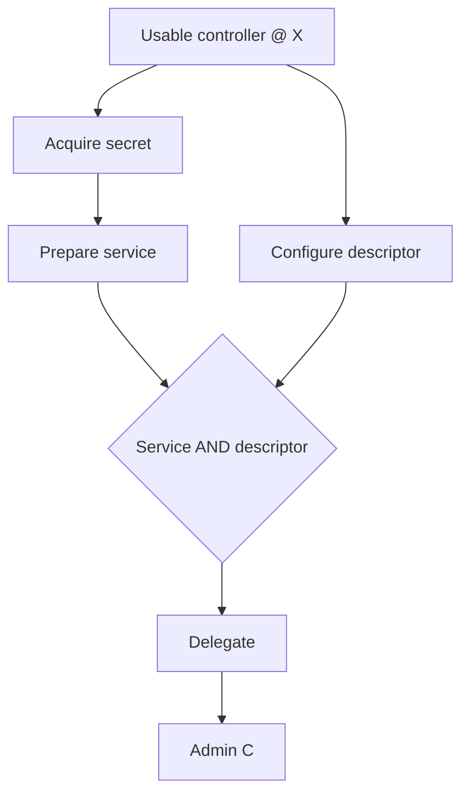

# AWG-R02 — Kiểm chứng kiến trúc và audit thực nghiệm

Ngày thực thi: **16/10/2026**. Repository: [nairyuuu/ad-weighted-graph](https://github.com/nairyuuu/ad-weighted-graph).

Baseline duy nhất: **`develop@340e8e526e1e693d4c4b55635c459985eb08fa49`**. Kết quả dưới đây là thực thi mới trong phiên Work; AWG-R01 là tài liệu đầu vào và đặc tả thí nghiệm, không được dùng thay cho execution evidence.

## 1. Phán quyết và phạm vi bằng chứng

**Giữ và tối ưu planner hiện tại; chưa triển khai AND–OR discovery production ở vòng tiếp theo.** Sửa lỗi phối hợp actor và transport trước, rồi loại việc parse catalog/rebuild graph lặp lại. Bằng chứng hiện có đủ để ưu tiên hướng này; chưa đủ để kết luận một engine AND–OR mới tốt hơn trên SEAMLESS.

Ba kết quả quyết định:

- **Verified:** 310/310 test hiện có được chọn đã pass trên Python 3.14.8, sau khi materialize đủ file cho suite đó. Đây là suite có chủ đích cho semantics, search, credential/RBCD, ranking, Top-K và lineage, không phải toàn bộ test repository.
- **Verified:** 78 biến thể thuộc 12 nhóm F1 đã chạy. Có một sai lệch reachability trên API hỗ trợ nhiều capability cùng hai identity usable: evaluator replay U → V → U thành công, search trả `no_path`, `complete=true`. Các khoảng trống ForceChangePassword/HasSession là **thiếu composition trong catalog hiện tại**, không phải primitive transition sinh effect sai.
- **Verified trong fixture:** cache catalog cố định giữ nguyên toàn bộ digest đầu ra trên bốn input; pipeline RBCD nhỏ giảm trung vị **2,803 → 0,332 giây**. Gộp lịch sử membership tương đương, vẫn dùng candidate generator/evaluator gốc, giảm expansion 11.742 → 384 ở fixture 6 membership. Hai phép đo này chỉ là monkeypatch thử nghiệm, chưa phải thay đổi production.

**Strong inference:** phần nền tảng evaluator, typed artifact/context, known-False veto, provenance, shared-work assessment và replay đáng giữ. Số lượng công việc lặp lại đang là vấn đề có thể sửa tại chỗ. Viết thêm compiler/grounder AND–OR lúc này tạo thêm nghĩa vụ đồng bộ ngữ nghĩa trong khi chưa chứng minh cần thiết.

**Hypothesis requiring experiment:** sau những tối ưu này, một traversal chia sẻ giữa nhiều target có thể vẫn cần AND–OR hoặc một chế độ capability saturation. Chưa có raw SEAMLESS để kiểm định giả thuyết đó. Không suy rộng các tỷ số trên fixture thành speedup toàn sản phẩm.

## 2. F0 — Baseline tái lập

### 2.1 Mã nguồn và cách cô lập

Đã đọc AWG-R01, gồm toàn bộ F0/F1/F2, trước khi dựng thí nghiệm. Baseline được lấy qua GitHub connector ở SHA nêu trên; không dùng file từ một báo cáo lịch sử như source truth. Vì clone trực tiếp bằng endpoint sẵn có không cung cấp phiên xác thực Git, đã materialize một **sparse checkout cục bộ** bằng GitHub API.

Đã kiểm SHA-1 theo định dạng Git object cho **126 blob đang dùng**, **88 tree**, và tái tạo đúng bytes của signed commit. Root tree là `51e2849e28d69410c83e13aab9f9210942160256`; `git rev-parse HEAD` trả đúng `340e8e526e1e693d4c4b55635c459985eb08fa49`. `git diff HEAD --name-only` và `git status --porcelain` đều rỗng sau thực nghiệm. Nhánh cục bộ riêng `r02-experiments` chỉ trỏ vào commit baseline; không có remote, commit mới, PR, issue, merge, hoặc thay đổi main/develop. Prototype và output ở thư mục `experiments/`, `evidence/` bên cạnh checkout.

Evidence: `source-provenance.json`, `upstream-tree.json`, `upstream-commit.json`, `exact-commit.raw`, `f0-probes.json`. Mỗi source file materialize có cả Git blob hash và SHA-256. Script `materialize_git.py` ghi lại phương thức dựng checkout; không cần chạy script này khi đã clone được repository.

### 2.2 Runtime và dependencies

| Thành phần | Phiên bản thực thi |
| --- | --- |
| Python | CPython **3.14.8**, Clang 22.1.3 |
| OS | Linux x86_64, glibc 2.39; 9 logical CPU được môi trường báo cáo |
| Runtime | `networkx==3.7`, `PyYAML==6.0.3` |
| Tests/schema | `pytest==9.1.1`, `jsonschema==4.26.0` |
| Công cụ khóa theo repo | `ruff==0.16.8`, `yamllint==1.38.0` |

`requirements-tests.txt` bao gồm requirements-dev/runtime của baseline. Toàn bộ 15 distribution thực tế và dependency bắc cầu có trong `environment.json`, `requirements-frozen.txt`. Khác AWG-R01, phiên này cài dependency và Python 3.14 qua mạng thành công, nên đã chạy source thật. Không dùng môi trường Python 3.12 bootstrap cho số liệu cuối.

### 2.3 Tests và hành vi baseline

Lệnh F0 cuối, chạy từ `baseline/` bằng đường dẫn tuyệt đối tới Python trong venv:

```bash
r02_python="$(cd ../.venv/bin && pwd)/python"
"$r02_python" -m pytest -q \
  tests/test_attack_semantics_transitions.py tests/test_engine.py \
  tests/test_rbcd.py tests/test_asrep.py tests/test_kerberoasting.py \
  tests/test_top_k_search.py tests/test_exploration.py \
  tests/test_week4_min_effort_search.py tests/test_graph_lineage.py \
  --junitxml=../evidence/f0-complete.xml
```

Kết quả: **310 passed in 111.30s**. Lệnh trong `README.md` dùng executable tuyệt đối để tránh cảnh báo prefix của Python 3.14 khi gọi qua đường dẫn `../.venv` trong những lượt đầu.

Các lượt F0 đầu thất bại do sparse snapshot thiếu fixture/schema/script và chưa có Git metadata; đã bổ sung file đúng blob hash rồi chạy lại toàn bộ suite chọn. Log đầu và log rerun vẫn được giữ. **Không sửa source/test upstream để làm test pass.** Test count này không chứng minh coverage toàn AD, tính hữu ích sản phẩm hay runtime full-SEAMLESS.

Đã chạy thêm control API/CLI và giới hạn search:

| Input | API | CLI | Kết luận |
| --- | --- | --- | --- |
| Bỏ các key `graph`/`catalog`, cấp graph ngoài | 3 paths, complete | exit 0 | Baseline transport hoạt động |
| `graph:null` | 3 paths, complete | exit 1 | Mismatch transport được tái hiện |
| `catalog:null` | 3 paths, complete | exit 1 | Mismatch transport được tái hiện |
| Cả hai null | 3 paths, complete | exit 1 | Không do Git metadata hoặc thiếu graph |
| `top_k=1`, `max_expansions=1`, cùng packet C | Truncated | `is_k_best_proven=false` | Control bảo đảm đúng khi search bị cắt |

CLI từ chối theo **sự hiện diện key**, dù giá trị null, với lỗi `use explicit graph/snapshot; supplied candidates/catalog are unsupported`. Evidence: `f0-probes.json`, các `f0-query-*.json`, `f0-cli-*.json`, `f0-probes-run.log`. Đây là defect compatibility nhỏ, không phải lỗi đường đi. Source: [src/engine/query_cli.py](https://github.com/nairyuuu/ad-weighted-graph/blob/340e8e526e1e693d4c4b55635c459985eb08fa49/src/engine/query_cli.py).

### 2.4 Giới hạn tái lập

Không có sáu raw file SEAMLESS theo manifest snapshot `sha256:e0601d763eeea285d268ec9e468d321c50c9d7faba53c8e7442a2fcc4159c812` (tổng 11.371.828 bytes). Không có Neo4j/AD lab để xác nhận hành vi tấn công thực tế. Đã chạy unit checks yêu cầu private preparation thất bại khi thiếu raw đúng chuẩn; không chạy full parser → batch → ranking trên SEAMLESS.

Không so trực tiếp số giây mới với packet/benchmark lịch sử #292/#293: input, phần pipeline và provenance không đồng nhất. Venv không đóng gói trong bundle; hệ điều hành, CPU scheduling, wheel availability và private Git access vẫn là giới hạn tái lập. Không pin CPU, không kiểm soát host contention; báo cáo median/range của mẫu nhỏ, không công bố confidence interval hay p-value.

## 3. F1 — Oracle độc lập và 12 ca ngữ nghĩa

### 3.1 Hợp đồng thí nghiệm

`oracle.py` chỉ import standard library. Mỗi input có các fact hữu hạn, action instance ground bằng tay, positive prerequisite theo AND, effect add-only, runtime guard True/False/Unknown, work-unit identity và giá công khai. Không import AWG candidate generator, transition, rating hoặc cost helper để sinh expected outcome.

Enumerator duyệt mọi **tập action thực thi được** bằng bitmask. Vì trong hợp đồng này effects chỉ thêm, fact set và paid-work set được quyết định bởi tập action, không bởi thứ tự; lưu một witness cho mỗi mask đủ để kiểm reachability và min-C. Đây là oracle đầy đủ **trong model hữu hạn đó**, không phải oracle cho delete effects, retries, probability theo lịch sử hay toàn bộ Windows/AD. Mỗi model tối đa 6 action instance, thấp hơn trần khoảng 12 trong R01. RBCD còn có DFS độc lập liệt kê thứ tự và dừng tại first goal để kiểm đúng ba lịch hợp lệ.

Expected reachability/C được ghi literal trong `cases.py` trước khi chạy native search; oracle phải khớp các literal này. Truth table bốn tổ hợp `f AND g` và chu kỳ không seed được cross-check riêng. Chi phí oracle là tổng **union** work IDs, không lấy số của AWG làm expected. Đây là abstraction được specialize theo fixture: các guard/thuộc tính đã cố định True được lược khỏi rule ground; các prerequisite đang ablate được giữ tường minh. Không coi oracle này là bản triển khai độc lập đầy đủ của mọi rule AD hoặc mọi gate chưa bị thay đổi trong input.

Hai alternative dùng **cùng các action ground**, không được thêm bridge mà incumbent thiếu:

- **Conditional graph nhẹ:** bỏ fact ban đầu khỏi dynamic prerequisite; suy luận implication bảo thủ từ *mọi producer* để loại prerequisite dư. Ví dụ membership chỉ được tạo sau usable identity thì không phạt kiến trúc unary vì giữ cả hai điều kiện tương đương. Chỉ chạy graph search khi còn tối đa một dynamic prerequisite/action và một goal động. Từ chối trường hợp AND độc lập; không giả phép AND thành OR.
- **AND–OR nhẹ:** worklist đếm prerequisite, giữ support đầu tiên, dựng witness theo dependency. Không có optimal-C optimizer. Unknown/FALSE không fire action. Có đúng gate AND thật cho service credential + descriptor RBCD.

AWG được chạy bằng `materialize_query(...).search(...)` gốc. **67 witness trả về** được kiểm lại bằng oracle độc lập và replay bằng evaluator AWG như checker thứ hai. Mọi attempt không applicable đều có additions rỗng. Tất cả 78 native searches hết queue trong budget; điều đó không sửa được khoảng trống generator của ca 9.

Phần lớn chi phí F1 là ledger synthetic, không phải C đã calibrate của kỹ thuật AD. Ca 10 có thêm phép kiểm **bộ ranking AWG thật**, dùng work B=4+1 cho đúng rubric 0..4/unit; oracle tổng vẫn A=2/B=5. P và I để unrated, không điền midpoint hay bịa dữ liệu.

Evidence chính: `f1-results.json` và 78 file được tham chiếu trong `f1-inputs/`; `f1-run.log`; `f1-shared-work-native-rating.json`. Mỗi input có query, canonical graph, snapshot facts, action model, native-request mapping và SHA-256. Phần negative gate chỉ thay đúng guard được định danh, không xóa toàn nhánh một cách tùy ý.

### 3.2 Kết quả từng ca

`PASS` dưới đây nghĩa đúng trong contract đã công khai; `UNSUPPORTED` nghĩa thiếu bridge/scope mong muốn, không tự tính là primitive bug. `FAIL` là phản ví dụ có trace hợp lệ bằng chính evaluator hiện tại.

| F1 | Biến thể | Kết quả native và expected độc lập | Phân loại |
| --- | ---: | --- | --- |
| 1. Membership chain/cycle/diamond | 1 | 40 ordered witnesses, 84 expansions; min synthetic C=1; group entitlement không thêm group vào `control` | **PASS** |
| 2. WriteDacl → derived right → reset → activation → host | 1 | Dựng `GenericAll` branch-local, `scenario_reset_password`, kích hoạt V, membership, admin H2; C=5 | **PASS**, cùng graph bất biến |
| 3. ForceChangePassword → activation | 3 | Reset marker đạt C=2; downstream host không đạt. Khai báo rõ `reset_password_control` làm positive control thì kích hoạt và host đạt C=2 | Primitive **PASS**; chuỗi tự nối **UNSUPPORTED** |
| 4. Host admin → HasSession → credential/identity | 3 | Admin source + material marker đạt C=2; material không tự thành password/usable. Password artifact có owner/context/provenance và `secret_valid` rõ ràng làm positive control đạt host C=2 | Primitive **PASS**; bridge recovery **UNSUPPORTED** |
| 5. AS-REP request/recovery/activation | 3 | True đạt host C=6; False/Unknown dừng ở material, không sinh secret hoặc usable identity | **PASS** |
| 6. Kerberoasting không có structural route tới service identity | 3 | Structural reachability U→V=false; semantic request/recover/activate vẫn tìm được host khi True; False/Unknown không vượt recovery | **PASS**; structural-only làm mất coverage |
| 7. RBCD đủ hai nhánh và reuse | 2 | Đúng cả 3 thứ tự acquire/prepare/configure, cùng 8 trạng thái tích lũy theo action mask; C=9. Controlled service có sẵn bỏ acquire+prepare, còn 3 bước, C=4 | **PASS** |
| 8. RBCD thiếu prerequisite/binding/context | 53 | Không false positive; 40 phép False/Unknown trên 20 vị trí runtime gate, 9 probe known identity/usable/exact rights/SPN, 4 probe thiếu mỗi nhánh hoặc sai artifact/context | **PASS trong phạm vi các probe đã chạy** |
| 9. Switch rồi quay actor cũ | 1 | U,V cùng usable@X; goal cần admin H1,H2,H3. Replay U:H1→V:H2→U:H3 applicable cả 3; search 5 expansions, 0 path, `complete=true` | **FAIL** phối hợp actor của public multi-goal API; có điều chỉnh so với ca R01, xem §4.1 |
| 10. Shared-work A=2/B=5; suffix dùng B | 1 | Oracle C=5; native có 7 witnesses, native ranking chọn 5, các witness còn lại C=7; exact within-scope flag đúng | **PASS** native cost/dedup; AND–OR first-support không tối ưu C |
| 11. Unknown / authoritative FALSE | 3 | True đạt admin C=1; thiếu gate → INDETERMINATE; observed False → BLOCKED và reject optimistic assumption; cả hai không thêm effect | **PASS** |
| 12. Owner/context isolation | 4 | Password V@X đạt host C=2; V@Y, W@X hoặc AS-REP material chưa recovery không đạt cùng goal | **PASS** context/artifact boundary; không benchmark multi-source batch |

Tổng parity với oracle là **77/78 input**, sai lệch duy nhất ở ca 9. Đây không phải điểm chất lượng 98,7%: 53 input cùng biến đổi một model RBCD và hai chuỗi mong muốn vẫn thiếu bridge. Tất cả 67 witness native đã trả đều hợp lệ theo model độc lập; không tìm thấy false positive trong bộ nhỏ này.

### 3.3 RBCD — AND là nhu cầu thật, nhưng ba thứ tự không phải ba exposure



Ba thứ tự đạt goal là A→S→D→T→H, A→D→S→T→H, D→A→S→T→H. Bỏ riêng service hoặc descriptor đều không được delegation. Artifact khác authentication context không thay thế artifact đúng binding, dù principal có vẻ giống. Reuse đã chuẩn bị service làm acquisition/preparation thừa và không bị tính lại.

40 runtime probes thay riêng các vị trí: acquire có effective reset/directory write/password policy; prepare có secret validity/key derivation/encryption compatibility/service authentication/KDC; configure có effective descriptor write/directory write; delegate có SPN binding/policy/KDC/S4U acceptance; admin có SPN binding/WinRM network/listener/endpoint/authentication/admin context. Mỗi vị trí chạy cả False và absent/Unknown. Probe static bao gồm known principal/impersonated identity, usable controller, exact ACL rights và cả SPN flag/list values. Bộ này không bao trùm mọi loại binding sai, mọi tổ hợp lỗi, hoặc mọi thuộc tính tài khoản/Windows policy; test existing bổ sung account eligibility nhưng không thay một oracle AD lab.

Withhold quyền reset hoặc descriptor chuyển một source–goal cell từ reachable sang unreachable, dù nhánh độc lập kia vẫn làm được phần việc của nó. Đây là kiểm counterfactual cục bộ có alternative order; không phải bằng chứng engine đã tìm tối ưu remediation toàn doanh nghiệp, và không dùng tỷ lệ mất ordered paths làm tỷ lệ giảm exposure.

## 4. Defect đã xác nhận và ranh giới chưa hỗ trợ

### 4.1 Candidate scheduler không phối hợp đầy đủ identity đã usable

**Verified — defect completeness của tổ hợp public API.** Input ca 9 có ba structural quyền: `U AdminTo H1`, `V AdminTo H2`, `U AdminTo H3`; `U@X` và `V@X` đều usable ban đầu. Goal typed là `admin_control={H1,H2,H3}`, target H3. Mọi runtime guard cần thiết True với provenance giả định rõ ràng.

Oracle trả witness cost 3. Explicit requests bằng evaluator gốc:

1. `obtain_admin_execution_on_host(actor=U, source=U, target=H1)` → APPLICABLE.
2. Cùng technique với V→H2 → APPLICABLE, giữ admin H1.
3. Cùng technique với U→H3 → APPLICABLE, giữ admin H1,H2, goal đạt.

Search chỉ mở hai initial branches tương ứng U hoặc V. Sau một action AdminTo, scheduler giữ current actor của branch; không có bước chọn identity usable khác để hợp nhất các capability hợp lệ **trong cùng scenario**. U branch có H1/H3, V branch có H2, không branch nào có cả ba. Public `run` trả `status=no_path`, `complete=true`. Evidence: `f1-results.json`, `actor-gap-public-api.json`; source [src/engine/search.py](https://github.com/nairyuuu/ad-weighted-graph/blob/340e8e526e1e693d4c4b55635c459985eb08fa49/src/engine/search.py) (`initial_actors`, `current_actor`, `next_actor`) và [src/engine/query.py](https://github.com/nairyuuu/ad-weighted-graph/blob/340e8e526e1e693d4c4b55635c459985eb08fa49/src/engine/query.py) (typed cumulative goal).

Đây là mâu thuẫn giữa hành vi search và trace language mà evaluator/API đang chấp nhận. Nếu sản phẩm chủ ý không hỗ trợ multi-identity cumulative goals thì phải reject/đánh dấu unsupported input đó; không trả no-path như kết luận đầy đủ. Không được hiểu phát hiện này là mọi single-asset query hiện tại đều sai.

**Giới hạn quan trọng của F1.9:** ca R01 nguyên văn yêu cầu Alice lấy Bob, Bob làm xuất hiện quyền mới chỉ Alice dùng được, rồi buộc Alice trở lại. Catalog hiện tại chỉ có mutation tự cấp quyền/membership cho actor, chưa có recipe cross-identity thích hợp để dựng đúng dependency này bằng rule gốc. Không thêm rule giả để ép planner fail. Thí nghiệm đã thay bằng public cumulative goal với hai actor usable sẵn và explicit U→V→U replay; nó xác nhận lỗi phối hợp hiện có, nhưng **chưa tái hiện nguyên văn forced-return-after-new-right**. Forward activation được kiểm ở ca 2/5/6. Phần scheduler hẹp đó vẫn là coverage question cần quyết định khi mở thêm semantic recipe.

### 4.2 ForceChangePassword dừng ở marker

**Verified — coverage/composition gap.** `reset_target_password` sinh `authentication_control(V)`. Generator chỉ tạo `AuthenticationControl(V,X)` để activation từ `reset_password_control(V)`. Không có bước nối hai loại state này. `scenario_reset_password` dưới GenericAll sinh cả marker reset, nên chuỗi WriteDacl→GenericAll→reset có thể đi tiếp nhưng ForceChangePassword gốc thì không.

Primitive behavior khớp test existing; không đủ căn cứ gắn nhãn “transition reset sai”. Product intent vẫn thiếu nhất quán: nếu đã thực hiện password reset thành công và có credential/context dùng được, cần recipe rõ cho outcome đó. Chỉ copy `authentication_control` sang usable identity sẽ bỏ qua credential type, account eligibility, KDC và authentication acceptance. Files liên quan: [configs/attack_semantics.yml](https://github.com/nairyuuu/ad-weighted-graph/blob/340e8e526e1e693d4c4b55635c459985eb08fa49/configs/attack_semantics.yml), [src/engine/search.py](https://github.com/nairyuuu/ad-weighted-graph/blob/340e8e526e1e693d4c4b55635c459985eb08fa49/src/engine/search.py), [src/engine/semantics/transitions.py](https://github.com/nairyuuu/ad-weighted-graph/blob/340e8e526e1e693d4c4b55635c459985eb08fa49/src/engine/semantics/transitions.py).

### 4.3 HasSession dừng ở material không định kiểu

**Verified — functionality chưa hỗ trợ.** Sau admin H1 và đủ session freshness/presence/accessibility, `recover_session_credential_material` chỉ thêm `credential_material={V}`. Không có password artifact V@X; `activate_recovered_identity` cần đúng recovered password artifact và guards. Positive control chỉ thành công khi khai báo password artifact có provenance và `secret_valid=True`.

Đây là ranh giới thận trọng đúng ở primitive level. Không biết material là password, hash, ticket, hay dữ liệu không khôi phục được thì không tự kích hoạt identity. Thiếu recovery/activation bridge là khoảng trống sản phẩm thực, nhưng F1 không chứng minh có thể giải nó bằng một edge vô điều kiện. Files: catalog, `semantics/state.py`, `semantics/credentials.py`, evaluator.

### 4.4 Những điều không được gọi là bug sau F1

- AS-REP/Kerberoasting dừng khi recovery Unknown/FALSE; effect rỗng là đúng. Có material không có nghĩa biết secret.
- RBCD không thành công nếu mới có một prerequisite hoặc artifact sai context; ordinary OR graph không đủ thay thế nó.
- Native shared-work dedup **đúng trong phản ví dụ đã chạy**. Không có bằng chứng phải thay assessor chi phí.
- Truncated Top-K tự hạ guarantee; không thấy lỗi “truncated nhưng globally optimal” trong control đã chạy.
- Chưa có bằng chứng xác suất P calibrated, đủ coverage real-world, hay min-C toàn SEAMLESS. Những vấn đề đó không được giải bằng một test count lớn.

## 5. So sánh ba kiến trúc bằng cùng input

| Tiêu chí | Incumbent stateful planner | Conditional graph nhẹ | AND–OR nhẹ |
| --- | --- | --- | --- |
| Grounding/rule AD | Dùng rule thật trong repo | Chỉ action ground thủ công của F1 | Cùng action ground thủ công của F1 |
| Reachability F1 | 77/78; lỗi actor case 9 | Xử lý 23/78; những input còn lại được ghi unsupported theo giới hạn unary/multi-goal của prototype | 78/78 trên model add-only hữu hạn |
| Witness | 67 native witnesses hợp lệ theo oracle và native replay | Witness ở phần xử lý đều hợp lệ | Tất cả positive witnesses hợp lệ |
| RBCD đầy đủ | Đúng 3 order + reuse | Từ chối AND service+descriptor thay vì flatten | Biểu diễn trực tiếp AND và tích lũy hai nhánh |
| Nonstructural credential | Producer AS-REP/Kerb hiện có, đã chạy | Có thể biểu diễn chuỗi sau grounding đúng | Có thể biểu diễn chuỗi sau grounding đúng |
| Actor/context | Typed state tốt; scheduler hụt phối hợp | Cần grounding identity/context đúng; prototype multi-goal không hỗ trợ | Các fact scoped cho phép tích lũy actor trong một scenario; vẫn cần grounder thật |
| Shared-work C | Native ranking đúng C=5 | Báo unsupported C; edge-local sum sẽ chọn 7 | First-support witness C=7; không có minimum claim |
| Chi phí duy trì tiếp theo | Sửa scheduler/cache/index; giữ một bộ semantics/replay | Thấp nếu chỉ unary, tăng khi compile conjunction/proof/work | Thêm compiler/fact identity/support/invalidation và witness C layer; chưa có số thực thi end-to-end |
| Rủi ro migration | Thấp nếu giữ contract, provenance và guard | Bỏ nonstructural/action-AND nếu dùng AD nodes đơn thuần | Parity rule/provenance/unknown và path-dependent scoring chưa được chứng minh |

Không dùng tỷ lệ pass để quảng cáo một alternative: nhiều input cùng model, hai alternative không phải production engines, không có parser/graph preparation/grounding/rating full pipeline. **Không so milliseconds của action list đã ground sẵn với AWG xử lý catalog/provenance để công bố AND–OR nhanh hơn.**

Phản ví dụ chi phí được thực thi:

| Prefix đến cùng capability admin H1 | Work đã trả | Giá prefix | Work thêm cho suffix HasSession | Tổng |
| --- | --- | ---: | ---: | ---: |
| A: direct | a | 2 | b=5 | **7** |
| B: membership + inherited | b | 5 | b đã trả, thêm 0 | **5** |

B được biểu diễn bằng hai unit 4 và 1 trong packet AWG để tuân rubric; cùng identity work được reuse ở suffix. Native Top-K trả `[5,7,7,7,7,7,7]` và chứng minh minimum trong declared finite scope. Không có P/I số. Conditional graph từ chối chứng nhận minimum vì shared work; AND–OR support đầu tiên A tạo witness hợp lệ giá 7. Muốn AND–OR trả min-C đúng phải thêm tối ưu proof union/paid-work labels, không chỉ lấy tổng min của từng nhánh.

**Strong inference:** AND–OR có lợi về ngôn ngữ biểu diễn dependency; F1 chưa chứng minh cần một engine mới để lấy lợi ích đó. State merge hẹp trên chính planner đã giảm work mà không cần nhân đôi rule. Nếu mục tiêu chỉ là reachability, có thể thu nhỏ output contract của planner trước. Nếu cần Top-K ordered programs hoặc full-history P, không được tái dùng phép merge đó tự động.

## 6. F2 — Bottleneck đo được

### 6.1 Phương pháp và fairness

Đã đo bốn input: two-routes, AS-REP, RBCD gốc, và RBCD thêm 1.001 group/1.000 edge không liên quan. Query, facts, action vocabulary, graph, budget và rating packet của một input giữ nguyên giữa hai mode. Hai mode dùng cùng Python/dependencies và cùng generator/evaluator/ranking code.

Mode thử nghiệm cache đóng băng tuple catalog tại đúng content hash, patch các alias load default trong process, giữ validation/equality gates của recipe, kiểm source bytes/catalog không đổi sau run. Custom-path load không bị thay. Mỗi mode có một lượt đầu và ba lượt tiếp; setup cache ghi riêng. Tổng cộng 32 query-pipeline trials, cộng 24 search-only trials cho 4 kích thước membership và 5 lượt cProfile riêng. Lượt đo thăm dò cũ có thể chồng với F0 probe được giữ dưới `f2-pilot-*`; số trong báo cáo lấy từ lượt F2 cuối chạy riêng, không dùng lượt thăm dò.

Timer `perf_counter` được đặt quanh graph load/validation, query materialization, search, rating/outcome với search đã cung cấp sẵn, và wire+JSON serialization. Native semantic replay và fact-program replay bên trong rating được bọc timer riêng; `rating exclusive = rating inclusive - replay`. Không cộng replay hai lần. cProfile chỉ dùng tìm call count/hotspot; không lấy số cProfile làm benchmark vì instrumentation có overhead, đúng theo [Python 3.14 profiler documentation](https://docs.python.org/3.14/library/profile.html).

Prebuilt input/packet factory và tạo graph padding là chuẩn bị fixture, không tính vào request total; metadata có factory time nhưng không phải chi phí production đầy đủ. Transport đọc từ chuỗi in-memory; serialization đo payload search/ranking/diagnostics, không gồm toàn bộ CLI bookkeeping, ghi file hoặc graph transport. Do đó total dưới đây là **pipeline được đo**, không phải latency end-to-end của một công cụ đã triển khai.

### 6.2 Catalog cache — cùng output, ít công việc lặp lại

| Fixture | Nodes/edges | Gốc median (s) | Cache median (s) | Tỷ số gốc/cache | Setup cache (ms) |
| --- | ---: | ---: | ---: | ---: | ---: |
| two-routes | 7/3 | 0.579 | 0.140 | 4.13× | 86.1 |
| asrep | 4/2 | 0.526 | 0.183 | 2.87× | 49.5 |
| rbcd | 5/2 | 2.803 | 0.332 | 8.45× | 44.9 |
| rbcd-padding-1000 | 1006/1002 | 3.872 | 1.585 | 2.44× | 54.0 |

Tất cả output digest **trùng chính xác** giữa 4 lượt/mode của mỗi input, gồm paths, attempt/state/provenance, coverage, ranking, min-C và Top-K nếu có. Không chỉ so path count. Cache setup không bị giấu: ở RBCD nhỏ, lượt đầu + setup cache khoảng 0,384s so với 2,792s gốc. Đây là lượt đầu trong process đã import module/chuẩn bị input, không phải cold-start cả process hoặc OS. Full raw measurements/ranges nằm trong `f2-results.json`.

Các pha dưới đây là **lượt có request total trung vị** trong ba lượt tiếp, đơn vị ms; chọn cùng một lượt cho cả hàng để tổng các pha cộng được, thay vì cộng median từ những lượt khác nhau.

| Input/mode | Graph prep | Query prep | Search | Replay | Rating còn lại | Serialize | Tổng |
| --- | ---: | ---: | ---: | ---: | ---: | ---: | ---: |
| rbcd gốc | 65.2 | 54.9 | 836.3 | 1617.7 | 179.1 | 49.6 | 2802.9 |
| rbcd cache | 56.4 | 0.5 | 23.0 | 53.6 | 153.2 | 45.2 | 331.8 |
| rbcd-padding-1000 gốc | 308.2 | 57.6 | 806.7 | 1920.9 | 720.5 | 58.0 | 3871.9 |
| rbcd-padding-1000 cache | 301.5 | 19.3 | 150.6 | 330.9 | 729.1 | 53.6 | 1585.0 |

**Verified:** trong profile search RBCD gốc, `evaluate_rbcd` được gọi 14 lần, và `load_catalog` cũng **14 lần**. Cumulative catalog time chiếm **96.2%** thời gian của lượt profile đó. Source gọi lại `load_catalog()` ngay trong `evaluate_rbcd`, dù selected catalog đã được cấp cho search. Replay không truyền catalog vào mọi đường gọi cũng gây lặp parse. Files: [src/engine/semantics/rbcd.py](https://github.com/nairyuuu/ad-weighted-graph/blob/340e8e526e1e693d4c4b55635c459985eb08fa49/src/engine/semantics/rbcd.py), [src/engine/semantics/credentials.py](https://github.com/nairyuuu/ad-weighted-graph/blob/340e8e526e1e693d4c4b55635c459985eb08fa49/src/engine/semantics/credentials.py), [src/engine/semantics/catalog.py](https://github.com/nairyuuu/ad-weighted-graph/blob/340e8e526e1e693d4c4b55635c459985eb08fa49/src/engine/semantics/catalog.py), [src/engine/ranking/verification.py](https://github.com/nairyuuu/ad-weighted-graph/blob/340e8e526e1e693d4c4b55635c459985eb08fa49/src/engine/ranking/verification.py).

**Verified:** sau cache, ở search padding, `PreparedSemanticGraph.__getitem__` được gọi 5 lần và trả defensive copy; profile ghi 222,794 lượt gọi `deepcopy`. `__getitem__` riêng chiếm cumulative **29.7%** của profile cached padding. Không cộng các cumulative percentage lồng nhau. Whole graph scan/copy và snapshot-binding validation trở nên rõ sau khi loại YAML.

Profile riêng cho **rating/replay cached padding** ghi 3 lần `EngineGraph.from_canonical`, 10 lần `validate_graph`, 6 lần `graph_digest`/snapshot binding và 869.348 lượt `deepcopy`. Đây là work thực được gọi lặp trên cùng canonical graph cho ba candidate. Source orchestration dựng lại EngineGraph theo từng candidate; graph_digest còn validate/hash graph nhiều lần. Đây là ứng viên tái dùng prepared immutable graph và binding validation, **không phải lý do bỏ replay/provenance**. Số call trong `f2-profile-rating-padding-cache.json` có thể kiểm lại bằng `.pstats`.

Payload search/ranking RBCD ba path ở phép đo hiện tại đã khoảng **3,61 MB** dù graph gốc chỉ có 5 node/2 edge. Serialization khoảng 45–58ms ở các lượt đại diện; đây chưa phải bottleneck đứng đầu nhưng cho thấy verbose audit/state lặp có chi phí thực. Không suy ra payload hay bottleneck full-SEAMLESS từ con số nhỏ này.

### 6.3 Enumeration thứ tự — kiểm tối ưu tại chỗ, không đổi semantic rules

Tạo 3–6 nhóm độc lập mà U là member; mỗi nhóm cho AdminTo cùng H1. Membership passive C=0, action terminal C=1. Query chỉ cần admin H1; mọi subset membership không rỗng có thể đứng trước terminal. Oracle tổ hợp độc lập dự đoán **2^n−1** tập membership terminal, không dựa trên output của planner.

Monkeypatch queue giữ nguyên candidate generator/evaluator, gộp entry khi bằng nhau ở `(current_actor, full AttackState, used_actions, history_length)`. Cùng fixed graph/context và fixture cost như trên. Không chỉ dùng current AD node. So exact hash của tập final membership states, reachability và C=1; native ordered-program enumeration được giữ làm baseline.

| Số membership | Expansions gốc → merge | Ordered witnesses gốc → witness giữ | Median search (s), gốc → merge | Tập terminal semantic khác nhau |
| --- | ---: | ---: | ---: | ---: |
| 3 | 48 → 24 | 33 → 12 | 0.0269 → 0.0071 | 7 → 7 |
| 4 | 260 → 64 | 196 → 32 | 0.1579 → 0.0256 | 15 → 15 |
| 5 | 1,630 → 160 | 1,305 → 80 | 1.6950 → 0.0979 | 31 → 31 |
| 6 | 11,742 → 384 | 9,786 → 192 | 14.4973 → 0.2690 | 63 → 63 |

**Verified trong miền hẹp này:** cùng tất cả terminal semantic sets và minimum active C; giảm được work ngay trong planner gốc. Với n=6, baseline trả 9.786 ordered programs cho 63 tập membership terminal; merge giữ 192 witness và 384 expansions. Thời gian median 14,497 → 0,269s chỉ so **hai mode cùng output contract reachability/state-set/C của fixture**, không nói Top-K tương đương.

**Không bảo toàn mọi ordered program.** Không áp dụng key thử nghiệm này cho shared-work ledger chưa biểu diễn paid set, full-history P, context/resource changes, hoặc Top-K trace enumeration. Phần benchmark cố ý chỉ kiểm C=1 với passive membership; không phải state-dominance theorem tổng quát. Nếu triển khai mode reachability, coverage/guarantee phải ghi đúng output contract; không giữ nguyên nhãn “mọi path đầy đủ” của API cũ sau khi merge.

**Hypothesis requiring experiment:** hợp nhất trên state liên quan goal và paid work, hoặc partial-order reduction có proof, sẽ giúp query thực. Chưa có kết quả cho all-goal traversal, A*, backward search, index lớn, memory tail hoặc remediation batch. Không có speedup AND–OR end-to-end để công bố.

## 7. Quyết định kiến trúc và backlog cho fork solo

Giữ một nguồn sự thật semantic: catalog + evaluator + typed artifact/binding + replay. Giữ AttackState trước; F1 không biện minh xóa accumulated capabilities, derived rights, identities hoặc contexts. Giữ native shared-work assessor và C-first output; P/I thiếu basis vẫn unrated. Tách mục tiêu “discovery một proof/capability” khỏi “liệt kê mọi ordered program” bằng output contract, không bằng một engine production thứ hai.

### 7.1 Backlog nhỏ, theo thứ tự thực thi

| Ưu tiên | Việc cụ thể | File/module có khả năng đổi | Điều kiện xong / dừng |
| --- | --- | --- | --- |
| **P0-1** | Chốt và sửa scheduling của identity đã usable trong cùng context; hoặc reject explicit combination API chưa hỗ trợ | `src/engine/search.py`, `query.py`; tests exploration/engine và fixture actor mới | Reproducer ca 9 không còn `no_path,complete=true` với replay hợp lệ. Không union giữa foothold/query độc lập. Giữ budget/first-goal invariants |
| **P0-2** | Chuẩn hóa null-vs-omitted khi export query qua CLI | `src/engine/query_cli.py`, serializer trong `batch.py`/research export; tests query CLI | Bốn input F0 có cùng semantic result khi null có nghĩa “không override”; vẫn reject catalog/candidates thực sự được nhúng ngoài contract |
| **P1-1** | Nạp và validate catalog một lần cho cùng content/version; truyền cùng catalog vào replay, giữ recipe equality checks | `semantics/catalog.py`, `rbcd.py`, `credentials.py`, `evaluator.py`, `ranking/verification.py` | Full output parity, 78 F1 và suite chọn; cache key/invalidation có content identity. Profile không còn 14 YAML loads cho 14 action RBCD. Không nới guard để tăng tốc |
| **P1-2** | Tái dùng prepared graph/indices và snapshot binding theo query; bỏ rebuild/copy/whole scan lặp nội bộ | `semantics/evaluator.py`, `rbcd.py`, `ranking/orchestration.py`, `verification.py`, `graph.py`; `snapshot_facts.py` nếu cần | Fixture padding giữ exact digest, giảm graph construction/hash counts. Giữ immutable public API và withheld-right behavior; không bỏ lineage validation |
| **P1-3** | Định nghĩa rõ password-reset outcome và HasSession material forms; triển khai bridge chỉ khi có đủ evidence/guards | `configs/attack_semantics.yml`, `semantics/state.py`, `transitions.py`, `credentials.py`, producer ở `search.py` | Fixture positive/False/Unknown/type/context được viết trước. Không auto-promote material hoặc auth-control thành usable; nếu chưa có basis thì trả “unsupported bridge” rõ |
| **P2-1** | Thử mode reachability/min-C dùng existing generator, tránh permutation tương đương; key gồm relevant state + actor/context + paid units + used-action constraints + remaining budget | `search.py`, `program_identity.py`, `top_k.py`, `query.py` | So oracle cases 1/7/9/10/11/12 trước khi claim dominance. Key thử ở F2 không đủ cho full-history P/Top-K; dừng nếu mất witness bắt buộc hoặc work reuse |
| **P2-2** | Lấy raw manifest đúng pin; đo một nguồn nhiều target với cache/prepared graph trước khi thêm engine | `batch.py`, `scripts/research/source_goal_batch.py`, test/benchmark fixtures | Cùng source/context/snapshot, báo graph setup và amortized query riêng. Không tái dùng result của source khác làm capability chung |

Không xây lúc này: ba engine hoàn chỉnh, rule DSL/framework mới, PDDL integration, calibrated P không có dữ liệu, global graph-cut optimality, thuật toán A* với heuristic chưa có proof, hoặc rewrite parser/provenance. Đặc biệt không thay evaluator/replay bằng một graph closure mà native semantics chưa xác nhận.

### 7.2 Điều gì sẽ khiến thay đổi quyết định về AND–OR?

Chỉ mở pilot nhỏ khi **sau P0/P1**, cùng dữ liệu thực và cùng budget/output objective vẫn không đáp ứng discovery vì enumeration có quá nhiều state tương đương; shared traversal bằng planner không giải được; và compiler tối thiểu có thể dùng **chính executable rule contracts**, không nhân đôi semantics. Pilot phải cùng vocabulary/prerequisites/context/provenance, đo cả grounding/setup, và replay native mọi witness. Thất bại parity là stop condition trước khi so tốc độ.

AND–OR chỉ nên trả confirmed reachable capabilities + support witnesses lúc đầu. Min-C vẫn cần paid-work-aware witness optimizer; P theo lịch sử vẫn là lớp đánh giá riêng. “78/78 trên action list bằng tay” không đủ để nhận migration risk này. Dijkstra cũng chỉ trả minimum của graph/cost đã mô hình đúng; single-source APIs có thể chia sẻ traversal nhưng không tự giải action conjunction/shared work của AWG ([NetworkX shortest-path documentation](https://networkx.org/documentation/stable/reference/algorithms/shortest_paths.html)).

### 7.3 Câu hỏi còn mở có thể đổi quyết định

1. Raw full-SEAMLESS sau catalog/prepared-graph reuse còn bị giới hạn bởi search-space, graph binding hay audit/rating? Chưa đo được vì thiếu raw; đây là bất định hiệu năng quan trọng nhất.
2. Sản phẩm cần một proof cho mỗi capability/target, minimum C, hay toàn bộ ordered programs? F2 chứng minh chi phí hai output contract rất khác; không được âm thầm thay output.
3. Shared work thực được nhận diện ở mức artifact/context/setup nào và khi nào tái dùng không hợp lệ? Ca 10 chỉ là counterexample số học, không phải validation taxonomy toàn bộ rating registry.
4. Password reset và HasSession tạo artifact nào có thể xác minh bằng evidence hiện có? Câu trả lời quyết định bridge; không quyết định bằng cách nối node cho đẹp.
5. Khi có cross-identity permission-mutation recipe thật, forced return kiểu R01.9 có cần action đổi actor tường minh/cost riêng hay chỉ scheduler selection? Ca multi-actor hiện đã có bug; không lấy nó làm chứng minh đầy đủ cho recipe chưa tồn tại.

## 8. Artifact, tái chạy và kết luận hành động

Bundle có `experiments/`, 78 input ground, JSON kết quả, F0 stdout/JUnit, F2 raw trials, profile JSON/`.pstats`, exact-source manifest/commit provenance, lock dependencies và README commands. Không đóng gói repository upstream hoặc venv như bản mã nguồn mới. Có quyền đọc GitHub riêng và Python 3.14 là đủ tái dựng baseline; không cần Neo4j cho các phép F0/F1/F2 nhỏ này.

Các evidence quan trọng:

| Evidence | Dùng để kiểm |
| --- | --- |
| `f0-complete.log`, `.xml` | 310 test chọn, 0 failure/error, thời gian |
| `environment.json`, `requirements-frozen.txt`, `source-provenance.json`, `f0-probes.json` | Exact SHA/dependencies/source bytes/CLI null và truncation |
| `f1-results.json`, `f1-inputs/`, `f1-run.log` | 78 input, literal expected/oracle/alternative/native, witness, request và status |
| `actor-gap-public-api.json` | `no_path,complete=true` ở public API; trace hợp lệ nằm trong F1 JSON |
| `f1-shared-work-native-rating.json` | Native C=5, Top-K và work ledger, P/I unrated |
| `f2-results.json`, `f2-run.log`, `f2-profile-*.json/.pstats` | Raw timing, exact output digests, counters, cache setup và merge limitations |
| `final-qa.json`, `MANIFEST-SHA256.txt` | Kiểm tính nhất quán evidence và checksum bundle |

Các khẳng định experimental dựa trên artifact đã chạy; link source ở trên pin đúng SHA. Hai tài liệu ngoài dùng để định nghĩa cách đọc profiler và phạm vi shortest-path, không dùng làm bằng chứng AWG chạy đúng. Microsoft [MS-SFU specification](https://learn.microsoft.com/en-us/openspecs/windows_protocols/ms-sfu/) là chuẩn đối chiếu protocol; thí nghiệm này chỉ kiểm RBCD WinRM recipe giới hạn trong repo, không kiểm đầy đủ mọi constrained-delegation behavior.

**Quyết định cuối: GIỮ planner và TỐI ƯU tại chỗ. Chưa đáng triển khai AND–OR discovery production.** Công việc đầu tiên cho fork là khóa regression cho actor composition, sửa no-path sai phạm vi, rồi đưa catalog reuse vào một thay đổi hẹp với exact-output parity. Bài đo đầu sau thay đổi phải là RBCD/padding F2 cùng input và replay còn nguyên; chỉ mở AND–OR pilot nếu bottleneck discovery còn tồn tại trên raw chuẩn sau các tối ưu này.
