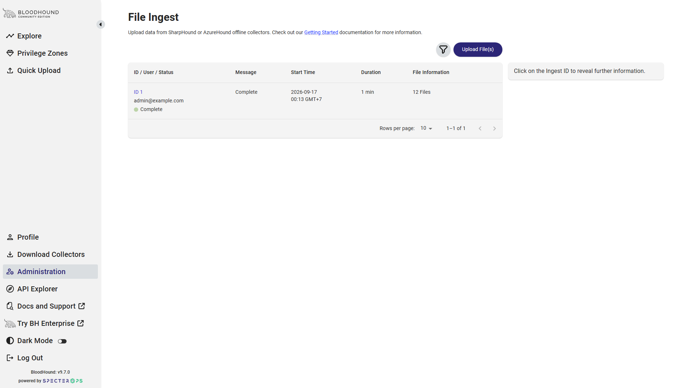
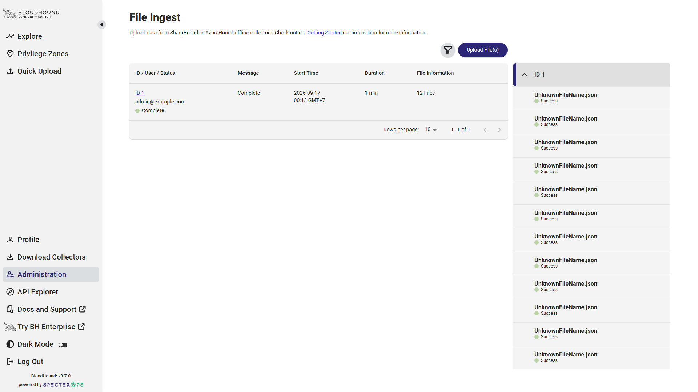
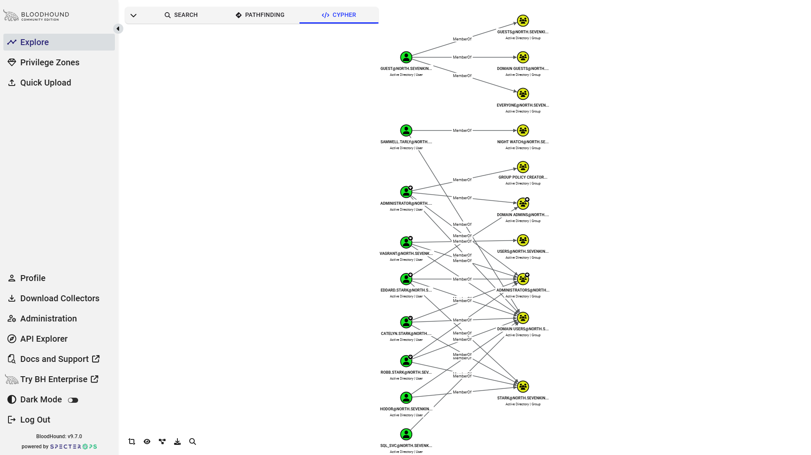
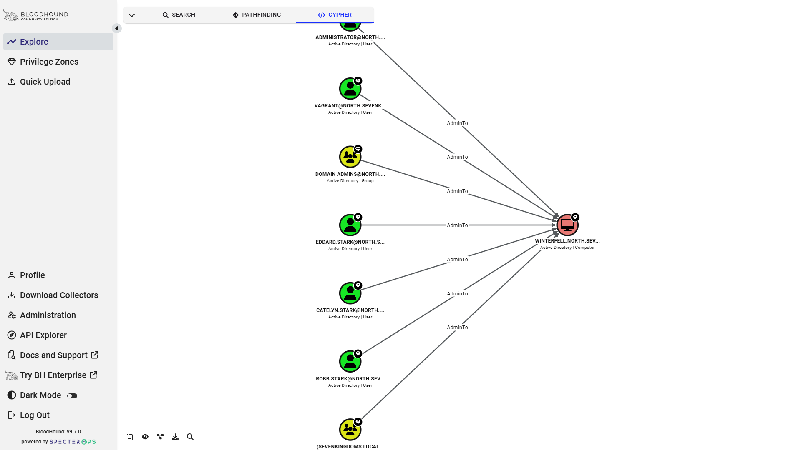
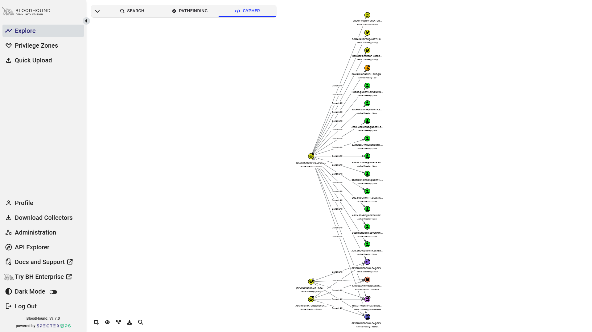
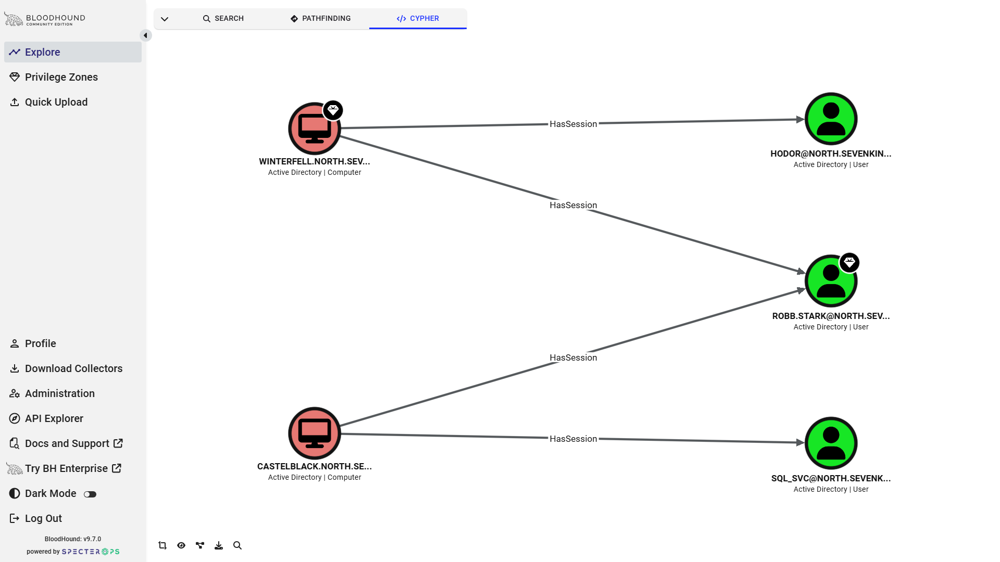

# Bao Cao Baseline Import BloodHound CE Cho Dataset A/B

Trạng thái: Completed (Refs #32).
Người thực hiện: @nairyuuu (Thực tập sinh B).
Người review: @Lolavine777 (Thực tập sinh A).
Liên kết nhiệm vụ: Refs #32, Refs #20, Refs #26, Refs #27, Refs #31.
Quyết định kiến trúc liên quan: [ADR-0007](https://github.com/Lolavine777/ad-weighted-graph-neo/blob/282450279ae0afa035b9597b86b2d250f6feca69/docs/adr/ADR-0007-enterprise-topology-independent-telemetry-evaluation.md), [ADR-0006](https://github.com/Lolavine777/ad-weighted-graph-neo/blob/282450279ae0afa035b9597b86b2d250f6feca69/docs/adr/ADR-0006-two-dataset-evaluation-framework.md) (lich su), [ADR-0002](https://github.com/Lolavine777/ad-weighted-graph-neo/blob/282450279ae0afa035b9597b86b2d250f6feca69/docs/adr/ADR-0002-edge-directionality-semantics.md), [ADR-0003](https://github.com/Lolavine777/ad-weighted-graph-neo/blob/282450279ae0afa035b9597b86b2d250f6feca69/docs/adr/ADR-0003-host-access-inference-policy.md).
Mã nguồn tái lập: `deploy/bloodhound/compose.yml`, `scripts/run_bloodhound_baseline.py`, `scripts/bloodhound_baseline_audit.py`.

---

## 1. Muc Tieu va Nguyen Tac Baseline

Tài liệu này thiết lập baseline thực nghiệm có khả năng tái lập hoàn toàn từ BloodHound Community Edition (CE) cho historical Dataset A/B:
1. **Dataset A (Benchmark Lab - GOADv2 NORTH):** Đối sánh độc lập giữa hai bản trích xuất song song từ SharpHound C# v2.3.3 (`a-sharphound`, 12 tệp) và BloodHound-Python (`a-python`, 7 tệp).
2. **Dataset B (Enterprise Multi-Domain Lab - `ad_sampledata`):** Khảo sát độc lập từng miền (`b-run-1: PHANTOM`, `b-run-2: GHOST`, `b-run-3: WRAITH`) và toàn bộ rừng đa miền kết hợp (`dataset_b`, 31 tệp).

SEAMLESS khong nam trong baseline nay.
SEAMLESS Legacy 4.0.3 reconciliation dùng [evidence #194](issue-47-seamless-legacy-403-reconciliation.md) và [comparison contract #195](seamless-legacy-403-comparison-contract.md).
Không suy SEAMLESS parity từ CE Dataset A/B hoặc scoped structural equality; full Legacy comparator vẫn `NOT_MEASURABLE`.

### Nguyen tac co ban
- **Evidence over Ground Truth:** Số liệu từ BloodHound CE là bằng chứng quan sát (observational evidence) về cách engine ingestion của SpecterOps chuẩn hóa và biểu diễn dữ liệu. Đây không phải chân lý tuyệt đối (ground truth) và không thay thế pipeline phân tích raw → graph độc lập của dự án.
- **Tách bạch 3 tầng số liệu:**
  1. *Raw Occurrences:* Số lượng phần tử hoặc bản ghi thực tế xuất hiện trong các mảng JSON (`Members[]`, `Aces[]`, `Sessions[]`, `LocalGroups[]`).
  2. *Unique Logical Pairs:* Số cặp quan hệ logic duy nhất `(source, target)` đã khử trùng lặp.
  3. *BloodHound-Ingested Relations:* Số cạnh thực tế được BloodHound CE tạo ra trên đồ thị Neo4j sau khi áp dụng các luật phân tích (post-processing rules).
- **Nguyên tắc cô lập môi trường (Database Isolation):** Tuyệt đối không import chồng chéo hai dataset hoặc hai collector vào cùng một database khi lấy số liệu baseline. Cơ sở dữ liệu được dọn dẹp hoặc khởi tạo mới trước mỗi snapshot.
- **Không suy diễn vắng mặt thành phủ định:** Việc thiếu dữ liệu hoặc collector thất bại (`StatusAccessDenied`, cờ không được bật) được ghi nhận là `unknown` hoặc `insufficient evidence`, tuyệt đối không diễn giải thành `false` logic.

### 1.1. Provenance va Anh xa Tap tin cua cac Snapshot Con (Sub-Snapshot Provenance Mapping)

Để đảm bảo khả năng tái lập độc lập (reproducibility) mà không phụ thuộc vào các đường dẫn tạm thời, toàn bộ 6 snapshot khảo sát được ánh xạ tường minh từ thư mục dữ liệu thô (`data/raw/`) dựa trên tiền tố tệp và mã băm manifest chuẩn (theo đặc tả Manifest Schema v1 từ #27 / #31):

| Snapshot Key | Thư mục dữ liệu gốc | Quy tắc nhận diện tệp (Glob Pattern) | Số tệp | Định danh Miền / Collector | Mã băm Snapshot ID (SHA-256) | Mã băm Archive gốc (SHA-256) |
| :--- | :--- | :--- | :---: | :--- | :--- | :--- |
| **`a-sharphound`** | `data/raw/dataset_a` | `NORTH_20240410083414_*.json` | 12 | SharpHound v2.3.3 (C#) / Miền `NORTH` | `sha256:ca5f09dd0272f607354086c53d255967eec51b7dab2d5bf9d3bbdd902f3d6f63` | `9f4482553b3d6b20df16e2fd615d543ac267f0e9a062ec4578d517548b4c666c` |
| **`a-python`** | `data/raw/dataset_a` | `ce_branch_bloodhoundpy_20240411011008_*.json` | 7 | BloodHound-Python CE / Miền `NORTH` | `sha256:b25cb32639ed10c1b0ddf488bf02b6547740a0a1eed00259571c4dd776516cdc` | `806fa21cc61b73c74a52126b0441ae633f6c6b6784731f5f16060b10c08e0e39` |
| **`b-run-1`** | `data/raw/dataset_b` | `20240305110018_*.json` | 12 | SharpHound v2.3.3 / Miền `PHANTOM.CORP` | `sha256:39d3a48729a01550467125c3115dedbb355205c02f46cd83e2f9dfb780e02602` | `2adb4bd1a7286869c00b0e2698dc5275b9520178fd8a07ead4cdcdb5159161ba` |
| **`b-run-2`** | `data/raw/dataset_b` | `20240305110427_*.json` | 7 | SharpHound v2.3.3 / Miền `GHOST.CORP` | `sha256:dfe659eef9715ffc37b51144d65e71552b775cbf263907b6c88f9dfb4d72196d` | `2adb4bd1a7286869c00b0e2698dc5275b9520178fd8a07ead4cdcdb5159161ba` |
| **`b-run-3`** | `data/raw/dataset_b` | `20240305111414_*.json` | 12 | SharpHound v2.3.3 / Miền `WRAITH.CORP` | `sha256:e4198d8c06426aa2ea214ac261a43935b14e98fe516d57c48a8da5be18031c12` | `2adb4bd1a7286869c00b0e2698dc5275b9520178fd8a07ead4cdcdb5159161ba` |
| **`dataset_b`** | `data/raw/dataset_b` | `*.json` (tổng hợp cả 3 run) | 31 | SharpHound v2.3.3 / Rừng 3 miền kết hợp | `sha256:f62a39280b2cfcaaa4d6a738365870b82765cd37458a3ac17ce8f2702514e3e1` | `2adb4bd1a7286869c00b0e2698dc5275b9520178fd8a07ead4cdcdb5159161ba` |

*Ghi chú kỹ thuật về nguồn gốc tệp:*
- Thư mục `data/raw/dataset_a` chứa tổng cộng 19 tệp JSON đại diện cho 2 phiên thu thập đồng thời trên lab GOADv2 NORTH (12 tệp từ SharpHound C# và 7 tệp từ BloodHound-Python CE).
- Thư mục `data/raw/dataset_b` chứa tổng cộng 31 tệp JSON giải nén từ archive `a8bfbcf9-4226-40ed-a0c4-a2cc05dbc708.zip`. 3 run thu thập độc lập trên 3 domain controller tương ứng được phân biệt tuyệt đối qua tiền tố timestamp (`20240305110018_` cho PHANTOM, `20240305110427_` cho GHOST, và `20240305111414_` cho WRAITH).
- Công cụ kiểm tra `scripts/bloodhound_baseline_audit.py` và `scripts/run_bloodhound_baseline.py` tự động đọc trực tiếp từ `data/raw/` theo tiền tố này hoặc từ thư mục staging trung gian `data/processed/snapshot-inputs/`, đảm bảo kết quả baseline có thể tái lập tức thì trên mọi môi trường sạch.
- **Xác thực bytes qua Manifest Schema v1 (Refs #27 / #31):** Runner `scripts/run_bloodhound_baseline.py` và script kiểm định `scripts/bloodhound_baseline_audit.py` tích hợp trực tiếp module `src.data.manifest`. Trước khi thực hiện ingestion hoặc audit, runner tính toán mã băm SHA-256 theo chunk cho từng tệp dữ liệu thực tế trên máy cục bộ, đối chiếu với manifest `data/processed/manifests/<snapshot-id>.json`. Nếu có bất kỳ sự sai khác về số lượng tệp, dung lượng bytes, hoặc mã băm, runner sẽ dừng ngay lập tức (`fail-fast`) với lỗi `ManifestError`, ngăn chặn hoàn toàn việc ghi nhận baseline trên dữ liệu cục bộ bị biến đổi.

---

## 2. Cau Hinh Moi Truong BloodHound CE Chuan Hoa

Để đảm bảo kết quả baseline có thể kiểm chứng độc lập bởi thành viên khác trong nhóm mà không phụ thuộc vào đường dẫn tuyệt đối trên máy cá nhân, môi trường BloodHound CE được đóng gói qua Docker Compose tại `deploy/bloodhound/compose.yml`:

| Thành phần | Image & Tag | Image Digest (SHA-256) | Cấu hình & Cổng mạng |
| :--- | :--- | :--- | :--- |
| **BloodHound CE** | `docker.io/specterops/bloodhound:v9.7.0` | `sha256:24dba2ba69f7fcc06c407f6503df2879487df492f8b62b33ec8ef2a6a97e4b4d` | Binary v9.7.0; API port `127.0.0.1:8080` (loopback only) |
| **Graph Database** | `docker.io/library/neo4j:4.4.42` | `sha256:73b5a47eb9952f47fcc42fcc80bdd6bd0d6b71eea9a1a345c216675498c790e4` | Bolt `127.0.0.1:7687`, HTTP `127.0.0.1:7474` |
| **Application DB** | `docker.io/library/postgres:18` | `sha256:4ef4dbc939d61acea57712655ddb4b4ab27419c913f94cca0cd57cb3ea3c2280` | Quản lý người dùng, auth token, jobs ingestion nội bộ |

Quy trình reset cơ sở dữ liệu giữa các lần import:
```powershell
# Cách 1: Tái lập hoàn chỉnh stack sạch
docker compose -f deploy/bloodhound/compose.yml down -v
docker compose -f deploy/bloodhound/compose.yml up -d

# Cách 2: Dọn sạch đồ thị Neo4j qua Cypher (tức thì, không tải lại stack)
# Gửi lệnh Cypher: MATCH (n) DETACH DELETE n;
```

---

## 3. Ho So Baseline Chi Tiet Theo Tung Snapshot

### 3.1. Snapshot `a-sharphound` (Dataset A - SharpHound C#)

#### 1. Dinh danh va Nguon goc (Identity & Provenance)
- **Dataset ID:** `a-sharphound` (Miền `NORTH.SEVENKINGDOMS.LOCAL`).
- **Snapshot ID:** `sha256:ca5f09dd0272f607354086c53d255967eec51b7dab2d5bf9d3bbdd902f3d6f63` (tham chiếu manifest #27 / #31).
- **Tệp lưu trữ gốc:** `NORTH_20240410083414_BloodHound-2.3.3.zip`.
- **Mã băm SHA-256 archive:** `9f4482553b3d6b20df16e2fd615d543ac267f0e9a062ec4578d517548b4c666c`.
- **Dung lượng lưu trữ:** 513.937 bytes (12 tệp JSON giải nén).
- **Thời điểm snapshot:** `2024-04-10T08:34:14Z`.

#### 2. Phien ban Cong cu (Tool Version)
- **Collector:** SharpHound v2.3.3 (C# Ingestion Engine, Schema v6).
- **Cờ thu thập (`meta.methods`):** `521215` (Bao gồm LocalAdmin, Sessions, LoggedOn, Trusts, ACLs, ObjectProps, Container, AD CS).

#### 3. Danh sach tep va Trang thai Ingestion (Input Files & Import Status)
Tất cả 12 tệp JSON đều được BloodHound CE ingest thành công (HTTP 200/202):
- Core AD: `computers.json` (2), `containers.json` (203), `domains.json` (1), `gpos.json` (3), `groups.json` (84), `ous.json` (1), `users.json` (16).
- AD CS: `aiacas.json` (1), `certtemplates.json` (31), `enterprisecas.json` (2), `ntauthstores.json` (1), `rootcas.json` (2).
- **Trạng thái import:** 12/12 tệp Success, 0 Failed, 0 Partial Failed.

#### 4. Thong ke So luong Truoc va Sau Import (Pre- and Post-Import Counts)
- **Tổng số bản ghi JSON thô (`data`):** 347 bản ghi.
- **Tổng số Node thực tế hiển thị trong BloodHound:** 320 Node (gồm 80 Node thuộc 6 loại cốt lõi M1 và 240 Node Container/AD CS/Base).
- **Hiện tượng trùng lặp ObjectIdentifier:** Đúng 27 nhóm xuất hiện 2 lần trong `groups.json` (1 bản ghi đầy đủ và 1 stub rỗng). BloodHound hợp nhất 27 nhóm này thành công trên đỉnh duy nhất theo khóa `objectid`.
- **Tham chiếu ngoại vi (Dangling References):** 12 tham chiếu ACE/Member trỏ về các định danh thuộc miền cha chưa xuất khẩu `SEVENKINGDOMS.LOCAL`. BloodHound khởi tạo các đỉnh này dưới dạng `Base` stub nodes để duy trì toàn vẹn quan hệ.

#### 5. Do phu 8 loai canh M1 va Doi sanh Data Inventory
| Loại cạnh M1 | Raw Occurrences | Unique Pairs | BloodHound Ingested | Ghi chú kỹ thuật & Bằng chứng thực tế |
| :--- | :---: | :---: | :---: | :--- |
| **`MemberOf`** | 42 | 42 | **42** | Trùng khớp tuyệt đối. Thừa hưởng nhóm tĩnh LDAP. |
| **`AdminTo`** | 7 | 7 | **7** | Thu thập từ `LocalGroups` (`-544`) và `LocalAdmins` trên 2 máy trạm `WINTERFELL` và `CASTELBLACK`. |
| **`GenericAll`** | 383 | 378 | **378** | 5 ACE trùng lặp được khử. BloodHound map 1:1 sang quan hệ `GenericAll`. |
| **`WriteDacl`** | 573 | 570 | **570** | 3 ACE trùng lặp được khử. Map 1:1 sang `WriteDacl`. |
| **`ForceChangePassword`** | 0 | 0 | **0** | Hoàn toàn vắng mặt trong snapshot này. |
| **`CanPSRemote`** | 0 | 0 | **0** | Nhóm `-580` không có thành viên; không sinh cạnh. |
| **`CanRDP`** | 1 (raw -555) | 0 (effective) | **0\*** | 1 thành viên thô trong nhóm `-555` trên `WINTERFELL`, nhưng `StatusAccessDenied` đối với `UserRights`. Không đủ bằng chứng để xác thực quyền RDP có hiệu lực. |
| **`HasSession`** | 9 | 4 | **4** | 9 phiên thu thập thô qua NetSession/Registry rút gọn thành 4 cặp (Computer, User) duy nhất. |

*\*Lưu ý:* BloodHound CE GUI có thể hiển thị cạnh `CanRDP` dựa trên membership nhóm `-555` thô nếu không áp dụng bộ lọc UserRights nghiêm ngặt. Tiêu chí của đề tài đòi hỏi đồng thời UserRights theo ADR-0003.

#### 6. Quan sat chuyen sau (Observation -> Interpretation -> Confidence -> Verification)
- **Observation:** Trong `computers.json`, trường `AllowedToDelegate: []` trên máy trạm `CASTELBLACK$` hoàn toàn rỗng trong bản trích xuất của SharpHound.
- **Interpretation:** SharpHound v2.3.3 đã bỏ qua thuộc tính `msDS-AllowedToDelegateTo` khi quét máy tính này, dẫn đến việc thiếu một vector tấn công Kerberos quan trọng trong kịch bản lab GOADv2.
- **Confidence:** Rất cao.
- **Need to verify:** Đối chiếu trực tiếp với snapshot `a-python` tại Mục 3.2.

---

### 3.2. Snapshot `a-python` (Dataset A - BloodHound-Python)

#### 1. Dinh danh va Nguon goc (Identity & Provenance)
- **Dataset ID:** `a-python` (Miền `NORTH.SEVENKINGDOMS.LOCAL`).
- **Snapshot ID:** `sha256:b25cb32639ed10c1b0ddf488bf02b6547740a0a1eed00259571c4dd776516cdc` (tham chiếu manifest #27 / #31).
- **Tệp lưu trữ gốc:** `ce_branch_bloodhoundpy_north_20240411011008_bloodhound.zip`.
- **Mã băm SHA-256 archive:** `806fa21cc61b73c74a52126b0441ae633f6c6b6784731f5f16060b10c08e0e39`.
- **Dung lượng lưu trữ:** 177.033 bytes (7 tệp JSON giải nén).
- **Thời điểm snapshot:** `2024-04-11T01:10:08Z`.

#### 2. Phien ban Cong cu (Tool Version)
- **Collector:** BloodHound-Python (nhánh CE, Schema v6).
- **Cờ thu thập (`meta.methods`):** `0` (Chỉ truy vấn giao thức LDAP tiêu chuẩn; không gọi RPC/SAMR/Registry và không quét AD CS).

#### 3. Danh sach tep va Trang thai Ingestion (Input Files & Import Status)
Tất cả 7 tệp JSON đều được BloodHound CE ingest thành công (HTTP 200/202):
- Core AD: `computers.json` (2), `containers.json` (19), `domains.json` (1), `gpos.json` (3), `groups.json` (51), `ous.json` (1), `users.json` (17).
- AD CS: Không có (0 tệp).
- **Trạng thái import:** 7/7 tệp Success, 0 Failed.

#### 4. Thong ke So luong Truoc va Sau Import (Pre- and Post-Import Counts)
- **Tổng số bản ghi JSON thô (`data`):** 94 bản ghi.
- **Tổng số Node thực tế trong BloodHound:** 94 Node (75 Node thuộc 6 loại cốt lõi M1 và 19 Node Container).
- **Hiện tượng trùng lặp:** 0 bản ghi trùng lặp (BloodHound-Python chỉ duyệt đối tượng LDAP một lần, không sinh stub group).
- **Tham chiếu ngoại vi:** 7 tham chiếu trỏ sang miền `SEVENKINGDOMS.LOCAL`.

#### 5. Do phu 8 loai canh M1 va Doi sanh Data Inventory
| Loại cạnh M1 | Raw Occurrences | Unique Pairs | BloodHound Ingested | Ghi chú kỹ thuật & Bằng chứng thực tế |
| :--- | :---: | :---: | :---: | :--- |
| **`MemberOf`** | 42 | 42 | **42** | Hoàn toàn trùng khớp với bản SharpHound (42 cạnh). |
| **`AdminTo`** | 0 | 0 | **0** | Collector không gọi RPC/SAMR (`meta.methods = 0`), không thu thập `LocalGroups`. |
| **`GenericAll`** | 177 | 177 | **177** | Thấp hơn SharpHound (378) do chỉ trích xuất ACL trên các đối tượng LDAP thu thập được. |
| **`WriteDacl`** | 138 | 136 | **136** | 2 ACE trùng lặp được khử. Thấp hơn SharpHound (570). |
| **`ForceChangePassword`** | 0 | 0 | **0** | Vắng mặt trong snapshot. |
| **`CanPSRemote`** | 0 | 0 | **0** | Không có dữ liệu thu thập. |
| **`CanRDP`** | 0 | 0 | **0** | Không có dữ liệu thu thập. |
| **`HasSession`** | 0 | 0 | **0** | Không quét phiên mạng (`meta.methods = 0`). |

#### 6. Quan sat chuyen sau (Observation -> Interpretation -> Confidence -> Verification)
- **Observation:** `computers.json` của BloodHound-Python trích xuất được `CASTELBLACK$` có thuộc tính `AllowedToDelegate: ["WINTERFELL$"]`. Đồng thời `users.json` có 17 bản ghi (nhiều hơn 1 so với SharpHound do trích xuất thêm SID `NETWORK SERVICE` `S-1-5-20`).
- **Interpretation:** BloodHound-Python đọc trực tiếp thuộc tính LDAP `msDS-AllowedToDelegateTo` thành công, trong khi SharpHound v2.3.3 đã bỏ sót. Ngược lại, BloodHound-Python thiếu toàn bộ quan hệ host-access (`AdminTo`, `HasSession`, `CanRDP`) do giới hạn chỉ dùng LDAP.
- **Confidence:** Rất cao.
- **Need to verify:** Khi xây dựng parser M2, cần cơ chế kết hợp (fusion/adapter) cho phép nạp thuộc tính ủy thác từ nguồn LDAP bổ sung mà không làm mất thông tin host-level từ SharpHound.

---

### 3.3. Snapshot `b-run-1` (Dataset B - Domain PHANTOM.CORP)

#### 1. Dinh danh va Nguon goc (Identity & Provenance)
- **Dataset ID:** `b-run-1` (Miền `PHANTOM.CORP`).
- **Snapshot ID:** `sha256:39d3a48729a01550467125c3115dedbb355205c02f46cd83e2f9dfb780e02602` (tham chiếu manifest #27 / #31).
- **Tệp lưu trữ gốc:** `a8bfbcf9-4226-40ed-a0c4-a2cc05dbc708.zip`.
- **Mã băm SHA-256 archive:** `2adb4bd1a7286869c00b0e2698dc5275b9520178fd8a07ead4cdcdb5159161ba`.
- **Dung lượng lưu trữ:** 1.106.489 bytes (12 tệp JSON giải nén).
- **Thời điểm snapshot:** `2024-03-05T11:00:18Z`.

#### 2. Phien ban Cong cu (Tool Version)
- **Collector:** SharpHound v2.3.3 (C#, Schema v6, `meta.methods = 521215`).

#### 3. Danh sach tep va Trang thai Ingestion (Input Files & Import Status)
Tất cả 12 tệp JSON đều được BloodHound CE ingest thành công (HTTP 200/202):
- Core AD: `computers.json` (21), `containers.json` (208), `domains.json` (1), `gpos.json` (22), `groups.json` (115), `ous.json` (13), `users.json` (53).
- AD CS: `aiacas.json` (4), `certtemplates.json` (63), `enterprisecas.json` (2), `ntauthstores.json` (1), `rootcas.json` (4).
- **Trạng thái import:** 12/12 tệp Success.

#### 4. Thong ke So luong Truoc va Sau Import (Pre- and Post-Import Counts)
- **Tổng số bản ghi JSON thô (`data`):** 507 bản ghi.
- **Tổng số Node thực tế trong BloodHound:** 478 Node (196 Node thuộc 6 loại cốt lõi M1).
- **Hiện tượng trùng lặp ObjectIdentifier:** Có 29 ID trùng lặp (28 nhóm và 1 user). BloodHound hợp nhất thành công.
- **Sai lệch metadata:** `users.json` có 53 bản ghi trong `data[]` so với `meta.count = 49` (lệch +4). `computers.json` có 21 bản ghi so với `meta.count = 20` (+1). BloodHound duyệt mảng thực tế và không bị ảnh hưởng bởi `meta.count`.
- **Tham chiếu ngoại vi:** 6 tham chiếu tới miền ngoài hoặc đối tượng đặc biệt (gồm DN `CN=ENTERPRISE ADMINS,OU=GROUPS,OU=TIER0,DC=PHANTOM,DC=CORP`).

#### 5. Do phu 8 loai canh M1 va Doi sanh Data Inventory
| Loại cạnh M1 | Raw Occurrences | Unique Pairs | BloodHound Ingested | Ghi chú kỹ thuật & Bằng chứng thực tế |
| :--- | :---: | :---: | :---: | :--- |
| **`MemberOf`** | 78 | 78 | **78** | Trùng khớp tuyệt đối. |
| **`AdminTo`** | 2 | 2 | **2** | 2 quan hệ trên máy tính nội bộ `PHANTOM.CORP`. |
| **`GenericAll`** | 451 | 439 | **439** | 12 ACE trùng lặp được khử. |
| **`WriteDacl`** | 880 | 874 | **874** | 6 ACE trùng lặp được khử. |
| **`ForceChangePassword`** | 5 | 5 | **5** | Xuất hiện 5 quan hệ trên các tài khoản user của miền `PHANTOM`. |
| **`CanPSRemote`** | 0 | 0 | **0** | Không có thành viên trong nhóm `-580`. |
| **`CanRDP`** | 1 (raw -555) | 0 (effective) | **0\*** | 1 thành viên trên `DC01.PHANTOM.CORP`, nhưng thiếu `SeRemoteInteractiveLogonRight`. |
| **`HasSession`** | 51 | 26 | **26** | 51 phiên thô rút gọn thành 26 cặp (Computer, User) duy nhất. |

---

### 3.4. Snapshot `b-run-2` (Dataset B - Domain GHOST.CORP)

#### 1. Dinh danh va Nguon goc (Identity & Provenance)
- **Dataset ID:** `b-run-2` (Miền `GHOST.CORP`).
- **Snapshot ID:** `sha256:dfe659eef9715ffc37b51144d65e71552b775cbf263907b6c88f9dfb4d72196d` (tham chiếu manifest #27 / #31).
- **Tệp lưu trữ gốc:** `a8bfbcf9-4226-40ed-a0c4-a2cc05dbc708.zip`.
- **Mã băm SHA-256 archive:** `2adb4bd1a7286869c00b0e2698dc5275b9520178fd8a07ead4cdcdb5159161ba`.
- **Dung lượng lưu trữ:** 479.159 bytes (7 tệp JSON giải nén).
- **Thời điểm snapshot:** `2024-03-05T11:04:27Z`.

#### 2. Phien ban Cong cu (Tool Version)
- **Collector:** SharpHound v2.3.3 (C#, Schema v6, `meta.methods = 521215`).

#### 3. Danh sach tep va Trang thai Ingestion (Input Files & Import Status)
Tất cả 7 tệp JSON đều được BloodHound CE ingest thành công (HTTP 200/202):
- Core AD: `computers.json` (1), `containers.json` (206), `domains.json` (1), `gpos.json` (3), `groups.json` (58), `ous.json` (1), `users.json` (7).
- AD CS: Không xuất hiện trong export của miền này (0 tệp).
- **Trạng thái import:** 7/7 tệp Success.

#### 4. Thong ke So luong Truoc va Sau Import (Pre- and Post-Import Counts)
- **Tổng số bản ghi JSON thô (`data`):** 277 bản ghi.
- **Tổng số Node thực tế trong BloodHound:** 271 Node (65 Node thuộc 6 loại cốt lõi M1).
- **Hiện tượng trùng lặp ObjectIdentifier:** 6 nhóm bị lặp lại trong `groups.json`. BloodHound hợp nhất thành công.
- **Sai lệch metadata:** `users.json` có 7 bản ghi so với `meta.count = 5` (+2).
- **Tham chiếu ngoại vi:** 8 tham chiếu trỏ sang miền cha `PHANTOM.CORP`.

#### 5. Do phu 8 loai canh M1 va Doi sanh Data Inventory
| Loại cạnh M1 | Raw Occurrences | Unique Pairs | BloodHound Ingested | Ghi chú kỹ thuật & Bằng chứng thực tế |
| :--- | :---: | :---: | :---: | :--- |
| **`MemberOf`** | 25 | 25 | **25** | Trùng khớp tuyệt đối. |
| **`AdminTo`** | 0 | 0 | **0** | Máy chủ `GHOST-DC` không có local admin bổ sung ngoài Domain Admins mặc định. |
| **`GenericAll`** | 331 | 330 | **330** | 1 ACE trùng lặp được khử. |
| **`WriteDacl`** | 488 | 485 | **485** | 3 ACE trùng lặp được khử. |
| **`ForceChangePassword`** | 0 | 0 | **0** | Vắng mặt trong miền này. |
| **`CanPSRemote`** | 0 | 0 | **0** | Không có dữ liệu thành viên. |
| **`CanRDP`** | 0 | 0 | **0** | Không có dữ liệu thành viên. |
| **`HasSession`** | 0 | 0 | **0** | Không ghi nhận phiên hoạt động tại thời điểm quét. |

---

### 3.5. Snapshot `b-run-3` (Dataset B - Domain WRAITH.CORP)

#### 1. Dinh danh va Nguon goc (Identity & Provenance)
- **Dataset ID:** `b-run-3` (Miền `WRAITH.CORP`).
- **Snapshot ID:** `sha256:e4198d8c06426aa2ea214ac261a43935b14e98fe516d57c48a8da5be18031c12` (tham chiếu manifest #27 / #31).
- **Tệp lưu trữ gốc:** `a8bfbcf9-4226-40ed-a0c4-a2cc05dbc708.zip`.
- **Mã băm SHA-256 archive:** `2adb4bd1a7286869c00b0e2698dc5275b9520178fd8a07ead4cdcdb5159161ba`.
- **Dung lượng lưu trữ:** 1.932.946 bytes (12 tệp JSON giải nén).
- **Thời điểm snapshot:** `2024-03-05T11:14:14Z`.

#### 2. Phien ban Cong cu (Tool Version)
- **Collector:** SharpHound v2.3.3 (C#, Schema v6, `meta.methods = 521215`).

#### 3. Danh sach tep va Trang thai Ingestion (Input Files & Import Status)
Tất cả 12 tệp JSON đều được BloodHound CE ingest thành công (HTTP 200/202):
- Core AD: `computers.json` (12), `containers.json` (707), `domains.json` (1), `gpos.json` (7), `groups.json` (112), `ous.json` (6), `users.json` (40).
- AD CS: `aiacas.json` (2), `certtemplates.json` (43), `enterprisecas.json` (2), `ntauthstores.json` (1), `rootcas.json` (1).
- **Trạng thái import:** 12/12 tệp Success.

#### 4. Thong ke So luong Truoc va Sau Import (Pre- and Post-Import Counts)
- **Tổng số bản ghi JSON thô (`data`):** 934 bản ghi.
- **Tổng số Node thực tế trong BloodHound:** 906 Node (150 Node thuộc 6 loại cốt lõi M1).
- **Hiện tượng trùng lặp ObjectIdentifier:** 28 nhóm bị lặp lại trong `groups.json`. BloodHound hợp nhất thành công.
- **Sai lệch metadata:** `users.json` có 40 bản ghi so với `meta.count = 39` (+1). `computers.json` có 12 bản ghi so với `meta.count = 11` (+1).
- **Tham chiếu ngoại vi:** 4 tham chiếu (trong đó có quan hệ Local Admin gán cho tài khoản thuộc miền `PHANTOM.CORP` trên máy `EXTDC01`).

#### 5. Do phu 8 loai canh M1 va Doi sanh Data Inventory
| Loại cạnh M1 | Raw Occurrences | Unique Pairs | BloodHound Ingested | Ghi chú kỹ thuật & Bằng chứng thực tế |
| :--- | :---: | :---: | :---: | :--- |
| **`MemberOf`** | 58 | 58 | **58** | Trùng khớp tuyệt đối. |
| **`AdminTo`** | 11 | 11 | **11** | 11 quan hệ quản trị cục bộ phong phú trên các máy trạm/server của WRAITH. |
| **`GenericAll`** | 2.718 | 2.707 | **2.707** | 11 ACE trùng lặp được khử. |
| **`WriteDacl`** | 1.235 | 1.230 | **1.230** | 5 ACE trùng lặp được khử. |
| **`ForceChangePassword`** | 47 | 47 | **47** | Phân quyền reset password dồi dào trên các tài khoản user. |
| **`CanPSRemote`** | 0 | 0 | **0** | Không có thành viên trong nhóm `-580`. |
| **`CanRDP`** | 0 | 0 | **0** | Không có thành viên trong nhóm `-555`. |
| **`HasSession`** | 9 | 3 | **3** | 9 phiên thô rút gọn thành 3 cặp (Computer, User) duy nhất. |

---

### 3.6. Snapshot `dataset_b` (Toan Bo Rung Da Mien Ket Hop - 31 Teps)

#### 1. Dinh danh va Nguon goc (Identity & Provenance)
- **Dataset ID:** `dataset_b` (Rừng kết hợp 3 miền `PHANTOM.CORP`, `GHOST.CORP`, `WRAITH.CORP`).
- **Snapshot ID:** `sha256:f62a39280b2cfcaaa4d6a738365870b82765cd37458a3ac17ce8f2702514e3e1` (tham chiếu manifest #27 / #31).
- **Tệp lưu trữ gốc:** `a8bfbcf9-4226-40ed-a0c4-a2cc05dbc708.zip`.
- **Mã băm SHA-256 archive:** `2adb4bd1a7286869c00b0e2698dc5275b9520178fd8a07ead4cdcdb5159161ba`.
- **Tổng dung lượng:** 3.518.594 bytes (31 tệp JSON).

#### 2. Thong ke Tong the Sau Khi BloodHound Ingest Toan Bo Rung
- **Tổng số bản ghi JSON thô (`data`):** **1.718 bản ghi**.
- **Tổng số ObjectIdentifier duy nhất:** **1.469 Node**.
- **Tổng số Node thuộc 6 loại cốt lõi M1:** **407 Node** (User: 97, Computer: 34, Group: 247, Domain: 3, OU: 20, GPO: 32).
- **Tổng số Node Container/AD CS:** 1.062 Node (Container: 1.121 raw -> 939 unique; AD CS: 123 unique).

#### 3. Do phu 8 loai canh M1 Tren Toan Bo Rung Da Mien
| Loại cạnh M1 | Raw Occurrences | Unique Pairs | BloodHound Ingested | Tương quan cộng dồn từng miền |
| :--- | :---: | :---: | :---: | :--- |
| **`MemberOf`** | 161 | 161 | **161** | = 78 (PHANTOM) + 25 (GHOST) + 58 (WRAITH). Không có giao thoa membership ngoài miền. |
| **`AdminTo`** | 13 | 13 | **13** | = 2 (PHANTOM) + 0 (GHOST) + 11 (WRAITH). Bao gồm 1 quan hệ gán chéo từ user PHANTOM sang máy WRAITH. |
| **`GenericAll`** | 3.500 | 3.293 | **3.293** | Khử 207 ACE trùng lặp nội bộ và kế thừa. |
| **`WriteDacl`** | 2.603 | 2.229 | **2.229** | Khử 374 ACE trùng lặp nội bộ và kế thừa. |
| **`ForceChangePassword`** | 52 | 52 | **52** | = 5 (PHANTOM) + 0 (GHOST) + 47 (WRAITH). |
| **`CanPSRemote`** | 0 | 0 | **0** | Không có bằng chứng thành viên trên cả 3 miền. |
| **`CanRDP`** | 1 | 0 | **0** | 1 membership thô duy nhất trên DC01 không thỏa mãn điều kiện UserRights. |
| **`HasSession`** | 60 | 29 | **29** | = 26 (PHANTOM) + 0 (GHOST) + 3 (WRAITH). |

---

## 4. Bang Tong Hop So Sanh Baseline Giua Cac Snapshot

Bảng dưới đây đối sánh toàn diện số liệu baseline giữa các snapshot và collector:

| Chỉ số / Metric | Dataset A (SharpHound) | Dataset A (Python) | Dataset B (PHANTOM) | Dataset B (GHOST) | Dataset B (WRAITH) | Dataset B (Toàn bộ 31 tệp) |
| :--- | :---: | :---: | :---: | :---: | :---: | :---: |
| **Số tệp JSON** | 12 | 7 | 12 | 7 | 12 | 31 |
| **Tổng bản ghi thô** | 347 | 94 | 507 | 277 | 934 | 1.718 |
| **Tổng Node duy nhất** | 320 | 94 | 478 | 271 | 906 | 1.469 |
| **Node 6 loại M1** | 80 | 75 | 196 | 65 | 150 | 407 |
| **ID trùng lặp** | 27 (groups) | 0 | 29 (groups/users) | 6 (groups) | 28 (groups) | 63 (nội bộ từng miền) |
| **Dangling References** | 12 | 7 | 6 | 8 | 4 | 8 |
| **`MemberOf`** | 42 | 42 | 78 | 25 | 58 | 161 |
| **`AdminTo`** | 7 | 0 | 2 | 0 | 11 | 13 |
| **`GenericAll`** | 378 | 177 | 439 | 330 | 2.707 | 3.293 |
| **`WriteDacl`** | 570 | 136 | 874 | 485 | 1.230 | 2.229 |
| **`ForceChangePassword`** | 0 | 0 | 5 | 0 | 47 | 52 |
| **`CanPSRemote`** | 0 | 0 | 0 | 0 | 0 | 0 |
| **`CanRDP` (effective)** | 0 | 0 | 0 | 0 | 0 | 0 |
| **`HasSession`** | 4 | 0 | 26 | 0 | 3 | 29 |
| **Trusts Topology** | 1 | 1 | 3 | 1 | 2 | 6 (3 miền + 2 stub) |

---

## 5. Danh Muc Quan Sat An Ninh va Ranh Gioi Ky Thuat

Cấu trúc chuẩn hóa `Observation → Interpretation → Confidence → Need to verify`:

### 5.1. Quan sat 1: Hien tuong trung lap ObjectIdentifier va rui ro Last-Write-Wins
- **Observation:** Trong `groups.json` của SharpHound trên cả hai dataset (27 ID tại NORTH, 28 tại PHANTOM, 6 tại GHOST, 28 tại WRAITH), mỗi nhóm này xuất hiện 2 lần: lần đầu chứa đầy đủ `Members[]` và `Aces[]`, lần sau là bản ghi stub chỉ có `ObjectIdentifier` và các mảng rỗng.
- **Interpretation:** Khi ingest vào BloodHound CE, engine hợp nhất các thuộc tính vào cùng node Neo4j theo khóa `objectid`. Nếu parser tự viết ở M2 sử dụng cơ chế ghi đè đơn giản (last-write-wins dictionary mapping), bản ghi rỗng đọc sau sẽ xóa sạch toàn bộ danh sách thành viên của nhóm.
- **Confidence:** Tuyệt đối (100% bằng chứng kiểm tra trong mã nguồn thô).
- **Need to verify:** Kiểm thử parser M2 với test case bản ghi lặp để đảm bảo mảng `Members[]` luôn được hợp nhất (`set.union`).

### 5.2. Quan sat 2: Tham chieu mien va doi tuong treo (Dangling References)
- **Observation:** Dữ liệu chứa các tham chiếu trỏ tới các SID hoặc tên miền không nằm trong danh mục tệp xuất bản:
  - 12 tham chiếu ACE/Member trong Dataset A trỏ sang miền cha `SEVENKINGDOMS.LOCAL`.
  - 2 quan hệ External Trust trong Dataset B trỏ sang các miền ngoại vi `REVENANT.CORP` và `CHILD.WRAITH.CORP`.
  - 1 tham chiếu thành viên nhóm theo dạng DN trong `PHANTOM.CORP` (`CN=ENTERPRISE ADMINS,OU=GROUPS,OU=TIER0,DC=PHANTOM,DC=CORP`).
- **Interpretation:** BloodHound CE xử lý các tham chiếu này bằng cách tạo các nút gốc `Base` tối thiểu để không làm gãy đồ thị. Parser không được coi việc thiếu tệp đối tượng đích là lỗi ngoại lệ dừng chương trình.
- **Confidence:** Rất cao.
- **Need to verify:** Parser M2 cần triển khai cờ khởi tạo `Boundary/Stub Node` cho các định danh treo và phân loại rõ ranh giới an ninh.

### 5.3. Quan sat 3: Phan biet Membership thong thuong va Quyen truy cap co hieu luc (CanRDP)
- **Observation:** Máy `WINTERFELL` (Dataset A) và `DC01` (Dataset B) đều có 1 bản ghi thành viên trong nhóm Remote Desktop Users (`S-1-5-32-555`). Tuy nhiên:
  - Trên `WINTERFELL`, lệnh quét `UserRights` bị lỗi `StatusAccessDenied`.
  - Trên `DC01`, `UserRights` chỉ cấp `SeRemoteInteractiveLogonRight` cho local Administrators (`-544`), hoàn toàn không cấp cho `-555`.
- **Interpretation:** Trong đồ thị tấn công theo ADR-0003, chỉ có thành viên nhóm `-555` là chưa đủ điều kiện để sinh cạnh `CanRDP`; cần có quyền UserRights tương ứng và không bị cấm bởi `SeDenyRemoteInteractiveLogonRight`. BloodHound CE giao diện người dùng hiển thị cạnh `CanRDP` đơn thuần theo group membership, tạo ra false-positive tiềm tàng.
- **Confidence:** Rất cao.
- **Need to verify:** Parser M2 phải kiểm tra đồng thời cả hai điều kiện trước khi sinh cạnh `CanRDP`; trường hợp `StatusAccessDenied` phải được gán trạng thái `unknown`.

### 5.4. Quan sat 4: Di biet may chu RODC va cờ isdc
- **Observation:** Tại `PHANTOM.CORP` và `WRAITH.CORP`, hai máy chủ `RODC01` và `EXTRODC01` có `PrimaryGroupSID` kết thúc bằng RID 521 (chuẩn MS-ADTS cho Read-Only Domain Controllers) và nằm dưới `OU=DOMAIN CONTROLLERS`. Tuy nhiên trường `Properties.isdc` lại ghi giá trị `false`.
- **Interpretation:** Cờ `isdc` không đủ để đánh giá vai trò hay khả năng nhân bản của các máy này.
  PRP giới hạn mật khẩu theo cấu hình mặc định, nhưng quyền nhân bản bị cấp sai có thể mở rộng khả năng đó (xem [Microsoft KB 4050867](https://learn.microsoft.com/en-us/troubleshoot/windows-server/active-directory/rodc-replicates-passwords-grant-incorrect-permissions)).
- **Confidence:** Cao đối với phân loại RODC từ RID 521; chưa đủ bằng chứng để kết luận applicability của DCSync.
- **Need to verify:** Nhận diện vai trò từ bằng chứng thuộc tính và kiểm tra effective replication rights cùng PRP.
  Theo ADR-0008 và Graph Contract 1.0.0, đồ thị cấu trúc không chứa cạnh `ControlsDomain` hay `DCSync`.
  DCSync, nếu được mô hình hóa, thuộc tầng semantic/runtime; applicability phải dựa trên effective replication rights, PRP và bằng chứng snapshot/runtime.
  Khi thiếu bằng chứng bắt buộc, kết quả phải là `unknown` hoặc `indeterminate`, không hard-code `false` từ vai trò RODC.

---

## 6. Minh Chung Truc Quan (Visual Evidence tu BloodHound CE v9.7.0)

Nhằm bổ sung bằng chứng quan sát trực quan theo đề xuất tại PR #33 (Finding 6), mục này lưu trữ và thuyết minh 6 ảnh chụp màn hình trích xuất trực tiếp từ giao diện BloodHound CE v9.7.0 đang vận hành trên máy trạm cục bộ sau khi ingest hoàn tất snapshot đại diện `a-sharphound` (`NORTH.SEVENKINGDOMS.LOCAL`, 12 tệp JSON).

> [!NOTE]
> - **Nguyên tắc an toàn dữ liệu:** Toàn bộ ảnh chụp được thực hiện trên môi trường phòng thí nghiệm tổng hợp (synthetic lab GOADv2 NORTH). Không chứa bất kỳ thông tin nhạy cảm, IP nội bộ thực tế, credential cá nhân hay token xác thực bí mật nào.
> - **Vai trò bằng chứng:** Hình ảnh đóng vai trò minh chứng quan sát hỗ trợ (supporting visual evidence). Kết quả kiểm toán số học từ `scripts/bloodhound_baseline_audit.py` và `scripts/run_bloodhound_baseline.py` vẫn là test-oracle chính thức.

### 6.1. Qua trinh Nap Tap tin (File Ingestion Status)

#### 1. Tong quan Trang thai Ingestion (Job Ingest Overview)

- **Định danh Snapshot:** `a-sharphound` (`NORTH.SEVENKINGDOMS.LOCAL`).
- **Mã băm Snapshot ID:** `sha256:ca5f09dd0272f607354086c53d255967eec51b7dab2d5bf9d3bbdd902f3d6f63`.
- **Mô tả trực quan:** Bảng quản trị File Ingest của BloodHound CE v9.7.0 ghi nhận Job ID 1 do người dùng quản trị nạp thành công (`Status: Complete`, thời gian xử lý `1 min`, tổng số `12 Files`).

#### 2. Chi tiet Xu ly Tung Tap tin (Job Ingest File Details)

- **Định danh Snapshot:** `a-sharphound` (`NORTH.SEVENKINGDOMS.LOCAL`).
- **Mã băm Snapshot ID:** `sha256:ca5f09dd0272f607354086c53d255967eec51b7dab2d5bf9d3bbdd902f3d6f63`.
- **Mô tả trực quan:** Bảng chi tiết mở rộng của Ingest Job ID 1 chứng minh toàn bộ 12/12 tệp JSON (bao gồm 7 tệp Core AD và 5 tệp AD CS) đều đạt trạng thái `Success`, không có tệp nào bị lỗi hoặc từ chối schema.

---

### 6.2. Trang thai Do thi Thuc te theo Cypher Queries (Live Graph Verification)

#### 3. Quan he Thanh vien Nhom (MemberOf Relationships)

- **Định danh Snapshot:** `a-sharphound` (`NORTH.SEVENKINGDOMS.LOCAL`).
- **Mã băm Snapshot ID:** `sha256:ca5f09dd0272f607354086c53d255967eec51b7dab2d5bf9d3bbdd902f3d6f63`.
- **Truy vấn Cypher:** `MATCH (u:User)-[r:MemberOf]->(g:Group) RETURN u, r, g LIMIT 25;`
- **Mô tả trực quan:** Cấu trúc phân cấp thành viên LDAP kết nối các User nodes (`GUEST`, `SAMWELL.TARLY`, `ADMINISTRATOR`, `VAGRANT`, `EDDARD.STARK`, `CATELYN.STARK`, `ROBB.STARK`, `HODOR`, `SQL_SVC`) tới các Group nodes tương ứng (`DOMAIN ADMINS`, `ADMINISTRATORS`, `DOMAIN USERS`, `STARK`, `NIGHT WATCH`, `GROUP POLICY CREATOR`, ...), xác thực trực quan cho 42 quan hệ `MemberOf` baseline.

#### 4. Quyen Quan tri Cuc bo Tren May tram (AdminTo Relationships)

- **Định danh Snapshot:** `a-sharphound` (`NORTH.SEVENKINGDOMS.LOCAL`).
- **Mã băm Snapshot ID:** `sha256:ca5f09dd0272f607354086c53d255967eec51b7dab2d5bf9d3bbdd902f3d6f63`.
- **Truy vấn Cypher:** `MATCH (s)-[r:AdminTo]->(c:Computer) RETURN s, r, c;`
- **Mô tả trực quan:** Ảnh minh họa các quan hệ `AdminTo` được truy vấn thành công trên BloodHound CE; tổng baseline định lượng chính thức của snapshot `a-sharphound` là **7 unique logical pairs**, lấy từ audit/report (bao gồm các quan hệ quản trị từ `ADMINISTRATOR`, `VAGRANT`, `EDDARD.STARK`, `CATELYN.STARK`, `ROBB.STARK`, nhóm `DOMAIN ADMINS`, và nhóm kế thừa từ miền cha trỏ tới máy tính `WINTERFELL`).

#### 5. Quyen Kiem soat Doi tuong Toan phan (GenericAll ACLs)

- **Định danh Snapshot:** `a-sharphound` (`NORTH.SEVENKINGDOMS.LOCAL`).
- **Mã băm Snapshot ID:** `sha256:ca5f09dd0272f607354086c53d255967eec51b7dab2d5bf9d3bbdd902f3d6f63`.
- **Truy vấn Cypher:** `MATCH (s)-[r:GenericAll]->(t) RETURN s, r, t LIMIT 25;`
- **Mô tả trực quan:** Chùm cạnh quyền kiểm soát toàn diện `GenericAll` xuất phát từ các nhóm bảo mật (đặc biệt là nhóm thừa kế từ miền cha `SEVENKINGDOMS.LOCAL`) trỏ đến hàng loạt đối tượng User, OU, Container và Certification Authority (Root CA).

#### 6. Phien Dang nhap Hoat dong Tren May tinh (HasSession Relationships)

- **Định danh Snapshot:** `a-sharphound` (`NORTH.SEVENKINGDOMS.LOCAL`).
- **Mã băm Snapshot ID:** `sha256:ca5f09dd0272f607354086c53d255967eec51b7dab2d5bf9d3bbdd902f3d6f63`.
- **Truy vấn Cypher:** `MATCH (c:Computer)-[r:HasSession]->(u:User) RETURN c, r, u;`
- **Mô tả trực quan:** Minh chứng toàn bộ 4 quan hệ phiên mạng duy nhất trên đồ thị giữa máy tính và người dùng:
  1. `WINTERFELL` $\to$ `HODOR`
  2. `WINTERFELL` $\to$ `ROBB.STARK`
  3. `CASTELBLACK` $\to$ `ROBB.STARK`
  4. `CASTELBLACK` $\to$ `SQL_SVC`
  Trực quan hóa chính xác 4 cặp `(Computer, User)` thu thập từ `NetSession` và `Registry` sau khi khử trùng lặp 9 bản ghi thô.

---

## 7. Huong Dan Tai Lap Baseline (Reproduction Guide)

Để tái lập toàn bộ kết quả trên bất kỳ môi trường nào mà không phụ thuộc vào đường dẫn tuyệt đối:

### 7.1. Yeu cau tien quyet
- Python 3.14.x với các thư viện trong `requirements-dev.txt`.
- Docker Engine và Docker Compose (nếu chạy trực tiếp với BloodHound CE container).
- Các tệp raw snapshot được đặt tại `data/raw/` theo quy ước của [data/README.md](../../data/README.md).

### 7.2. Cac buoc thuc hien
1. **Kiểm tra và chuẩn hóa snapshot manifests:**
   ```powershell
   .venv\Scripts\python scripts/snapshot_manifest.py verify data/processed/manifests/a-sharphound.json
   .venv\Scripts\python scripts/snapshot_manifest.py verify data/processed/manifests/dataset_b.json
   ```

2. **Chạy kiểm định baseline tự động (Auditing Engine):**
   ```powershell
   .venv\Scripts\python scripts/bloodhound_baseline_audit.py
   ```
   Lệnh này phân tích toàn bộ 6 snapshot và xuất tóm tắt kiểm định sang `.cache/bloodhound_baseline_summary.json`.

3. **Chạy qua BloodHound CE container (tùy chọn khi có Docker):**
   ```powershell
   docker compose -f deploy/bloodhound/compose.yml up -d
   .venv\Scripts\python scripts/run_bloodhound_baseline.py --snapshot a-sharphound
   docker compose -f deploy/bloodhound/compose.yml down -v
   ```

---

## 8. Ket Luan va Khuyen Nghi Cho Milestone M2

1. **Test-Oracle chuẩn xác:** Các số liệu Unique Relation Pairs trong tài liệu này (42 `MemberOf`, 7 `AdminTo`, 378 `GenericAll`, 570 `WriteDacl`, 4 `HasSession` trên Dataset A; và 161 `MemberOf`, 13 `AdminTo`, 3.293 `GenericAll`, 2.229 `WriteDacl`, 52 `ForceChangePassword`, 29 `HasSession` trên Dataset B) là test-oracle thực nghiệm vững chắc để đối soát kết quả đầu ra của Parser raw → graph ở Milestone M2.
2. **Khử trùng lặp và Hợp nhất:** Parser M2 bắt buộc phải triển khai cơ chế hợp nhất `set.union` cho `Members[]` và `Aces[]` trên cùng một `ObjectIdentifier`.
3. **Bảo toàn ranh giới miền:** Tiền tố SID miền của các nhóm cục bộ (`S-1-5-32-544`, `-555`) không được strip để tránh va chạm định danh trên rừng đa miền Dataset B.
