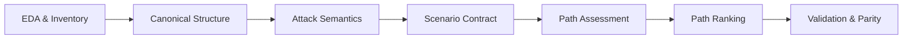

# Hướng weighting hiện hành - handoff Week 2 sang Week 3

Trạng thái: tổng hợp hiện hành cho M2 weighting direction sau feedback mentor ngày 2026-09-29, chưa phải quyết định production weighting.
Post-report mentor feedback ngày 2026-09-25 và định hướng ngày 2026-09-29 được áp dụng qua #42 và #140 trước mọi numeric production scoring.
Nghiên cứu Phase A trong PR #132 đã được merge vào develop như bằng chứng kỹ thuật, không phải phê duyệt toàn bộ đề xuất mô hình.

## Vì sao chưa chốt một weight cho mỗi relationship

[ADR-0008](https://github.com/Lolavine777/ad-weighted-graph-neo/blob/282450279ae0afa035b9597b86b2d250f6feca69/docs/adr/ADR-0008-structural-graph-attack-semantics-layering.md) tách structural relationship trong snapshot, semantic transition do attacker chọn và runtime context khi thực hiện.
Một relationship chứng minh quyền hoặc quan sát có nguồn; nó không chứng minh kỹ thuật đã được chọn, có thể chạy, đã thành công hay đã được quan sát.
[Semantic catalog](../../configs/attack_semantics.yml) sở hữu prerequisites, effects, failure conditions và expected telemetry của từng transition; [Attack Semantics](attack-semantics.md) giải thích cách các lớp tương tác.
Vì một loại cạnh có thể hỗ trợ nhiều transition và cùng transition có thể bị chặn bởi context, một fixed weight theo relationship không tự đại diện cho chi phí của một bước tấn công thực tế.

Hiện tại [Graph Contract](../../configs/contract.yml) vẫn biểu diễn các profile bằng edge-kind weights.
`unit` gán cost 1.0 cho mọi traversable edge để kiểm thử tính đúng và hồi quy M2; nó không khẳng định mọi attack step khó như nhau.
`illustrative` chỉ phục vụ tests với giá trị tùy ý.
`maut_v1` là profile historical/experimental, không phải production truth; cả ba profile đều có `production_ready: false`.
[Weight model M1](weight-model.md) lưu rubric và giá trị cũ để đối chiếu lịch sử, không phải hướng dẫn chấm điểm hiện hành.
[M1 evidence audit](m1-evidence-audit.md) xếp các fixed `maut_v1` values vào evidence category `illustrative_hypothesis` và chuyển quyết định cost sang [#42](https://github.com/nairyuuu/ad-weighted-graph/issues/42).

## Ba phương án cost ownership cần quyết định ở #42

| Candidate model | Cost gắn vào đâu | Lợi ích và giới hạn cần xem xét |
| --- | --- | --- |
| Relationship-level | Một cost theo structural relationship hoặc edge kind. | Khớp cách contract hiện lưu edge weights và đường đi cộng dồn; gom các kỹ thuật khác nhau của cùng một cạnh vào một giá trị, còn runtime phải được kiểm riêng. |
| Transition-level | Cost theo semantic transition / technique được chọn. | Phân biệt các cách abuse của cùng relationship; cần xác định cách biểu diễn bước transition, composition và tương thích với graph/path search hiện hành. |
| Transition-plus-context | Base cost theo technique, với runtime/context adjustment hoặc applicability gating. | Có thể xét reachability, freshness và controls của scenario; cần nguồn context, quy tắc tái lập được và cách tránh đếm trùng hoặc biến thiếu evidence thành điểm số. |

Đây là các phương án nghiên cứu, chưa có phương án được chọn.
Dù chọn phương án nào, predicate đã biết là thất bại phải chặn transition, còn predicate thiếu bằng chứng giữ `unknown`/`indeterminate`; một cost thấp không biến transition bị chặn thành khả dụng.
`cost_factors` trong catalog là mô tả đầu vào nghiên cứu, chưa phải rubric, hệ số hoặc cost đã được chấp thuận.

## Post-report constraints cho rubric

Mentor feedback làm rõ rằng candidate driver không tự động là một production criterion.
Mỗi criterion phải đo một construct đủ độc lập, có rubric và evidence có thể audit, và có policy rõ cho unknown/context-missing.
#42 phải lập independence/overlap matrix trước khi aggregate score để tránh double-count.

`Detectability` không còn là production dimension mặc định.
Khả năng bị phát hiện phụ thuộc audit policy, EDR, SOC coverage, telemetry và operational environment.
Nếu giữ detectability, nó phải là contextual parameter hoặc knowledge-based rubric với limitation rõ, không phải universal score suy ra trực tiếp từ Event ID hay ATT&CK mapping.

`Reliability` hoặc `success probability` cũng không còn là independent dimension mặc định.
Nếu giá trị này chỉ tổng hợp prerequisites, complexity, runtime controls hoặc các factor khác thì đưa nó vào cùng weighted sum sẽ double-count.
Khi chưa có independent measurement/calibration, nó phù hợp hơn với vai trò output/validation quantity hoặc research hypothesis.

Applicability gating vẫn tách khỏi numeric cost.
Blocked predicate phải chặn transition; missing predicate evidence giữ `unknown`/`indeterminate` thay vì biến thành penalty hoặc optimistic score.

## Difficulty drivers và hai ví dụ

Các driver đã xuất hiện trong [catalog](../../configs/attack_semantics.yml), [Attack Semantics](attack-semantics.md) và [evidence audit](m1-evidence-audit.md), nhưng hiện chỉ là candidate research inputs chứ chưa phải accepted production dimensions:

- **Technique / operation:** prerequisites và privilege requirements, technical complexity, reliability / failure risk, detectability và operational impact thay đổi theo hành động cụ thể.
- **Runtime context:** reachability / service availability, temporal freshness, authentication context và endpoint controls quyết định applicability hoặc mức cản trở trong scenario.
- **Structural evidence:** target kind, quyền hiệu lực và provenance giới hạn transition nào được xét; thiếu bằng chứng không phải bằng chứng quyền vắng mặt hay một numeric penalty mặc định.

`GenericAll` trên User có thể hỗ trợ `genericall_reset_password`, trên Group có thể hỗ trợ `genericall_add_member`, hoặc trên target hợp lệ có thể hỗ trợ `genericall_grant_write_dacl`.
Các transition này có target kind, password policy hoặc membership-change conditions, tác động vận hành và dấu hiệu phát hiện khác nhau; một fixed `GenericAll` cost che khuất lựa chọn kỹ thuật.

`HasSession` chỉ ghi nhận session trên Computer tại một thời điểm.
Transition `recover_session_credential_material` còn cần `source_admin_control`, `session_fresh`, `session_present` và `credential_accessible`; logoff hoặc credential protection có thể chặn nó.
Một fixed `HasSession` cost không thể thay cho kiểm tra freshness và endpoint controls, cũng không chứng minh credential đã bị lấy.

## Handoff Week 3 / #42

Trước khi tạo production profile, [#42](https://github.com/nairyuuu/ad-weighted-graph/issues/42) cần một successor decision cho:

1. **Cost ownership:** chọn relationship, transition hoặc composition với context, và chỉ rõ cách cộng cost trên path.
2. **Scoring rubric:** chọn bộ criterion tối thiểu, định nghĩa construct, thang đo, nguồn evidence, cách xử lý unknown và ranh giới giữa cost với applicability gating; kiểm tra independence/overlap trước aggregation.
3. **Independent rating và reconciliation:** chỉ bắt đầu sau khi ownership và rubric được accepted; lưu rationale có thể audit và giải quyết bất đồng trước khi chốt giá trị.
4. **Profile versioning:** đặt tên/version profile, contract và migration/compatibility policy, rồi mới cân nhắc `production_ready`.
5. **Sensitivity validation:** thử độ ổn định của lựa chọn đường đi khi giả định, target/technique và context thay đổi; không dùng telemetry độc lập làm calibration cho cùng một snapshot nếu thiếu environment, identity và time linkage.

Body cũ của #42 và [weight-model.md](weight-model.md) là bối cảnh lịch sử cho scoring theo cạnh.
Handoff này không chọn model, rubric hay numeric production weights thay cho quyết định kế tiếp.

## Định hướng mentor ngày 2026-09-29 và phân biệt tầng quyết định

Buổi trao đổi mentor ngày 2026-09-29 làm rõ định hướng đánh giá đường tấn công:
- Dự đoán đường tấn công dựa trên cấu trúc đồ thị, kỹ thuật leo thang và các giả định kịch bản.
- Xếp hạng toàn bộ đường đi (path-level ranking) theo khả năng thành công (success likelihood / probability under scenario) và tác động/rủi ro đích (target impact / risk).
- Đích của đường tấn công là tài sản quan trọng (target / crown jewel asset).
- Đề tài không yêu cầu thực nghiệm tấn công thật trên hệ thống (no live attack exploitation).
- Hiệu chuẩn thực nghiệm (empirical calibration) là hạng mục bằng chứng tùy chọn hoặc trong tương lai, không cấu thành cổng chặn bắt buộc đối với xếp hạng dự đoán kịch bản hay sản phẩm Week 3.
Đây là định hướng chiến lược, chưa phê chuẩn một công thức toán học, trọng số số học hay xác suất cụ thể nào.

Để bảo đảm tính trung thực khoa học và tránh nhầm lẫn giữa định hướng của mentor với đề xuất kỹ thuật, nhóm phân biệt rạch ròi 3 tầng thông tin:

| Tầng thông tin | Nội dung và bản chất | Thẩm quyền và trạng thái |
| --- | --- | --- |
| Accepted mentor orientation | Dự đoán đường đi dựa trên cấu trúc + kỹ thuật + giả định; xếp hạng đường theo khả năng thành công và tác động tới tài sản đích; không yêu cầu pentest thực tế. | Định hướng đã thống nhất với mentor ngày 2026-09-29; là kim chỉ nam cho thiết kế M2. |
| Diễn giải / Đề xuất của nhóm TTS A | Mô hình transition-plus-context giới hạn; phân tách 4 tầng dữ kiện; scenario contract với goal S2/S3; phân biệt evidence-only mode và scenario mode. | Đề xuất kỹ thuật của TTS A (@Lolavine777); đang hoàn thiện qua các issue #140, #141, #142, #143 để trình review. |
| Phương pháp do agent đề xuất | Các giả định tính bound L/U; các fixture số nguyên thử nghiệm; heuristics tự động xếp hạng candidate. | Gợi ý tham khảo trong quá trình nghiên cứu; tuyệt đối không tự đồng hóa thành quyết định của mentor hoặc cam kết của nhóm. |

## Ma trận đối chiếu yêu cầu gốc và lời làm rõ mới

Bảng sau đối chiếu các yêu cầu cốt lõi trong đề bài gốc ([00_todo.md](../00_todo.md)) với lời làm rõ mới từ mentor ngày 2026-09-29, hệ quả kỹ thuật và bằng chứng nghiệm thu:

| Yêu cầu gốc (00_todo.md) | Lời làm rõ mới từ mentor (2026-09-29) | Hệ quả kỹ thuật đối với repo | Bằng chứng nghiệm thu |
| --- | --- | --- | --- |
| Đồ thị có trọng số phản ánh độ khó khai thác | Trọng số phản ánh khả năng thành công và tác động đích trong kịch bản; dự đoán dựa trên cấu trúc, kỹ thuật và giả định. | Chuyển từ fixed weight theo cạnh sang đánh giá đường đi có điều kiện (conditional path assessment); phân tách rõ feasibility gating khỏi numeric scoring. | Scenario contract ([week3-scenario-contract.md](week3-scenario-contract.md)), catalog ngữ nghĩa và rubric rút gọn tại #141. |
| Tìm đường chi phí thấp nhất từ một máy bị chiếm tới Domain Admin | Đích của đường tấn công là tài sản quan trọng; xếp hạng cả đường theo khả năng thành công và tác động/rủi ro đích; không yêu cầu tấn công thực tế. | Giữ nguyên bài toán shortest-path tới DA trong roadmap; nhóm đề xuất coi DA membership / S2 usable identity là proxy hoặc checkpoint đặc quyền cao nhất, đồng thời mở rộng mục tiêu kịch bản tới target assets cụ thể (Domain Controller, Tier-0 resources). | Bộ ca kiểm thử từ foothold máy bị chiếm tới DA / target asset tại M3 (#142, W08). |
| Tìm nút thắt cổ chai (choke points) và so sánh kết quả với BloodHound | Đối chứng đường đi và choke point trên cùng snapshot và giả định kịch bản; làm rõ sự khác biệt giữa unweighted hop count và weighted ranking. | Giữ nguyên kế hoạch M4: thuật toán choke point tính trên tập đường tới target; so sánh độ trùng lặp và mức giảm rủi ro với BloodHound. | Bảng đối chứng BloodHound vs weighted graph và đo mức cắt giảm đường tấn công tại M4 (W11, W12). |
| Nhiều người chấm độc lập bộ tiêu chí, đo mức đồng thuận | Định hướng chưa chốt công thức cụ thể; cần rubric có thể audit, giải thích được khoảng cách mức và chống đếm trùng. | Quy trình chấm độc lập chỉ thực hiện sau khi construct và rubric được chốt ở #141 và successor ADR ở #143; không chấm điểm vội vã trên mô hình chưa duyệt. | Biên bản rubric, ma trận độc lập / đếm trùng và hồ sơ reconciliation tại #141-#143. |
| Chỉ phân tích trên dữ liệu, không khai thác thực tế trên hệ thống thật | Khẳng định lại: không yêu cầu thực nghiệm tấn công thật; phân tích dựa trên cấu trúc snapshot và giả định kịch bản có căn cứ. | Phân tích an toàn thuần túy trên mô hình dữ liệu; không cần red team exploit lab; mọi điều kiện runtime không có trong snapshot được đưa vào assumption ledger. | Script tái lập chạy trên snapshot đã xác thực hash ([raw_path_probe.py](../../scripts/research/raw_path_probe.py)) và test suite. |

Mọi yêu cầu cốt lõi của đề tài (shortest-path tới DA, đối chứng BloodHound, phân tích choke point) tiếp tục được giữ vững trong roadmap thực hiện trừ khi có quyết định thay thế bằng văn bản.

## Đề xuất phân biệt success có điều kiện và xác suất bị tấn công ngoài đời

Để cụ thể hóa định hướng của mentor về dự đoán dựa trên cấu trúc, kỹ thuật và giả định kịch bản mà không bịa đặt xác suất ngoài đời, nhóm TTS A đề xuất làm rõ bản chất của đại lượng "khả năng thành công":
Khả năng thành công của một đường tấn công trong mô hình được diễn giải là **xác suất có điều kiện theo điểm xuất phát và kịch bản**:
$P(\text{Path Success} \mid \text{Foothold, Scenario})$.
Biểu thức này mô tả câu hỏi kỹ thuật: *Nếu kẻ tấn công đã kiểm soát được máy X (foothold), và môi trường thỏa mãn các điều kiện runtime Y (scenario assumptions), thì chuỗi hành động dẫn tới mục tiêu Z có thể thực hiện trót lọt với mức độ tin cậy bao nhiêu?*

Nhóm tách biệt rõ đại lượng này với **xác suất bị tấn công ngoài đời thực** (marginal real-world breach incidence):
$P(\text{Breach})$.
Xác suất ngoài đời phụ thuộc vào động cơ của kẻ tấn công, chiến dịch phishing, lỗ hổng zero-day ban đầu, hoặc tần suất quét mạng từ bên ngoài.
Dữ liệu snapshot Active Directory tĩnh không chứa và không thể chứng minh xác suất bị tấn công ngoài đời thực.
Do đó, đề xuất nguyên tắc:
- Tuyệt đối không bịa đặt các con số tần suất (incidence numbers) hoặc base rate giả định từ bên ngoài.
- Đồ thị trọng số chỉ mô hình hóa khả năng leo thang và chuyển đổi đặc quyền nội bộ (internal lateral movement and privilege escalation) sau khi foothold đã được xác lập.

## Nối pipeline End-to-End: từ dữ liệu thô tới kiểm chứng

Để bức tranh kỹ thuật thông suốt từ đầu đến cuối, quy trình phân tích được chuẩn hóa thành 7 giai đoạn liên hoàn:

| Giai đoạn | Vai trò trong pipeline | Artifacts đã có trong repo | Artifacts còn thiếu / Cần làm tiếp |
| --- | --- | --- | --- |
| 1. EDA & Inventory | Xác thực nguồn, định dạng, checksum, thống kê thực thể và phát hiện rủi ro dữ liệu thô. | Manifests ([seamless-raw-v1.json](../../data/samples/manifests/seamless-raw-v1.json)), [data-inventory.md](data-inventory.md), [dataset-proposal-and-eda.md](dataset-proposal-and-eda.md), [reports/eda_summary.json](../../reports/eda_summary.json). | Hoàn thiện cùng B khi có snapshot mới; kiểm tra các quan hệ thiếu endpoint. |
| 2. Canonical Structure | Chuẩn hóa danh tính, hướng quan hệ, provenance và tạo đồ thị hợp đồng. | Graph Contract v1.3.0 ([contract.yml](../../configs/contract.yml)), normalizer, direct builder ([builder.py](../../src/parser/builder.py)), host-derived builder và lineage ([inference.py](../../src/parser/inference.py), [lineage.py](../../src/parser/lineage.py) theo #45/#92), unit tests ([test_builder_direct.py](../../tests/test_builder_direct.py), [test_graph_lineage.py](../../tests/test_graph_lineage.py)). | Ranh giới danh tính SEAMLESS đã đóng (#138 merged qua PR #148); kiểm chứng Neo4j projection thành công. |
| 3. Attack Semantics | Quy tắc kỹ thuật AD, điều kiện tiên quyết (prerequisites), hiệu ứng (effects) và telemetry. | [attack_semantics.yml](../../configs/attack_semantics.yml), [attack-semantics.md](attack-semantics.md), test catalog transitions ([test_attack_semantics_transitions.py](../../tests/test_attack_semantics_transitions.py)). | Rà soát các transition mở rộng theo rubric rút gọn ở #141. |
| 4. Scenario Contract | Xác lập foothold xuất phát, tài sản đích (crown jewel), phân tầng dữ kiện và assumption ledger. | [week3-scenario-contract.md](week3-scenario-contract.md), test fixtures scenario ([test_research_probes.py](../../tests/test_research_probes.py)). | Nghiệm thu scenario contract (#140 qua PR #144). |
| 5. Path Assessment | Đánh giá tính khả thi và chi phí / khả năng thành công của từng hành động trên đường đi. | Script nguyên mẫu ([semantics_probe.py](../../scripts/research/semantics_probe.py), [raw_path_probe.py](../../scripts/research/raw_path_probe.py)). | Rubric rút gọn (#141 qua PR #147); successor ADR-0013 Proposed và Đặc tả giao diện v1.0.0 (#143 qua PR #152). |
| 6. Path Ranking | Tìm kiếm và xếp hạng toàn bộ đường đi từ foothold tới tài sản đích theo cost/risk. | Thuật toán BFS / candidate enumerator trên fixture nghiên cứu; wire adapter ([path_ranking_wire_adapter.py](../../scripts/research/path_ranking_wire_adapter.py)). | B hoàn thiện bounded graph/search/evaluator integration #145/#155 theo #158; scalable search và CE export #127 là scope sau, không là requirement lượt #159. |
| 7. Validation & Parity | Kiểm chứng worked example, phân tích độ nhạy, so sánh đối chứng BloodHound và choke point. | Fixture test 20 ca nghiên cứu, worked examples và sensitivity (#142 qua PR #149, #150 qua PR #151). | Kiểm thử cấu trúc synthetic và đối soát cấu trúc SEAMLESS vs Legacy 4.0.3 (#47), baseline cùng snapshot (#82), demo M2 (#48); đối chứng BloodHound CE mở rộng và choke point ở M4. |

## Bằng chứng nghiên cứu tiếp nối và phân rã các bước tiếp theo

[Scenario và cost probes ngày 26-28/9](week3-scenario-cost-evidence.md) ghi phương pháp, script tái lập, raw structural candidates và giới hạn suy luận cho Phase A của #42.
[So sánh cost ownership Phase A](week3-cost-ownership-comparison.md) đề xuất transition-owned cost trong scenario cố định, với context gating và cost modifier có bằng chứng.
PR #132 đã được merge vào `develop` ngày 2026-09-29 như bằng chứng kỹ thuật và cơ sở dữ liệu thực nghiệm cho Phase A của #42.
Việc merge PR #132 không đồng nghĩa với việc phê chuẩn toàn bộ các khuyến nghị về cost ownership hay công thức số học thành quyết định chính thức.

Theo định hướng mentor ngày 2026-09-29 và kết quả rà soát M2-A, tiến trình thực hiện đã hoàn thành các mốc:
1. **Issue #140 (Hoàn thành - PR #144):** Xác lập phạm vi, định hướng prediction, nhận diện target candidate từ snapshot SEAMLESS, và chuẩn hóa scenario contract 4 tầng dữ kiện.
2. **Issue #141 (Hoàn thành - PR #147):** Thiết kế bản nháp mô hình trọng số và rubric rút gọn; định nghĩa construct, thang đo, quy tắc kết hợp giữa khả năng thành công và tác động đích.
3. **Issue #142 (Hoàn thành - PR #149):** Kiểm chứng mô hình bằng worked example và phân tích độ nhạy; ghi nhận kết luận Needs Revision để hiệu chỉnh mô hình.
4. **Issue #150 (Hoàn thành - PR #151):** Hiệu chỉnh và bảo vệ thành công đề xuất xếp hạng Pareto bảo thủ có phạm vi; reviewer (@nairyuuu) chấp thuận proposal và scope; phán quyết trên SEAMLESS tiếp tục là Insufficient Evidence.
5. **Issue #143 (Lượt 1 - PR #152 đã merge):** Soạn thảo successor ADR-0013 ở trạng thái Proposed thay thế phần production weighting của ADR-0001; ban hành bản dự thảo Đặc tả giao diện xếp hạng đường tấn công v1.0.0-draft ([path-ranking-interface-specification.md](path-ranking-interface-specification.md)) kèm bộ ví dụ synthetic kiểm thử được; thiết lập Quy chế quản trị định mức và bằng chứng ([evidence-rating-governance.md](evidence-rating-governance.md)).
6. **Issue #143 (Lượt 2 - Hoàn thành qua PR #154):** Chuẩn bị gói định mức chuyên gia độc lập cho kịch bản mẫu tổng hợp ([scenario-rating-packet.md](scenario-rating-packet.md)) với hai phiếu chấm trống độc lập và biên bản đối soát (giữ rater identity và điểm số pending); cập nhật checklist chuyển trạng thái ADR-0013 sang Accepted; xuất các hàm đối soát độ đồng thuận (IoU, Cohen's Kappa zero-variance fallback); đồng bộ trạng thái bàn giao #48.
7. **Issue #143 (Lượt 3 - PR #159):** Gói [SEAMLESS và brief tái lập](seamless-scenario-rating-packet.md) version 1.1.0 có hai foothold query tách biệt, action bindings với primary sources và required runtime gates, full-history conditional questions, canonical IDs và hai JSON sheets độc lập giữ pending.
Canonical pipeline xác minh đủ ba supplied routes, kể cả computer-target ACL, với code/graph/policy pins và expected/actual manifest.
[Disposition](path-ranking-acceptance-disposition.md) tách design acceptance, parameter validation và bounded integration theo #158.
8. **Issue #143 (Lượt 4 / PR #165 đã merge tại commit `fdf5928`):** Hợp nhất adapter chuyển dịch chuẩn tắc theo Issue #162; phát hành Scoped Parameter Bundle 1.0.0 ([seamless_parameter_bundle.json](../../tests/fixtures/ranking/seamless_parameter_bundle.json), digest `sha256:0a137817d33c7f22884ca06a19039b10bf75b39bd470a25b73ce5cb40ee58246`) đóng gói đầy đủ 9 đơn vị công việc, 11 câu hỏi tiền tố có điều kiện, 26 giả thiết runtime (tách riêng hai bản ghi `network_rpc_reachable` theo phạm vi Source A và Source B) và 3 ứng viên; kiểm chứng giải tích và phân tích độ nhạy tự động chạy sạch; Reviewer TTS B (@nairyuuu) đã phê duyệt chính thức tại review [#5387665338](https://github.com/nairyuuu/ad-weighted-graph/pull/165#pullrequestreview-5387665338) trên head `dd662f5`. ADR-0013, Interface 1.0.0 quy chuẩn và Scoped Parameter Bundle 1.0.0 chính thức được TTS A và TTS B chấp thuận trong phạm vi PR #165; bảo lưu bảng điểm con người ở trạng thái pending; phán quyết SEAMLESS giữ nguyên Insufficient Evidence; các cổng tích hợp #145/#155, đối soát Legacy #47 và nghiệm thu E2E #48 tiếp tục giữ nguyên độc lập.

## Trạng thái bàn giao tổng thể cho Milestone 2 và Issue #48

Status/gates authoritative là [ma trận acceptance disposition Mục 2](path-ranking-acceptance-disposition.md).
ADR-0013 và interface 1.0.0 đã được TTS A và TTS B chấp thuận chính thức cho phạm vi PR #165; các cổng tiếp theo giữ nguyên ranh giới mở và độc lập.
Design acceptance hoàn tất cho phạm vi PR #165 mà không gộp với parameters validated hay engine integrated.

| Hạng mục | Trạng thái | Evidence / unmet gate |
| --- | --- | --- |
| Research proposal | Reviewed | Scoped proposal #151; không tự là accepted ADR |
| ADR / interface | Accepted for PR #165 scope | TTS A và TTS B đã chính thức phê duyệt tại #5387665338, merged tại commit `fdf5928` |
| Scenario packet | Reviewed scope | Hai query, action bindings và runtime assumptions đã có; actual source ratings ở [release Week 3](ratings/week3-closeout/README.md) |
| Actual reviewed release | Validated trong supplied-candidate scope | 21 tham số có bindings/source/rationale, export/replay/oracle/engine và 21 local probes passed; research fixture giữ lịch sử riêng |
| SEAMLESS supplied-candidate assessment | Validated; final integrated verdict pending | C/P/I và ranking được kiểm chứng trên ba ứng viên; bounded search/integration và E2E chưa nghiệm thu |
| Bounded integration #145/#155 | Pending | B sở hữu final search-to-candidate-to-evaluator adapter, coverage và executable integration; scalable search ngoài scope lượt này |
| Structural evidence / Legacy reconciliation | Gates riêng | Canonical supplied routes đã verify; real same-snapshot Legacy/reconciliation #82/#47 chưa được thay bằng packet test |
| Product E2E / #48 | Pending | Accepted design + validated parameters + integration/reconciliation + clean-checkout evidence trên final revision |

Clarification hiện hành của [#143/#158](https://github.com/nairyuuu/ad-weighted-graph/pull/159#issuecomment-5927555315) cho phép A/B hoặc hai người phù hợp trong nhóm chấm độc lập với năng lực/phạm vi thực tế; external panel, chứng chỉ và chữ ký không là dependency.
Research/LLM-assisted scenario estimates có verified sources, conditional quantity đúng, basis/scope/uncertainty/sensitivity và A/B review có thể dùng để triển khai/kiểm thử dưới assumptions khi human agreement pending.
Hai prompts/models không là hai người chấm; không suy numeric probability từ nguồn kỹ thuật/model confidence hoặc claim empirical calibration.

Không dùng profile unit/illustrative, packet fixture, synthetic arithmetic hoặc CI PASS làm numeric parameters đã nghiệm thu.
Parent #143/#42/#48 tiếp tục mở; không coi preparation hay blocker documentation là Week 3 complete.

## Cơ sở tham số hiện hành — 2026-10-03

[Disposition Week 3](week3-rating-requirement-disposition.md) tiếp nhận bộ human-reviewed AI-assisted cho scenario hiện tại, không yêu cầu bổ sung chấm độc lập để chốt bộ này. [Actual release](ratings/week3-closeout/README.md) thay research fixture cho đầu vào tích hợp; không suy independent reliability, hiệu chuẩn hoặc global optimum. Các đoạn pending theo ngày ở trên là lịch sử, không yêu cầu agent nghiên cứu/chấm lại.
